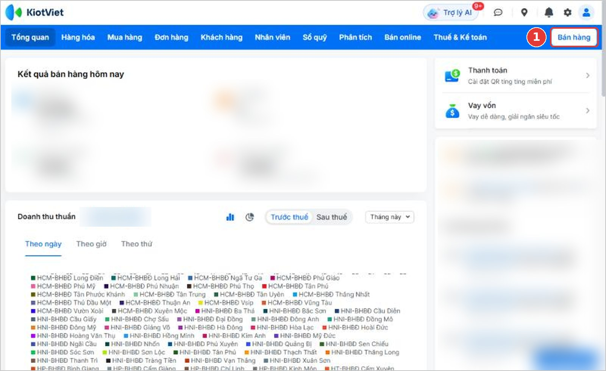
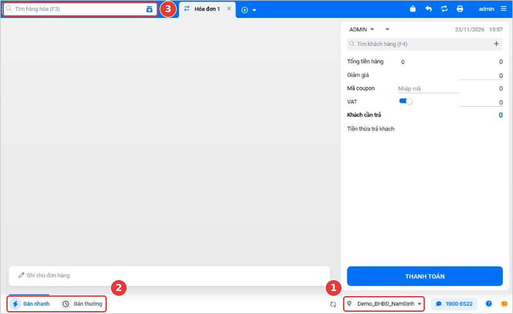
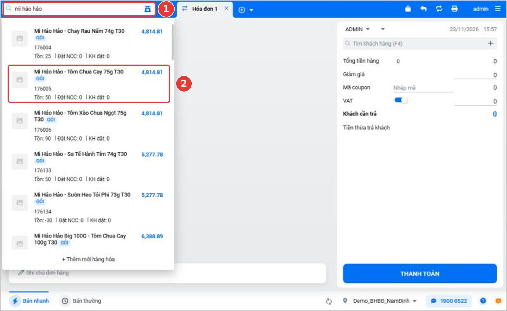
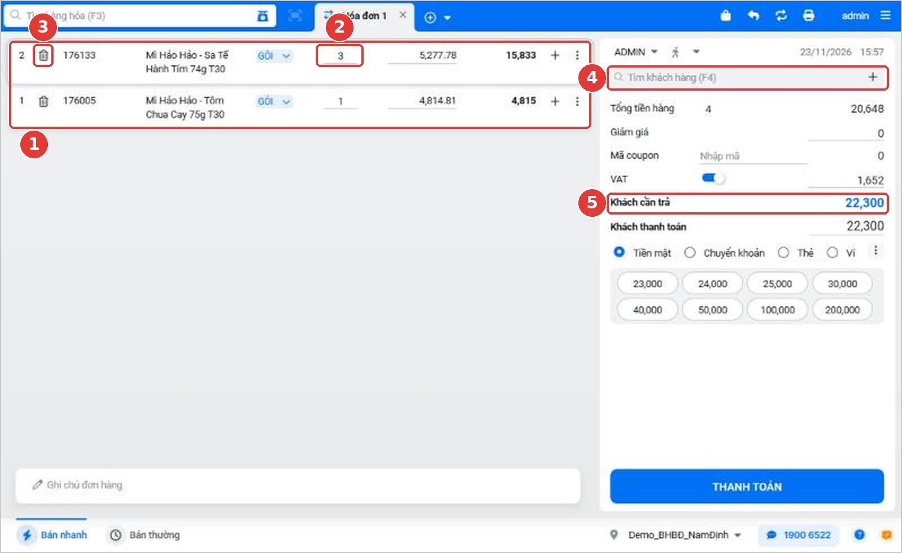
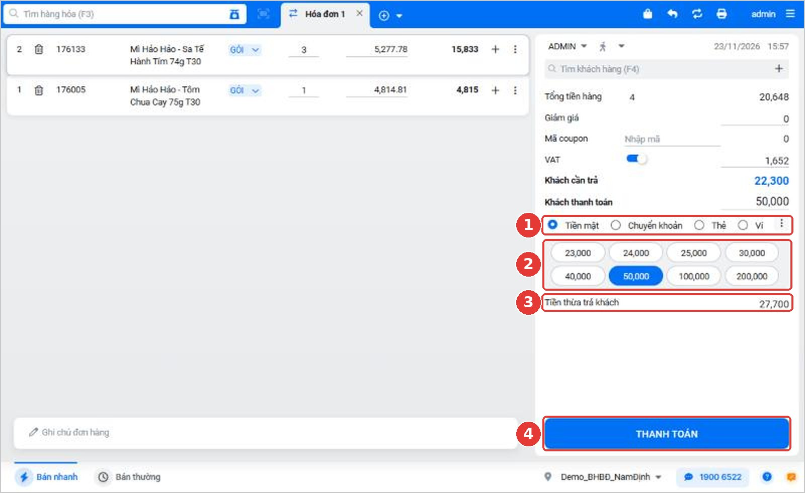
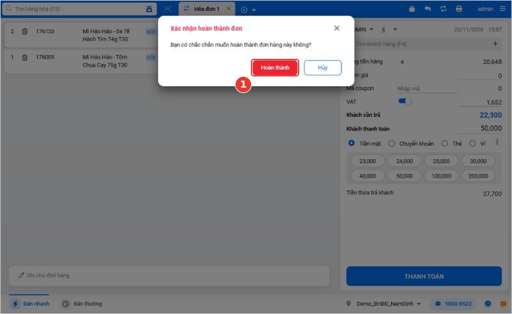
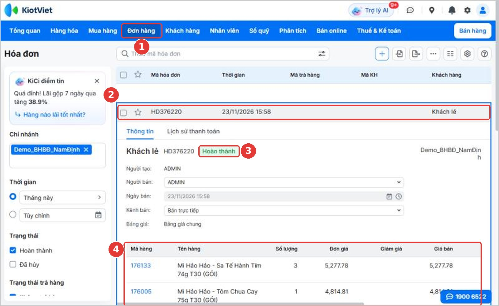
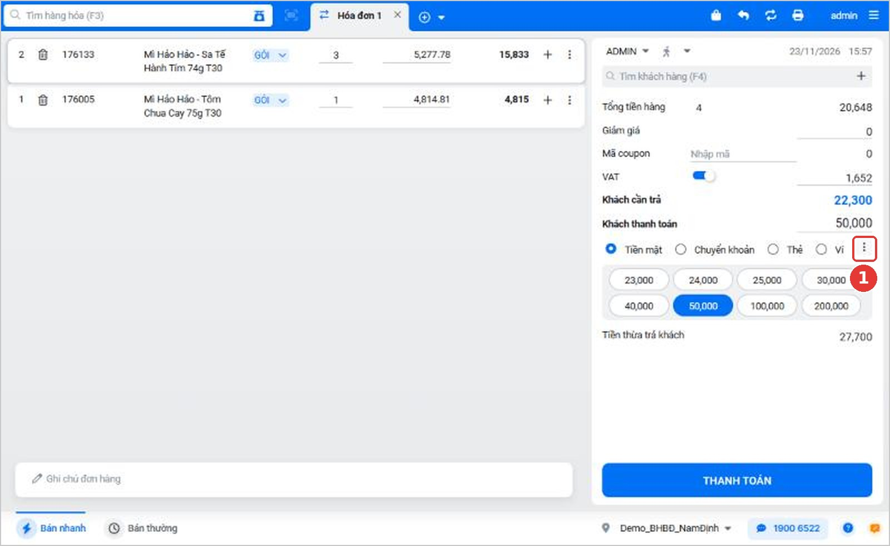
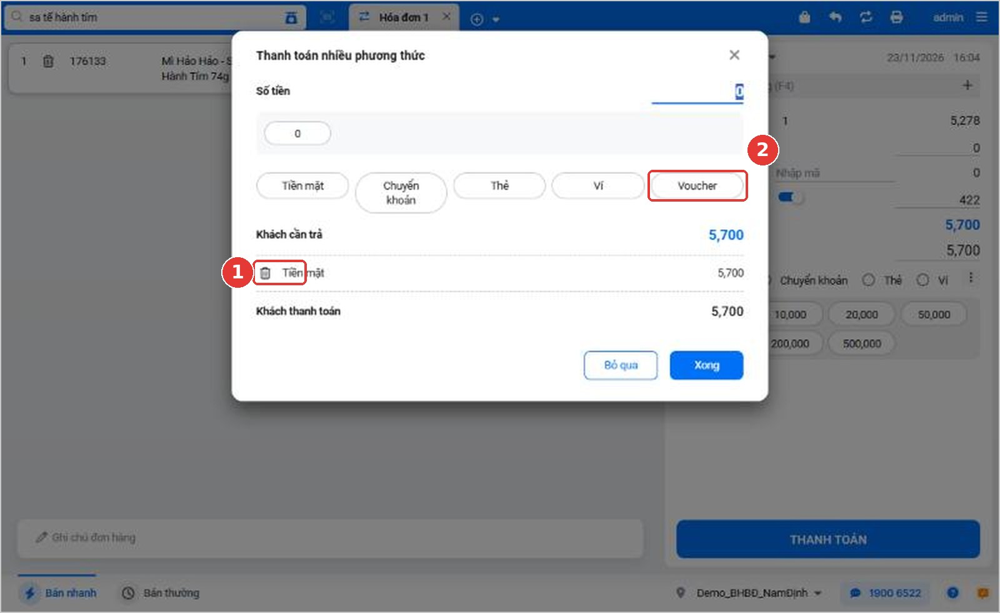
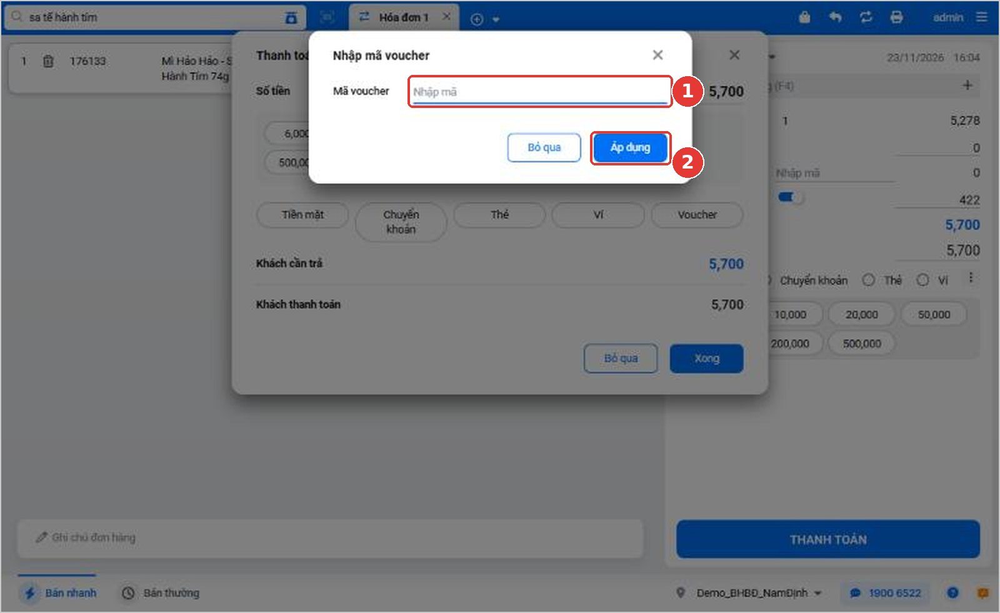

# Bán hàng tại quầy

TÀI LIỆU 01 · HƯỚNG DẪN NGHIỆP VỤ KIOTVIET

!!! video "Video hướng dẫn (có giọng đọc)"
    <video controls preload="metadata" playsinline style="width:100%;border-radius:8px" src="../video/01.mp4"></video>

    [:material-download: Tải video về máy](video/01.mp4){ download }

| Thông tin | Nội dung |
|---|---|
| **Mục đích** | Thực hiện một giao dịch bán lẻ tại quầy trên KiotViet, từ lúc mở màn hình bán hàng đến khi hoàn thành hóa đơn, kể cả khi khách thanh toán bằng voucher. |
| **Người thực hiện** | Nhân viên bán hàng, thu ngân |
| **Thời điểm** | Mỗi lần bán hàng cho khách |

!!! tip "Cách đọc"
    Số trong **vòng tròn đỏ** trên ảnh tương ứng với mục 1 2 3… trong phần chữ của bước đó; **khung đỏ** khoanh vùng cần bấm hoặc cần kiểm tra.

## Bước 1. Vào màn hình Bán hàng

Sau khi đăng nhập KiotViet (bhbd.kiotviet.vn), hệ thống mở trang **Tổng quan**.

1 Bấm nút **Bán hàng** ở góc trên bên phải để mở màn hình thu ngân.  

<figure markdown="span">
  { loading=lazy }
  <figcaption>Hình 1. Nút Bán hàng trên trang Tổng quan (số liệu doanh thu đã làm mờ)</figcaption>
</figure>

## Bước 2. Kiểm tra chi nhánh và chế độ bán

Trước khi bán đơn đầu tiên trong ca, kiểm tra 3 điểm sau:

1 **Chi nhánh** (góc dưới bên phải) phải đúng tên cửa hàng mình. Nếu sai, bấm vào để chọn lại. **Bán sai chi nhánh sẽ làm lệch tồn kho và doanh thu của cả hai cửa hàng.**  
2 **Chế độ bán** (góc dưới bên trái): dùng **Bán nhanh** cho khách mua tại quầy.  
3 **Ô tìm hàng hóa (F3)**: nơi quét mã vạch hoặc gõ tên hàng.  

<figure markdown="span">
  { loading=lazy }
  <figcaption>Hình 2. Màn hình Bán hàng (chế độ Bán nhanh)</figcaption>
</figure>

## Bước 3. Tìm và thêm hàng vào hóa đơn

1 **Quét mã vạch** sản phẩm, hoặc bấm vào ô tìm hàng (phím tắt **F3**) rồi gõ tên hoặc mã hàng.  
2 **Bấm vào đúng sản phẩm** khách mua. Mỗi dòng gợi ý có tên hàng, đơn vị tính (GÓI, THÙNG…), mã hàng, giá bán và số **Tồn** tại cửa hàng.  

Lặp lại cho từng mặt hàng. Quét cùng một mã nhiều lần thì số lượng tự tăng.

<figure markdown="span">
  { loading=lazy }
  <figcaption>Hình 3. Tìm hàng theo tên và chọn sản phẩm</figcaption>
</figure>

## Bước 4. Kiểm tra giỏ hàng

1 **Danh sách hàng đã chọn**: đối chiếu tên hàng và đơn vị tính với hàng thực tế khách mang ra quầy.  
2 **Số lượng**: bấm vào ô số lượng để gõ lại, hoặc dùng nút **− / +**.  
3 **Thùng rác**: xóa mặt hàng chọn nhầm hoặc khách không lấy nữa.  
4 **Tìm khách hàng (F4)**: nếu là khách quen, gõ số điện thoại để gắn hóa đơn cho khách. Bỏ trống thì hóa đơn ghi là **Khách lẻ**.  
5 **Khách cần trả**: số tiền cuối cùng đã gồm VAT. Đọc số tiền này cho khách.  

<figure markdown="span">
  { loading=lazy }
  <figcaption>Hình 4. Giỏ hàng và tổng tiền khách cần trả</figcaption>
</figure>

## Bước 5. Chọn hình thức thanh toán và thu tiền

1 **Hình thức thanh toán**: chọn đúng **Tiền mặt**, **Chuyển khoản**, **Thẻ** hoặc **Ví**. Chọn sai sẽ làm lệch sổ quỹ cuối ca.  
2 **Số tiền khách đưa**: với tiền mặt, bấm nhanh mệnh giá gợi ý hoặc gõ số tiền vào ô **Khách thanh toán**.  
3 **Tiền thừa trả khách**: hệ thống tự tính. Trả đúng số tiền này cho khách.  
4 Bấm **THANH TOÁN**.  

<figure markdown="span">
  { loading=lazy }
  <figcaption>Hình 5. Chọn hình thức thanh toán, số tiền khách đưa và bấm Thanh toán</figcaption>
</figure>

## Bước 6. Xác nhận hoàn thành đơn

Hệ thống hỏi lại "Bạn có chắc chắn muốn hoàn thành đơn hàng này không?".

1 Kiểm tra lại lần cuối rồi bấm **Hoàn thành**. Bấm **Hủy** nếu cần quay lại sửa đơn.  

Sau khi bấm Hoàn thành: hóa đơn được lưu, tồn kho bị trừ, máy in in hóa đơn cho khách (nếu quầy đã cài máy in) và màn hình trở về giỏ hàng trống để bán đơn tiếp theo.

<figure markdown="span">
  { loading=lazy }
  <figcaption>Hình 6. Hộp thoại xác nhận hoàn thành đơn</figcaption>
</figure>

## Bước 7. Tra cứu lại hóa đơn đã bán

Dùng khi cần in lại hóa đơn, kiểm tra đơn vừa bán hoặc đối chiếu khi khách thắc mắc.

1 Từ trang quản lý, vào menu **Đơn hàng → Hóa đơn**.  
2 Bấm vào dòng hóa đơn cần xem (hóa đơn mới nhất nằm trên cùng; có thể gõ mã hóa đơn vào ô tìm kiếm).  
3 Kiểm tra **trạng thái**: "Hoàn thành" là đã bán xong.  
4 Kiểm tra **danh sách hàng, số lượng, giá bán** của hóa đơn.  

<figure markdown="span">
  { loading=lazy }
  <figcaption>Hình 7. Chi tiết hóa đơn trong danh sách Hóa đơn</figcaption>
</figure>

## Thanh toán bằng voucher

Dùng khi khách đưa **voucher (phiếu mua hàng)** để trả thay tiền. Thao tác này làm ở **Bước 5**, thay cho việc chọn mệnh giá tiền mặt. Lưu ý: ô **Mã coupon** trên màn hình bán hàng dùng cho mã giảm giá, **không** dùng để nhập voucher.

1 Sau khi đã có hàng trong giỏ, bấm nút **⋮** (ba chấm) cạnh các hình thức thanh toán để mở cửa sổ **Thanh toán nhiều phương thức**.  

<figure markdown="span">
  { loading=lazy }
  <figcaption>Hình 8. Nút mở Thanh toán nhiều phương thức</figcaption>
</figure>

### Xóa dòng tiền mặt và chọn Voucher

1 Bấm **thùng rác** để xóa dòng **Tiền mặt** do hệ thống tự điền. Nếu không xóa, hệ thống báo "Số tiền thanh toán đã đủ, bạn không dùng thêm voucher được nữa".  
2 Bấm **Voucher**.  

<figure markdown="span">
  { loading=lazy }
  <figcaption>Hình 9. Cửa sổ Thanh toán nhiều phương thức</figcaption>
</figure>

### Nhập mã voucher và hoàn tất

1 Gõ hoặc quét **mã voucher** in trên phiếu của khách.  
2 Bấm **Áp dụng**.  

Nếu giá trị voucher nhỏ hơn số khách cần trả: chọn thêm **Tiền mặt** hoặc **Chuyển khoản** để thu phần còn thiếu, cho đến khi **Khách thanh toán** bằng **Khách cần trả**. Bấm **Xong**, rồi **THANH TOÁN** và **Hoàn thành** như Bước 5–6. Thu lại phiếu voucher giấy của khách.

<figure markdown="span">
  { loading=lazy }
  <figcaption>Hình 10. Hộp nhập mã voucher</figcaption>
</figure>

## Lưu ý và lỗi thường gặp

| Tình huống | Cách xử lý |
|---|---|
| Quét mã không ra hàng | Gõ tên hàng vào ô tìm (F3). Vẫn không có thì không tự tạo hàng mới, báo cửa hàng trưởng kiểm tra mã hàng. |
| Số Tồn âm hoặc bằng 0 nhưng hàng vẫn có trên kệ | Vẫn bán cho khách, sau đó báo cửa hàng trưởng kiểm tra lại phiếu nhập hoặc kiểm kho. |
| Chọn nhầm hàng, sai số lượng trước khi thanh toán | Sửa số lượng hoặc bấm thùng rác để xóa dòng. |
| Phát hiện sai sau khi đã bấm Hoàn thành | Không bán bù bằng đơn khác. Xử lý bằng nghiệp vụ Trả hàng (tài liệu 02) hoặc báo cửa hàng trưởng. |
| Khách chuyển khoản | Chỉ bấm Hoàn thành khi đã thấy tiền về tài khoản cửa hàng, và chọn đúng hình thức Chuyển khoản. |
| Màn hình hiện sai tên cửa hàng | Dừng bán, chọn lại chi nhánh ở góc dưới bên phải (Bước 2). |

**Phím tắt:** F3: tìm hàng hóa · F4: tìm khách hàng
