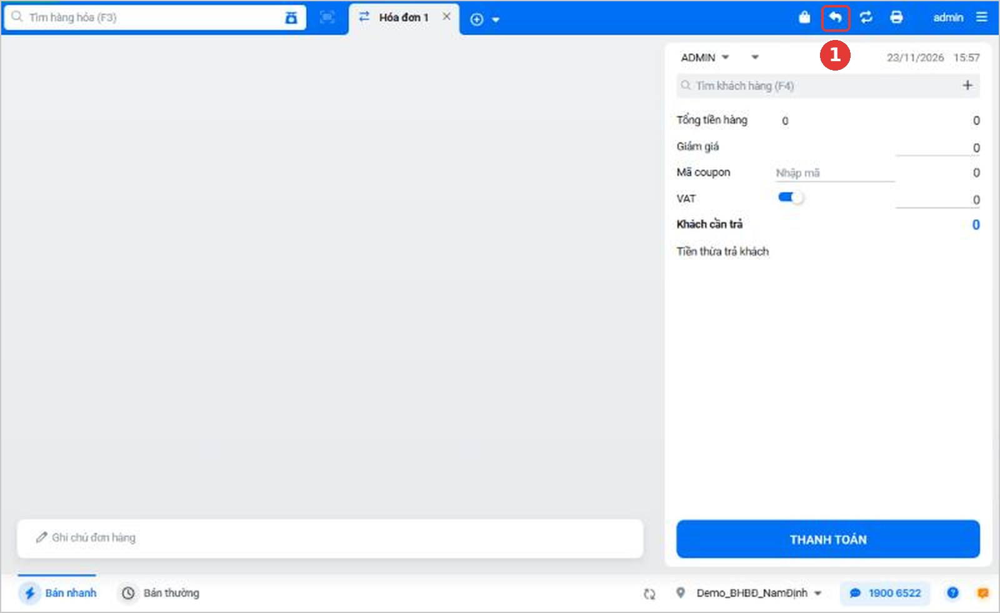
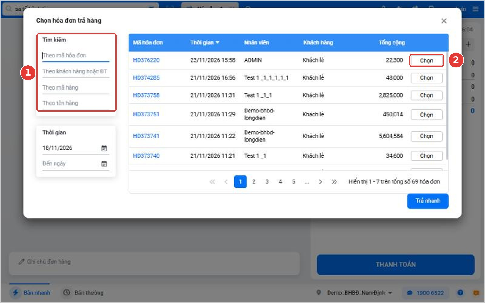
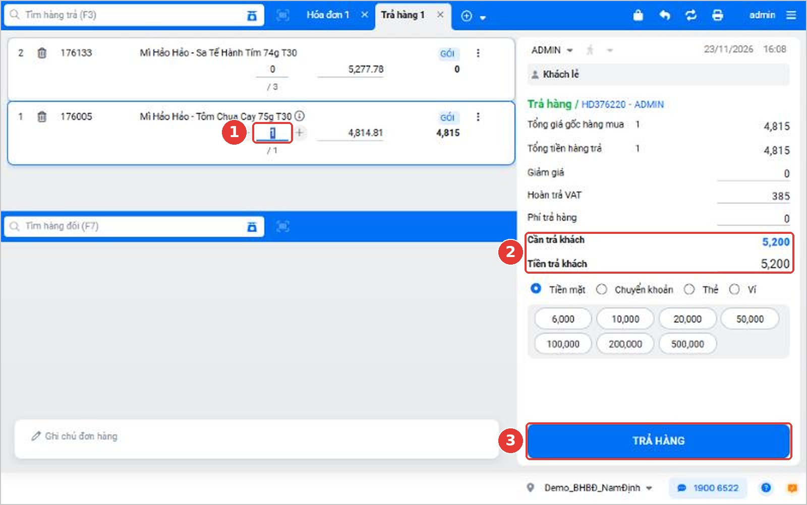
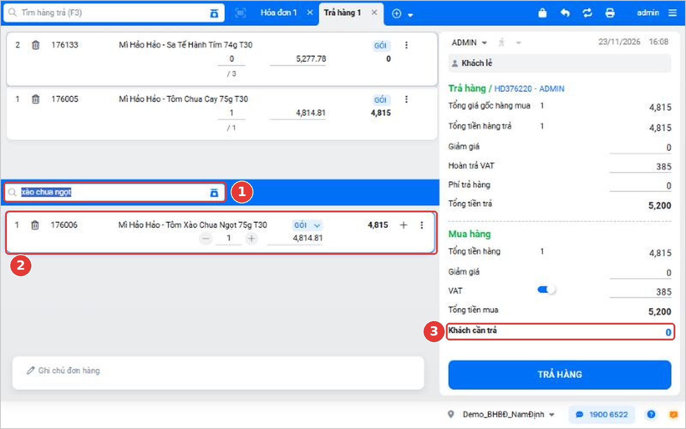
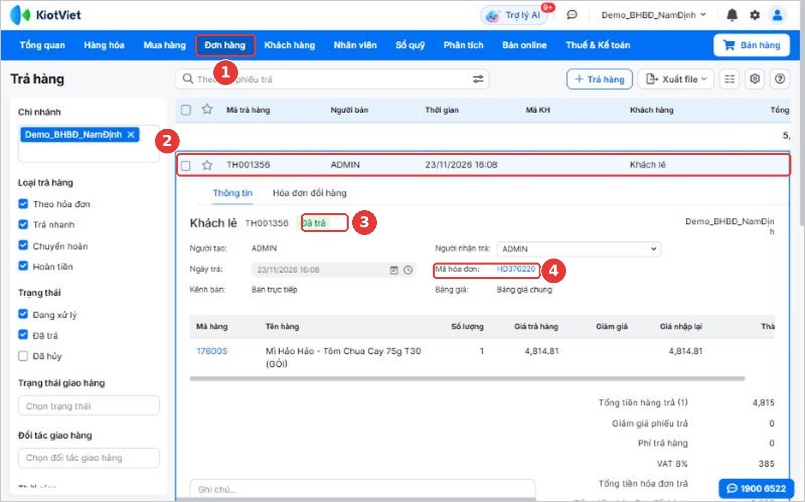

# Trả hàng và đổi hàng

TÀI LIỆU 02 · HƯỚNG DẪN NGHIỆP VỤ KIOTVIET

!!! video "Video hướng dẫn (có giọng đọc)"
    <video controls preload="metadata" playsinline style="width:100%;border-radius:8px" src="../video/02.mp4"></video>

    [:material-download: Tải video về máy](video/02.mp4){ download }

| Thông tin | Nội dung |
|---|---|
| **Mục đích** | Nhận lại hàng khách đã mua và hoàn tiền, hoặc đổi sang hàng khác, theo đúng hóa đơn gốc. |
| **Người thực hiện** | Thu ngân, cửa hàng trưởng |
| **Thời điểm** | Khi khách mang hàng đến trả hoặc đổi |

!!! tip "Cách đọc"
    Số trong **vòng tròn đỏ** trên ảnh tương ứng với mục 1 2 3… trong phần chữ của bước đó; **khung đỏ** khoanh vùng cần bấm hoặc cần kiểm tra.

## Bước 1. Mở chức năng Trả hàng

1 Trên màn hình **Bán hàng**, bấm biểu tượng **Trả hàng** (mũi tên quay lại) trên thanh công cụ phía trên.  

<figure markdown="span">
  { loading=lazy }
  <figcaption>Hình 1. Biểu tượng Trả hàng trên màn hình Bán hàng</figcaption>
</figure>

## Bước 2. Chọn hóa đơn khách đã mua

1 **Tìm hóa đơn** theo mã hóa đơn, số điện thoại khách, mã hàng hoặc tên hàng. Nếu hóa đơn cũ, chỉnh lại khoảng **Thời gian** bên dưới.  
2 Bấm **Chọn** ở đúng hóa đơn khách đã mua (đối chiếu ngày giờ và tổng tiền với hóa đơn giấy của khách).  

<figure markdown="span">
  { loading=lazy }
  <figcaption>Hình 2. Cửa sổ Chọn hóa đơn trả hàng</figcaption>
</figure>

## Bước 3. Nhập số lượng trả

Màn hình chuyển sang tab **Trả hàng**, liệt kê các mặt hàng trong hóa đơn gốc.

1 Nhập **số lượng khách trả** cho từng mặt hàng. Con số "/1", "/3" bên dưới là số lượng khách đã mua, không nhập vượt số này. Mặt hàng khách không trả để nguyên **0**.  
2 Kiểm tra **Cần trả khách** và **Tiền trả khách**: số tiền hoàn cho khách (đã gồm VAT).  
3 Bấm **TRẢ HÀNG**, sau đó bấm **Hoàn thành** ở hộp thoại xác nhận.  

<figure markdown="span">
  { loading=lazy }
  <figcaption>Hình 3. Nhập số lượng trả và kiểm tra số tiền hoàn cho khách</figcaption>
</figure>

## Bước 4. Đổi hàng (khi khách lấy hàng khác)

Nếu khách không lấy tiền mà đổi sang hàng khác, làm tiếp ngay trên tab Trả hàng trước khi bấm TRẢ HÀNG:

1 Bấm vào ô **Tìm hàng đổi (F7)** và tìm hàng khách muốn lấy.  
2 Hàng đổi hiện ở danh sách bên dưới, chỉnh số lượng nếu cần. Bên phải hiện thêm phần **Mua hàng**.  
3 Xem **Khách cần trả**: hệ thống tự tính chênh lệch giữa tiền hàng trả và tiền hàng mua mới. Thu thêm hoặc trả lại khách theo đúng số hiển thị, rồi bấm **TRẢ HÀNG → Hoàn thành**.  

<figure markdown="span">
  { loading=lazy }
  <figcaption>Hình 4. Đổi hàng: hàng trả ở trên, hàng mua mới ở dưới</figcaption>
</figure>

## Bước 5. Tra cứu phiếu trả hàng

1 Từ trang quản lý, vào menu **Đơn hàng → Trả hàng**.  
2 Bấm vào dòng phiếu trả (mã bắt đầu bằng **TH**).  
3 Trạng thái **Đã trả** là đã hoàn tất.  
4 **Mã hóa đơn** gốc được liên kết với phiếu trả. Tab **Hóa đơn đổi hàng** hiện hóa đơn mới nếu khách đổi hàng.  

<figure markdown="span">
  { loading=lazy }
  <figcaption>Hình 5. Chi tiết phiếu trả hàng</figcaption>
</figure>

## Lưu ý và lỗi thường gặp

| Tình huống | Cách xử lý |
|---|---|
| Khách không mang hóa đơn | Tìm hóa đơn theo số điện thoại khách hoặc theo tên hàng và khoảng thời gian khách nhớ. |
| Hàng trả bị hỏng, hết hạn, không bán lại được | Vẫn làm phiếu trả để hoàn tiền cho khách, sau đó lập phiếu Xuất hủy cho hàng đó (tài liệu 07). |
| Nhập nhầm số lượng trả, đã bấm Hoàn thành | Không tự bán lại để bù. Báo cửa hàng trưởng kiểm tra và xử lý phiếu trả. |
| Tiền hoàn cho khách | Phiếu trả hàng tự ghi một khoản chi trong Sổ quỹ. Lấy tiền trong két trả khách đúng số hiển thị để cuối ca không lệch quỹ. |

**Phím tắt:** F3: tìm hàng trả · F7: tìm hàng đổi
