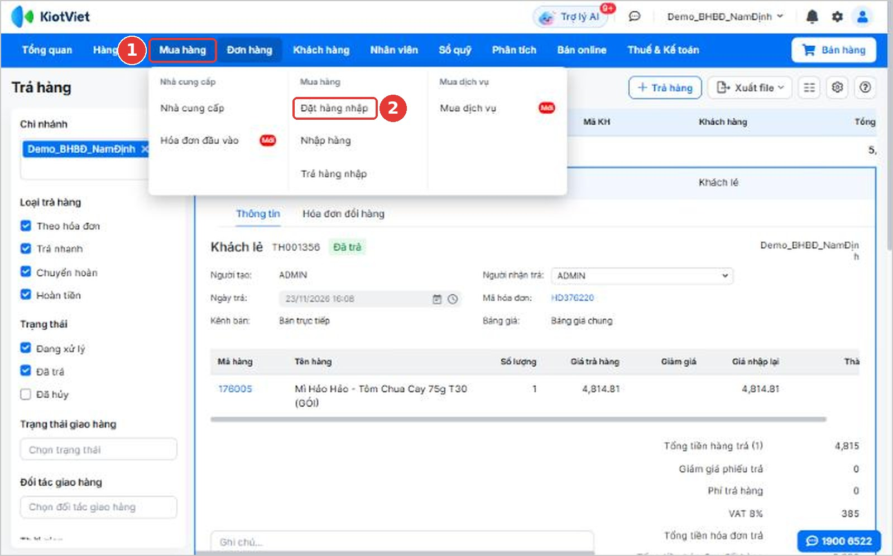
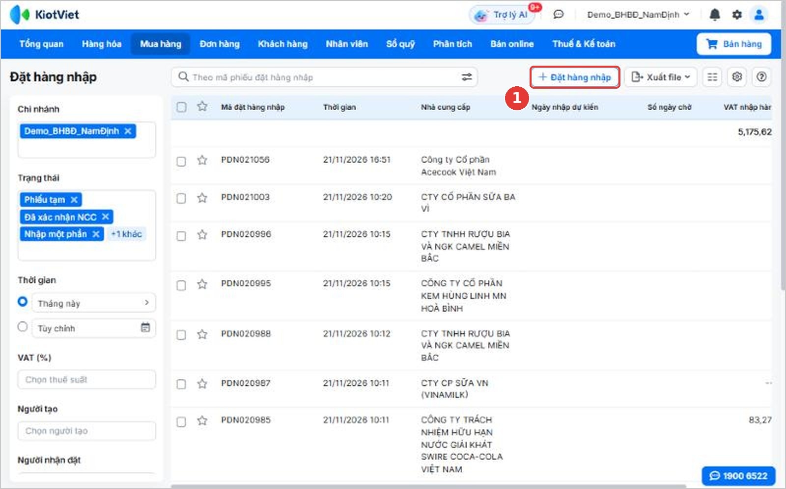
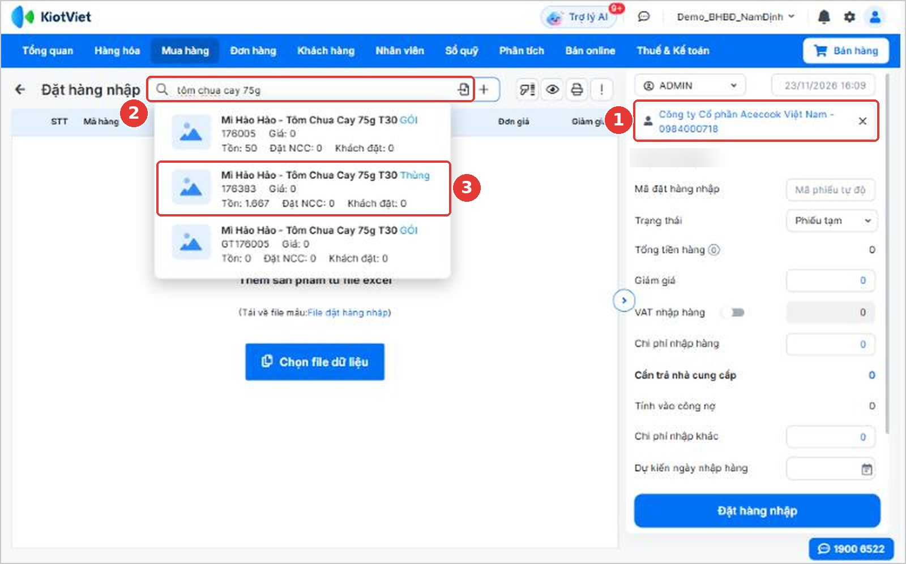
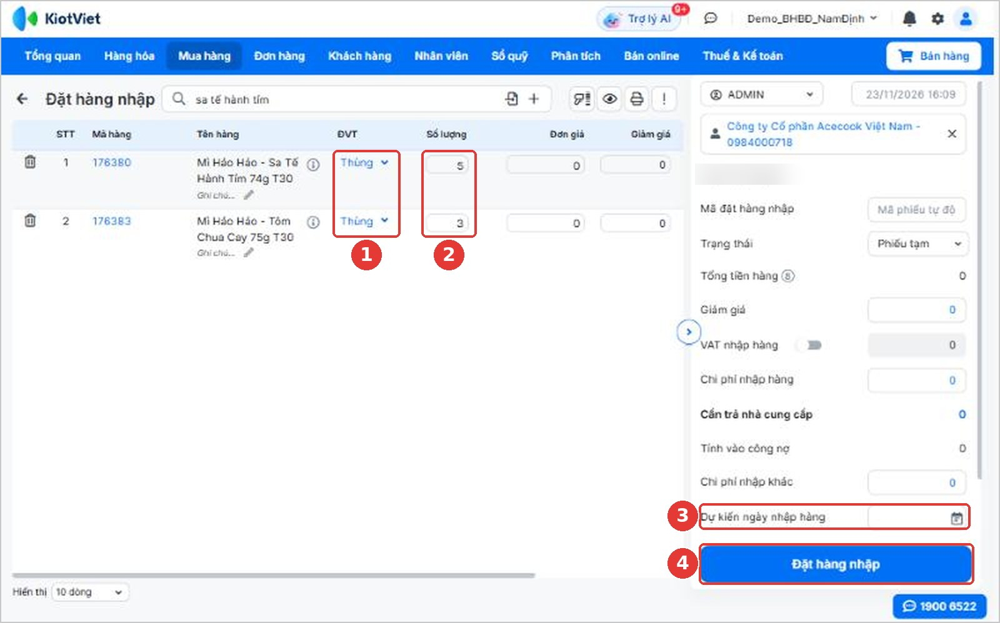
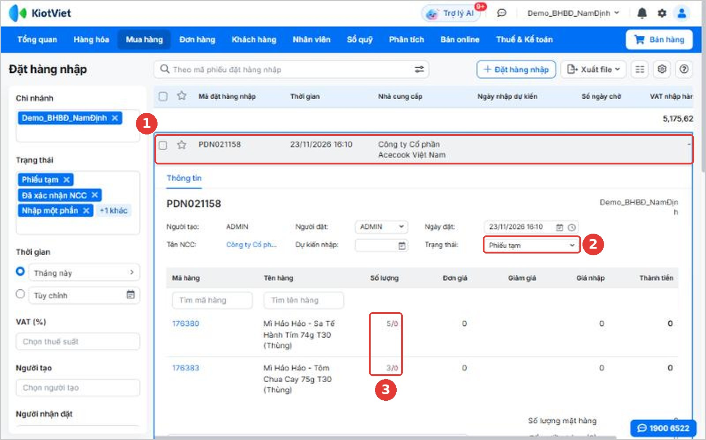
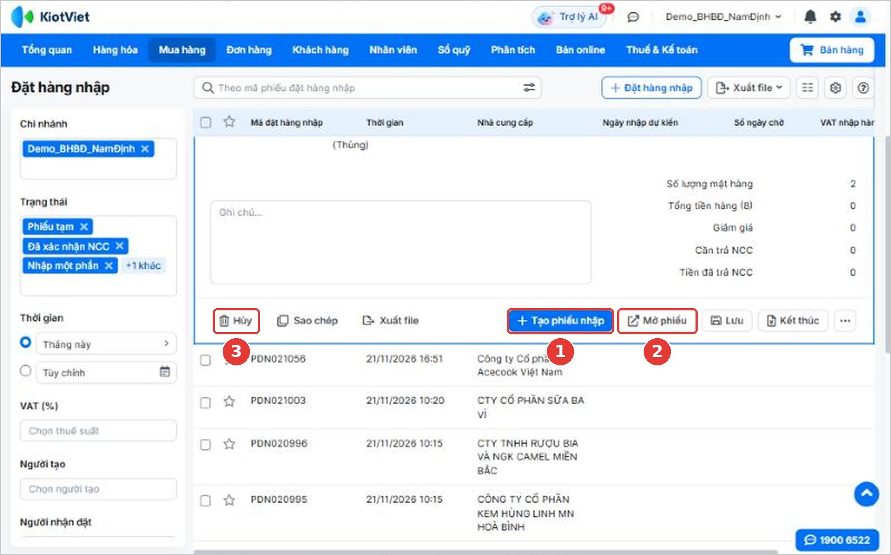

# Đặt hàng nhập từ nhà cung cấp

TÀI LIỆU 03 · HƯỚNG DẪN NGHIỆP VỤ KIOTVIET

!!! video "Video hướng dẫn (có giọng đọc)"
    <video controls preload="metadata" playsinline style="width:100%;border-radius:8px" src="../video/03.mp4"></video>

    [:material-download: Tải video về máy](video/03.mp4){ download }

| Thông tin | Nội dung |
|---|---|
| **Mục đích** | Lập phiếu đặt hàng nhập gửi nhà cung cấp (NCC) trên KiotViet, làm căn cứ để nhận và nhập hàng khi hàng về. |
| **Người thực hiện** | Cửa hàng trưởng hoặc nhân viên được phân công đặt hàng |
| **Thời điểm** | Theo lịch đặt hàng của từng NCC |

!!! tip "Cách đọc"
    Số trong **vòng tròn đỏ** trên ảnh tương ứng với mục 1 2 3… trong phần chữ của bước đó; **khung đỏ** khoanh vùng cần bấm hoặc cần kiểm tra.

## Bước 1. Mở danh sách Đặt hàng nhập

1 Rê chuột vào menu **Mua hàng**.  
2 Chọn **Đặt hàng nhập**.  

<figure markdown="span">
  { loading=lazy }
  <figcaption>Hình 1. Menu Mua hàng → Đặt hàng nhập</figcaption>
</figure>

## Bước 2. Tạo phiếu đặt hàng mới

1 Bấm **+ Đặt hàng nhập**.  

<figure markdown="span">
  { loading=lazy }
  <figcaption>Hình 2. Danh sách phiếu đặt hàng nhập</figcaption>
</figure>

## Bước 3. Chọn nhà cung cấp và tìm hàng

1 Ở ô **Tìm nhà cung cấp** bên phải, gõ tên NCC và chọn đúng NCC. Nên chọn NCC trước khi thêm hàng.  
2 Gõ tên hoặc mã hàng vào ô **Tìm hàng hóa (F3)**.  
3 Chọn đúng **đơn vị tính** cần đặt (ví dụ **Thùng** thay vì Gói). Dòng gợi ý có Tồn, Đặt NCC (đang đặt chưa về), Khách đặt để tham khảo số lượng cần đặt.  

<figure markdown="span">
  { loading=lazy }
  <figcaption>Hình 3. Chọn NCC và tìm hàng (công nợ NCC đã làm mờ)</figcaption>
</figure>

## Bước 4. Nhập số lượng và lưu phiếu

1 Kiểm tra **ĐVT** của từng dòng; bấm vào để đổi nếu chọn nhầm.  
2 Nhập **Số lượng** đặt.  
3 Chọn **Dự kiến ngày nhập hàng** (ngày NCC hẹn giao).  
4 Bấm **Đặt hàng nhập** để lưu. Hệ thống tạo phiếu mã **PDN…** với trạng thái **Phiếu tạm**.  

<figure markdown="span">
  { loading=lazy }
  <figcaption>Hình 4. Phiếu đặt hàng nhập đã điền số lượng</figcaption>
</figure>

## Bước 5. Kiểm tra phiếu vừa tạo

1 Bấm vào dòng phiếu **PDN** trong danh sách để xem chi tiết.  
2 **Trạng thái** của phiếu (Phiếu tạm, Đã xác nhận NCC, Nhập một phần…).  
3 Cột **Số lượng** dạng "5/0": số lượng đặt / số lượng đã nhập về.  

<figure markdown="span">
  { loading=lazy }
  <figcaption>Hình 5. Chi tiết phiếu đặt hàng nhập</figcaption>
</figure>

## Bước 6. Các thao tác trên phiếu

1 **Tạo phiếu nhập**: dùng khi hàng về, để nhập kho theo phiếu đặt này (xem tài liệu 04).  
2 **Mở phiếu**: sửa lại số lượng, mặt hàng khi NCC chưa giao.  
3 **Hủy**: hủy phiếu khi không đặt nữa.  

<figure markdown="span">
  { loading=lazy }
  <figcaption>Hình 6. Các nút thao tác ở cuối phiếu đặt hàng</figcaption>
</figure>

## Lưu ý và lỗi thường gặp

| Tình huống | Cách xử lý |
|---|---|
| Đặt hàng có làm tăng tồn kho không? | Không. Tồn kho chỉ tăng khi lập và hoàn thành phiếu Nhập hàng (tài liệu 04). |
| Không tìm thấy hàng khi đã chọn NCC | Kiểm tra lại tên/mã hàng. Nếu hàng chưa được khai báo cho NCC đó, báo bộ phận quản lý danh mục, không tự tạo hàng mới. |
| Đặt nhầm số lượng hoặc mặt hàng | Dùng Mở phiếu để sửa trước khi NCC giao; nếu không đặt nữa thì Hủy phiếu. |

**Phím tắt:** F3: tìm hàng hóa
