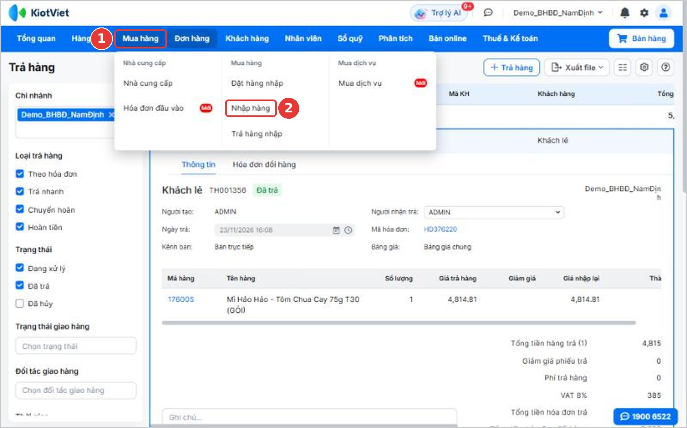
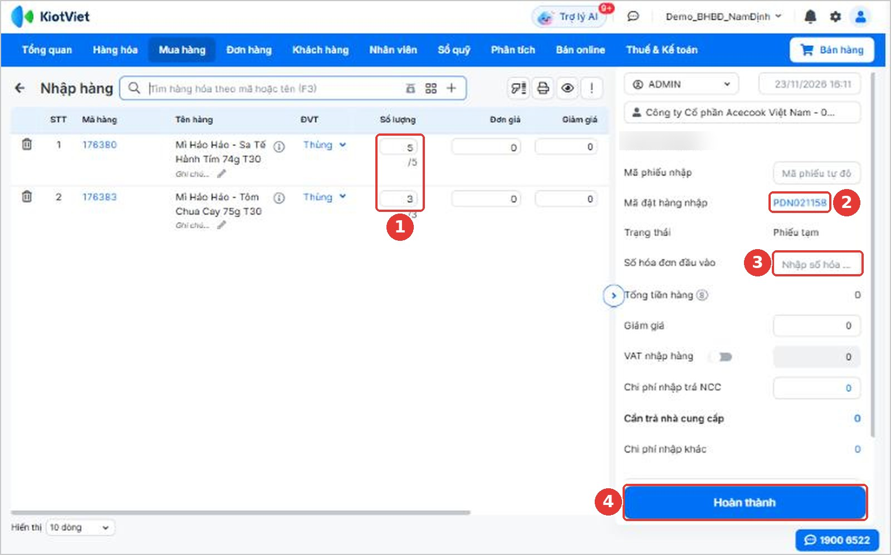
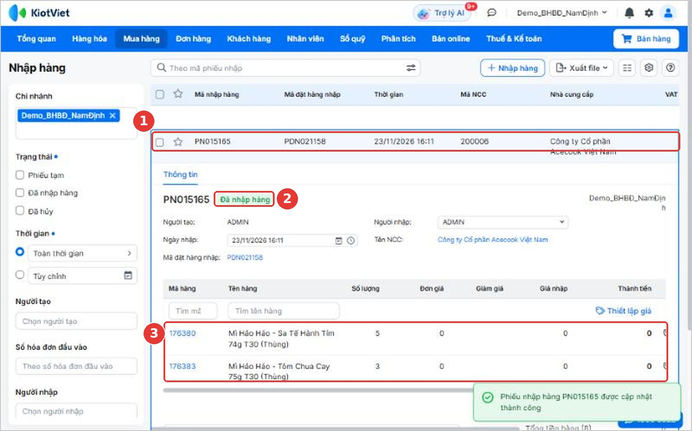

# Nhập hàng

TÀI LIỆU 04 · HƯỚNG DẪN NGHIỆP VỤ KIOTVIET

| Thông tin | Nội dung |
|---|---|
| **Mục đích** | Ghi nhận hàng NCC giao vào tồn kho cửa hàng, đúng số lượng thực nhận và đúng phiếu đặt hàng. |
| **Người thực hiện** | Cửa hàng trưởng hoặc nhân viên nhận hàng |
| **Thời điểm** | Ngay khi kiểm đếm xong hàng NCC giao |

!!! tip "Cách đọc"
    Số trong **vòng tròn đỏ** trên ảnh tương ứng với mục 1 2 3… trong phần chữ của bước đó; **khung đỏ** khoanh vùng cần bấm hoặc cần kiểm tra.

## Bước 1. Mở phiếu nhập

Có hai cách, ưu tiên cách 1 để phiếu nhập liên kết với phiếu đặt hàng:

- **Cách 1 – nhập theo phiếu đặt hàng:** vào **Mua hàng → Đặt hàng nhập**, mở phiếu PDN của NCC đang giao, bấm **Tạo phiếu nhập** (xem Bước 6 tài liệu 03).
- **Cách 2 – nhập không có phiếu đặt:** vào **Mua hàng → Nhập hàng** rồi bấm **+ Nhập hàng**.
1 Menu **Mua hàng**.  
2 Mục **Nhập hàng**.  

<figure markdown="span">
  { loading=lazy }
  <figcaption>Hình 1. Menu Mua hàng → Nhập hàng</figcaption>
</figure>

## Bước 2. Kiểm đếm và nhập số lượng thực nhận

Khi tạo từ phiếu đặt, hệ thống điền sẵn NCC, mặt hàng và số lượng đã đặt.

1 Đếm hàng thực tế và sửa **Số lượng** theo số thực nhận. Con số "/5" bên dưới là số lượng đã đặt.  
2 **Mã đặt hàng nhập** cho biết phiếu nhập này đi theo phiếu đặt nào.  
3 Nhập **Số hóa đơn đầu vào** (số hóa đơn của NCC giao kèm hàng).  
4 Bấm **Hoàn thành**. Tồn kho cửa hàng được cộng ngay sau bước này.  

**Hàng quản lý theo Lô – Hạn sử dụng:** với các mặt hàng đã chuyển sang quản lý theo lô, nhập đúng **số lô** và **hạn sử dụng** in trên bao bì cho từng dòng hàng trước khi bấm Hoàn thành.

<figure markdown="span">
  { loading=lazy }
  <figcaption>Hình 2. Phiếu nhập hàng tạo từ phiếu đặt (công nợ NCC đã làm mờ)</figcaption>
</figure>

## Bước 3. Kiểm tra phiếu nhập

1 Phiếu mới (mã **PN…**) nằm đầu danh sách **Nhập hàng**, có cả mã phiếu đặt đi kèm.  
2 Trạng thái **Đã nhập hàng** là đã cộng tồn kho.  
3 Đối chiếu lại **mặt hàng và số lượng** với hóa đơn/phiếu giao của NCC.  

<figure markdown="span">
  { loading=lazy }
  <figcaption>Hình 3. Phiếu nhập hàng đã hoàn thành</figcaption>
</figure>

## Lưu ý và lỗi thường gặp

| Tình huống | Cách xử lý |
|---|---|
| NCC giao thiếu so với phiếu đặt | Nhập đúng số thực nhận. Phiếu đặt chuyển sang trạng thái Nhập một phần, phần còn thiếu chờ NCC giao bổ sung. |
| Hàng giao bị hỏng, móp méo, cận date | Không nhận và không nhập phần hàng đó; ghi chú lên phiếu và báo NCC. |
| Lo ngại nhập trùng | Trước khi tạo phiếu, kiểm tra cột Số lượng của phiếu đặt (dạng đặt/đã nhập) để biết đã nhập chưa. |
| Nhập sai sau khi đã Hoàn thành | Không tự lập phiếu khác để bù. Báo cửa hàng trưởng xử lý trên phiếu nhập. |

**Phím tắt:** F3: tìm hàng hóa
