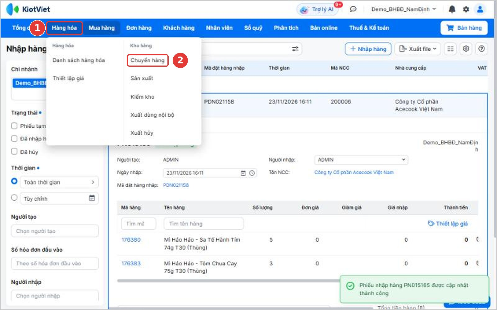
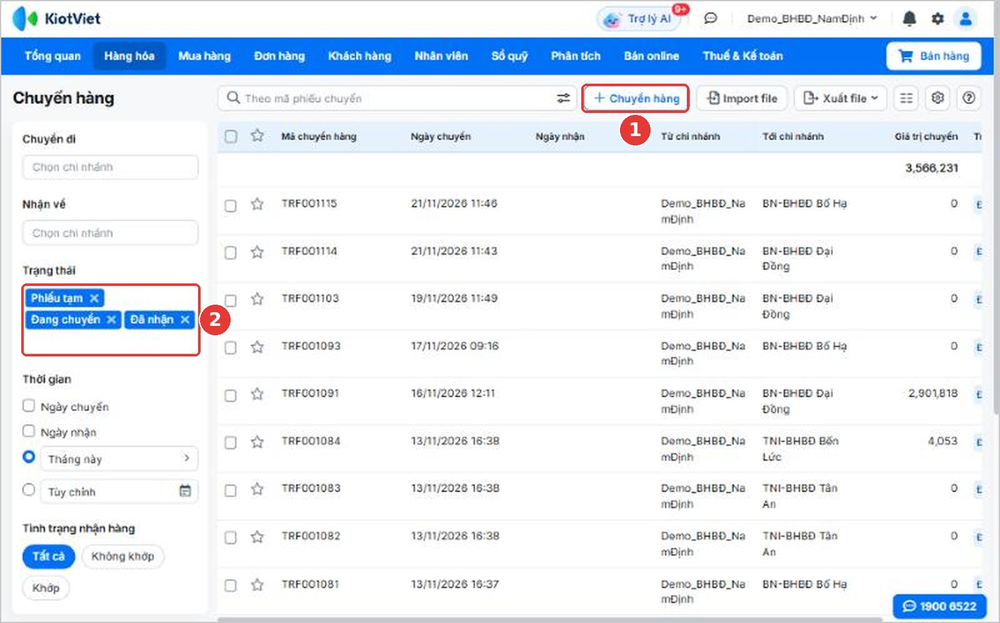
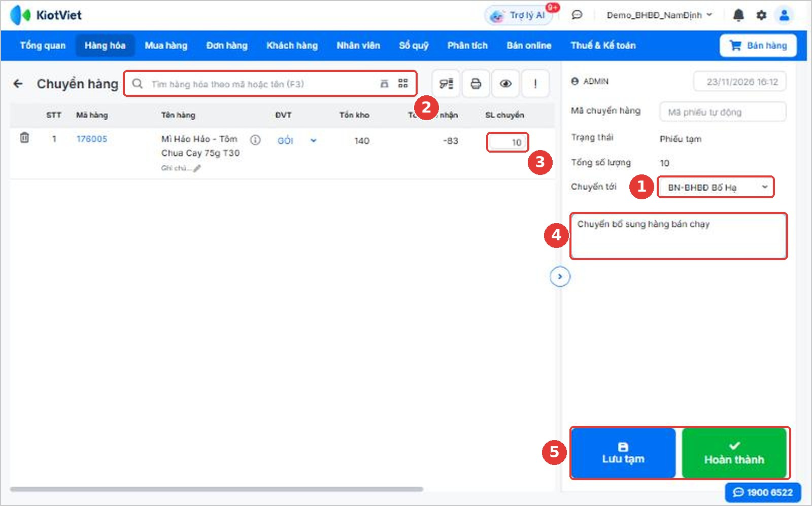

# Chuyển hàng và nhận hàng giữa các cửa hàng

TÀI LIỆU 05 · HƯỚNG DẪN NGHIỆP VỤ KIOTVIET

| Thông tin | Nội dung |
|---|---|
| **Mục đích** | Điều chuyển hàng từ cửa hàng này sang cửa hàng khác trong chuỗi, bảo đảm tồn kho hai bên khớp với hàng thực tế. |
| **Người thực hiện** | Cửa hàng trưởng của cửa hàng chuyển đi và cửa hàng nhận |
| **Thời điểm** | Khi có chỉ đạo điều chuyển hàng |

!!! tip "Cách đọc"
    Số trong **vòng tròn đỏ** trên ảnh tương ứng với mục 1 2 3… trong phần chữ của bước đó; **khung đỏ** khoanh vùng cần bấm hoặc cần kiểm tra.

## Bước 1. Mở chức năng Chuyển hàng

1 Rê chuột vào menu **Hàng hóa**.  
2 Chọn **Chuyển hàng** (nhóm Kho hàng).  

<figure markdown="span">
  { loading=lazy }
  <figcaption>Hình 1. Menu Hàng hóa → Chuyển hàng</figcaption>
</figure>

## Bước 2. Tạo phiếu chuyển mới

1 Bấm **+ Chuyển hàng**.  
2 Bộ lọc **Trạng thái** giúp xem nhanh các phiếu **Phiếu tạm**, **Đang chuyển**, **Đã nhận**.  

<figure markdown="span">
  { loading=lazy }
  <figcaption>Hình 2. Danh sách phiếu chuyển hàng</figcaption>
</figure>

## Bước 3. Lập phiếu chuyển (cửa hàng chuyển đi)

1 **Chuyển tới**: chọn đúng cửa hàng nhận.  
2 Tìm hàng cần chuyển ở ô **Tìm hàng hóa (F3)**.  
3 Nhập **SL chuyển**. Cột **Tồn kho** là tồn cửa hàng mình, **Tồn kho nhận** là tồn bên nhận.  
4 Ghi **Ghi chú** lý do chuyển.  
5 **Lưu tạm**: lưu nháp, chưa trừ kho. **Hoàn thành**: trừ kho cửa hàng mình, phiếu chuyển sang trạng thái **Đang chuyển** và hiện ở cửa hàng nhận.  

<figure markdown="span">
  { loading=lazy }
  <figcaption>Hình 3. Lập phiếu chuyển hàng</figcaption>
</figure>

## Bước 4. Nhận hàng (cửa hàng nhận)

- Vào **Hàng hóa → Chuyển hàng**, ở bộ lọc **Nhận về** chọn cửa hàng mình, trạng thái **Đang chuyển**.
- Mở phiếu chuyển đến, **kiểm đếm hàng thực tế** và nhập số lượng thực nhận cho từng dòng.
- Lưu phiếu nhận. Phiếu chuyển sang **Đã nhận** và tồn kho cửa hàng nhận được cộng.

## Lưu ý và lỗi thường gặp

| Tình huống | Cách xử lý |
|---|---|
| Bấm Hoàn thành nhầm cửa hàng nhận | Báo ngay cửa hàng trưởng để hủy phiếu trước khi bên kia nhận hàng. |
| Số nhận thực tế khác số chuyển | Bên nhận nhập đúng số thực nhận; phiếu sẽ hiện ở bộ lọc Tình trạng nhận hàng: Không khớp để hai bên đối soát. |
| Chưa có xe chuyển hàng | Dùng Lưu tạm. Chỉ bấm Hoàn thành khi hàng thực sự rời cửa hàng. |

**Phím tắt:** F3: tìm hàng hóa
