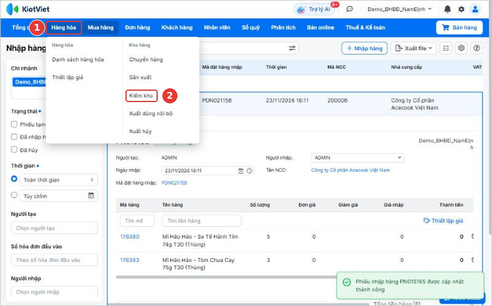
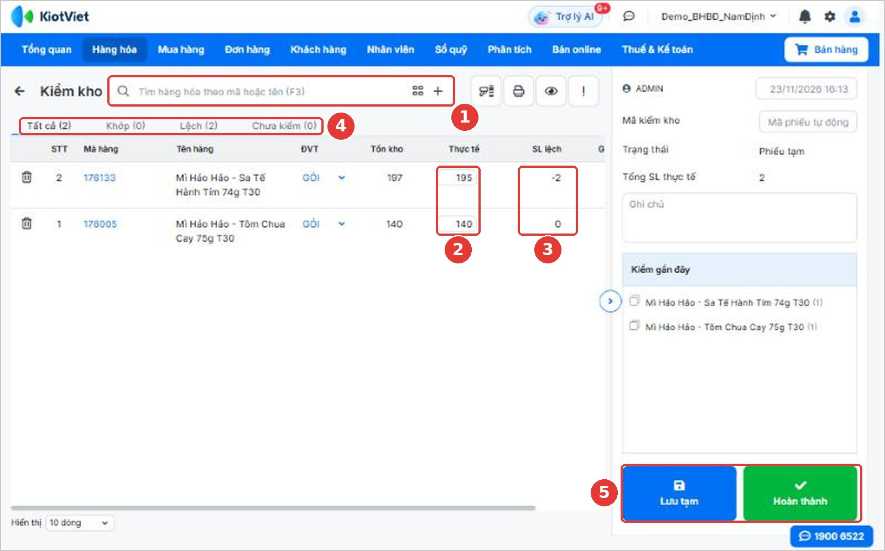

# Kiểm kho

TÀI LIỆU 06 · HƯỚNG DẪN NGHIỆP VỤ KIOTVIET

!!! video "Video hướng dẫn (có giọng đọc)"
    <video controls preload="metadata" playsinline style="width:100%;border-radius:8px" src="../video/06.mp4"></video>

    [:material-download: Tải video về máy](video/06.mp4){ download }

| Thông tin | Nội dung |
|---|---|
| **Mục đích** | Đếm hàng thực tế và cân bằng tồn kho trên KiotViet theo số thực tế. |
| **Người thực hiện** | Cửa hàng trưởng và nhân viên được phân công kiểm |
| **Thời điểm** | Theo lịch kiểm kho định kỳ hoặc khi phát hiện lệch tồn |

!!! tip "Cách đọc"
    Số trong **vòng tròn đỏ** trên ảnh tương ứng với mục 1 2 3… trong phần chữ của bước đó; **khung đỏ** khoanh vùng cần bấm hoặc cần kiểm tra.

## Bước 1. Mở chức năng Kiểm kho

1 Rê chuột vào menu **Hàng hóa**.  
2 Chọn **Kiểm kho**, sau đó bấm **+ Kiểm kho** để tạo phiếu mới.  

<figure markdown="span">
  { loading=lazy }
  <figcaption>Hình 1. Menu Hàng hóa → Kiểm kho</figcaption>
</figure>

## Bước 2. Nhập số lượng thực tế

1 Quét mã hoặc gõ tên hàng vào ô **Tìm hàng hóa (F3)** để thêm từng mặt hàng đã đếm.  
2 Nhập số đếm được vào cột **Thực tế**.  
3 Cột **SL lệch** = Thực tế − Tồn kho. Số âm là thiếu hàng, số dương là thừa hàng.  
4 Các tab **Tất cả / Khớp / Lệch / Chưa kiểm** giúp lọc nhanh các dòng cần đếm lại.  
5 **Lưu tạm** khi chưa kiểm xong. **Hoàn thành** khi đã kiểm xong và đã đếm lại các dòng lệch: hệ thống **cân bằng tồn kho theo số Thực tế**, không hoàn tác được.  

<figure markdown="span">
  { loading=lazy }
  <figcaption>Hình 2. Phiếu kiểm kho: số thực tế và số lệch</figcaption>
</figure>

## Lưu ý và lỗi thường gặp

| Tình huống | Cách xử lý |
|---|---|
| Dòng lệch lớn | Đếm lại lần hai, kiểm tra hàng để sai vị trí hoặc hàng chưa nhập phiếu trước khi bấm Hoàn thành. |
| Đang kiểm thì có khách mua | Hạn chế bán mặt hàng đang đếm. Nếu đã bán, cộng lại số đã bán vào số đếm trước khi nhập. |
| Kiểm nhiều ngày | Dùng Lưu tạm cuối mỗi buổi, hôm sau mở phiếu tạm ra kiểm tiếp. |

**Phím tắt:** F3: tìm hàng hóa
