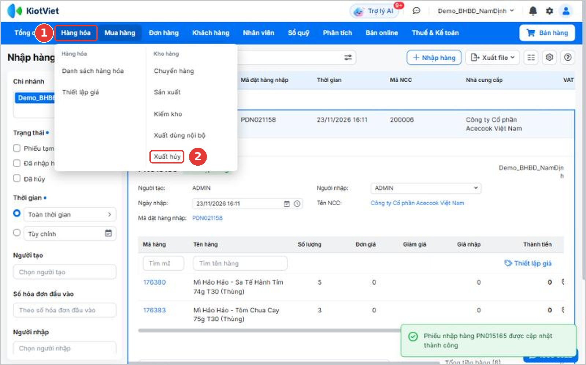
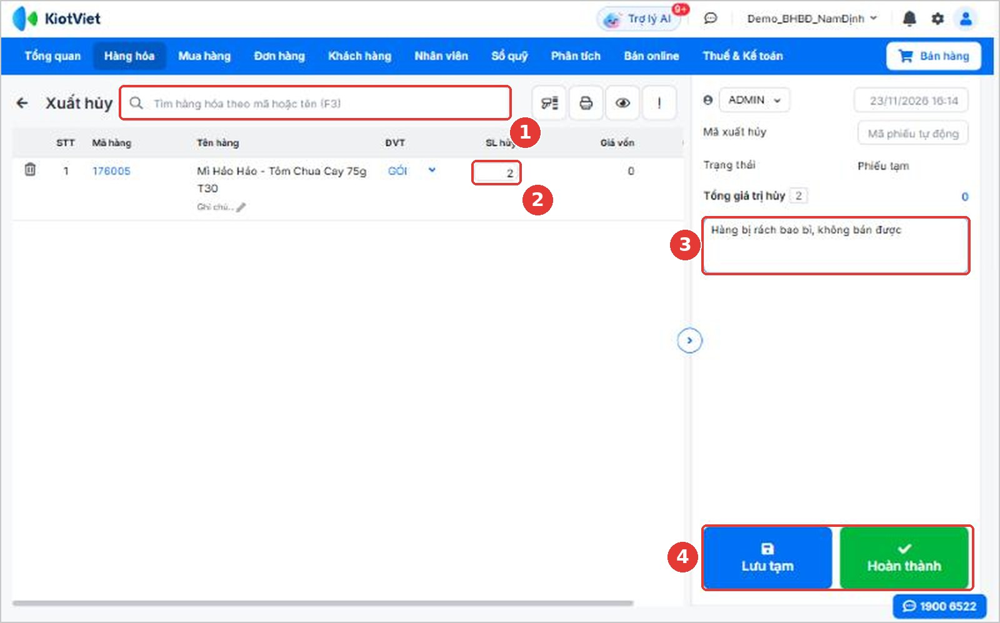

# Xuất hủy hàng hóa

TÀI LIỆU 07 · HƯỚNG DẪN NGHIỆP VỤ KIOTVIET

!!! video "Video hướng dẫn (có giọng đọc)"
    <video controls preload="metadata" playsinline style="width:100%;border-radius:8px" src="../video/07.mp4"></video>

    [:material-download: Tải video về máy](video/07.mp4){ download }

| Thông tin | Nội dung |
|---|---|
| **Mục đích** | Ghi giảm tồn kho các mặt hàng hư hỏng, hết hạn, không bán được. |
| **Người thực hiện** | Cửa hàng trưởng |
| **Thời điểm** | Khi phát hiện hàng hỏng/hết hạn, sau khi đã được duyệt hủy |

!!! tip "Cách đọc"
    Số trong **vòng tròn đỏ** trên ảnh tương ứng với mục 1 2 3… trong phần chữ của bước đó; **khung đỏ** khoanh vùng cần bấm hoặc cần kiểm tra.

## Bước 1. Mở chức năng Xuất hủy

1 Rê chuột vào menu **Hàng hóa**.  
2 Chọn **Xuất hủy**, sau đó bấm **+ Xuất hủy** để tạo phiếu mới.  

<figure markdown="span">
  { loading=lazy }
  <figcaption>Hình 1. Menu Hàng hóa → Xuất hủy</figcaption>
</figure>

## Bước 2. Lập phiếu xuất hủy

1 Tìm hàng cần hủy ở ô **Tìm hàng hóa (F3)**; chọn đúng đơn vị tính.  
2 Nhập **SL hủy**.  
3 Ghi rõ **lý do hủy** vào ô Ghi chú (hết hạn, rách bao bì, hư hỏng…).  
4 **Lưu tạm** nếu chờ duyệt. **Hoàn thành** để trừ tồn kho.  

<figure markdown="span">
  { loading=lazy }
  <figcaption>Hình 2. Phiếu xuất hủy</figcaption>
</figure>

## Lưu ý và lỗi thường gặp

| Tình huống | Cách xử lý |
|---|---|
| Lưu chứng từ | Chụp ảnh hàng hủy và lưu cùng mã phiếu xuất hủy (XH…) để đối chiếu khi kiểm tra. |
| Hàng hết hạn do khách trả lại | Làm phiếu Trả hàng trước (tài liệu 02), sau đó mới lập phiếu Xuất hủy. |
| Hủy nhầm sau khi Hoàn thành | Báo cửa hàng trưởng xử lý, không tự nhập hàng để bù. |

**Phím tắt:** F3: tìm hàng hóa
