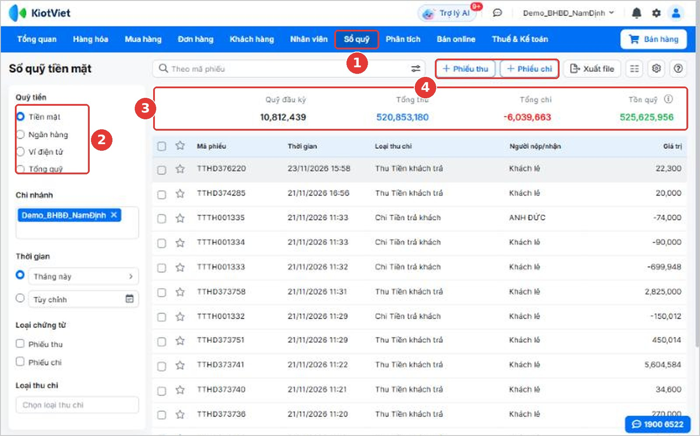
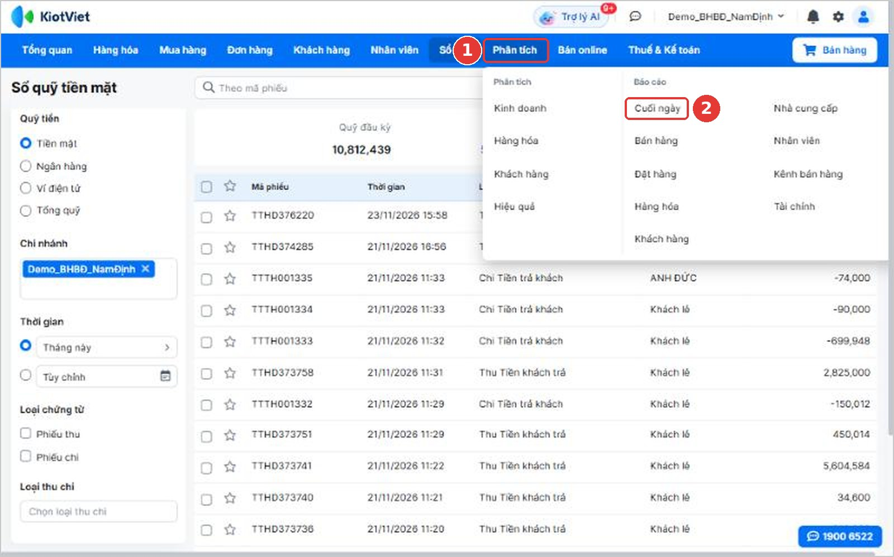
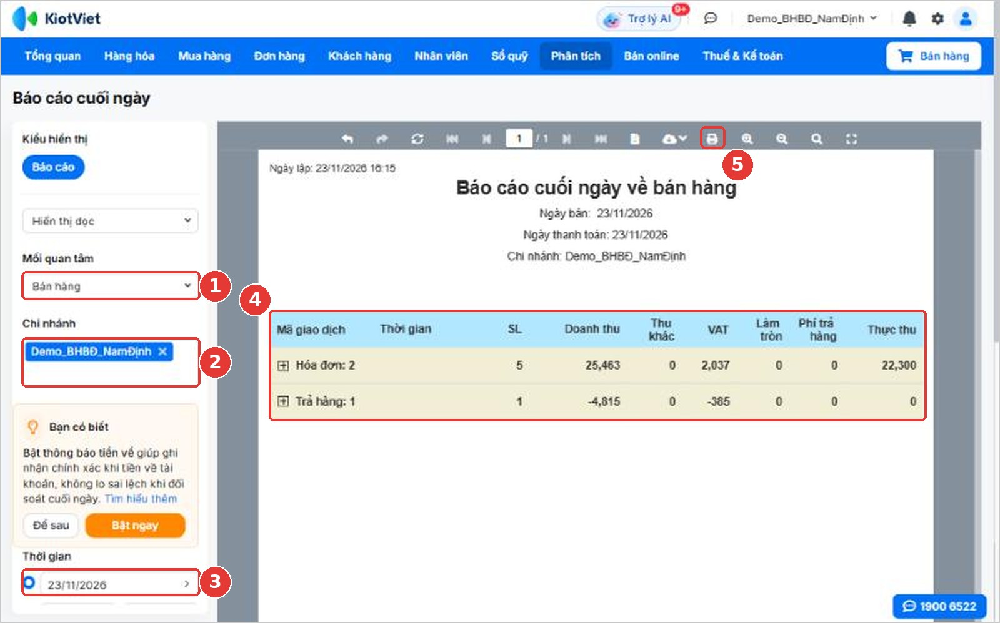
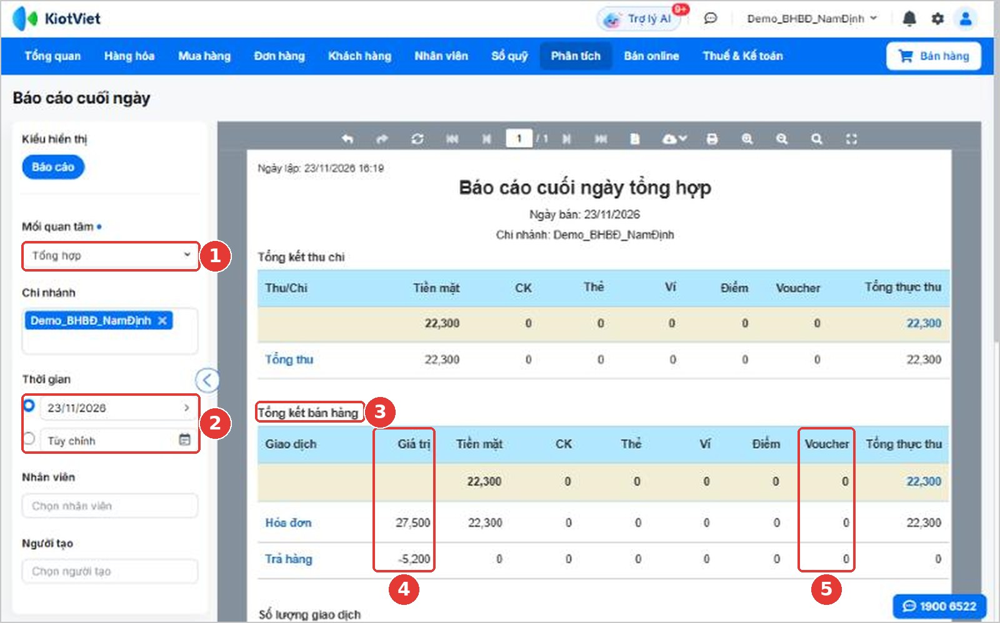

# 08. Sổ quỹ, báo cáo cuối ngày và xác định tiền nộp

| Thông tin | Nội dung |
|---|---|
| **Mục đích** | Đối soát tiền thu chi trong ngày, xem báo cáo cuối ngày và xác định số tiền phải nộp về tỉnh. |
| **Người thực hiện** | Thu ngân, cửa hàng trưởng |
| **Thời điểm** | Cuối ca, cuối ngày và khi nộp tiền |

!!! tip "Cách đọc"
    Số trong **vòng tròn đỏ** trên ảnh tương ứng với mục 1 2 3… trong phần chữ của bước đó; **khung đỏ** khoanh vùng cần bấm hoặc cần kiểm tra.

## Bước 1. Xem Sổ quỹ

1 Vào menu **Sổ quỹ**.  
2 Chọn **quỹ tiền** cần xem: Tiền mặt, Ngân hàng, Ví điện tử hoặc Tổng quỹ.  
3 Đọc **Quỹ đầu kỳ, Tổng thu, Tổng chi, Tồn quỹ** theo khoảng thời gian đang chọn. Đối chiếu tồn quỹ tiền mặt với tiền thực tế trong két.  
4 Lập **Phiếu thu / Phiếu chi** cho các khoản thu chi ngoài bán hàng (nếu được phép).  

<figure markdown="span">
  { loading=lazy }
  <figcaption>Hình 1. Sổ quỹ tiền mặt</figcaption>
</figure>

## Bước 2. Mở Báo cáo cuối ngày

1 Rê chuột vào menu **Phân tích**.  
2 Chọn **Cuối ngày** (nhóm Báo cáo).  

<figure markdown="span">
  { loading=lazy }
  <figcaption>Hình 2. Menu Phân tích → Báo cáo Cuối ngày</figcaption>
</figure>

## Bước 3. Xem báo cáo bán hàng trong ngày

1 **Mối quan tâm**: chọn **Bán hàng**.  
2 **Chi nhánh**: đúng cửa hàng mình.  
3 **Thời gian**: ngày cần xem.  
4 Bảng tổng hợp số hóa đơn, phiếu trả hàng, doanh thu và **Thực thu** trong ngày.  
5 Bấm biểu tượng **máy in** để in báo cáo nếu cần.  

<figure markdown="span">
  { loading=lazy }
  <figcaption>Hình 3. Báo cáo cuối ngày về bán hàng</figcaption>
</figure>

## Bước 4. Xác định số tiền nộp về tỉnh

Theo hướng dẫn của TTKD (đã thống nhất với Kế toán), các cửa hàng xuất báo cáo thu nộp tiền như sau:

1 Tại Báo cáo cuối ngày, **Mối quan tâm** chọn **Tổng hợp**.  
2 **Thời gian**: chọn ngày cần nộp tiền; nếu nộp cho nhiều ngày, chọn **Tùy chỉnh** và chọn từ ngày – đến ngày.  
3 Xem phần **Tổng kết bán hàng**.  
4 Lấy số ở cột **Giá trị**, dòng **Hóa đơn**.  
5 Lấy số ở cột **Voucher**, dòng **Hóa đơn**.  

!!! danger "SỐ TIỀN NỘP VỀ TỈNH = GIÁ TRỊ − VOUCHER"
    Ví dụ: Giá trị **3.906.805** − Voucher **20.000** = **3.886.805 đồng**

    **Không** lấy số Tiền mặt và Chuyển khoản ở bảng **Tổng kết thu chi** phía trên.

<figure markdown="span">
  { loading=lazy }
  <figcaption>Hình 4. Báo cáo cuối ngày tổng hợp – phần Tổng kết bán hàng</figcaption>
</figure>

## Lưu ý và lỗi thường gặp

| Tình huống | Cách xử lý |
|---|---|
| Tồn quỹ tiền mặt khác tiền trong két | Kiểm tra các hóa đơn chọn sai hình thức thanh toán (chuyển khoản nhưng ghi tiền mặt) và các phiếu trả hàng trong ngày. |
| Báo cáo hiện sai cửa hàng | Kiểm tra lại ô Chi nhánh; chỉ để một chi nhánh khi lấy số nộp tiền. |
| Số tiền nộp | Không lấy cột Tiền mặt và Chuyển khoản ở bảng Tổng kết thu chi phía trên. |
