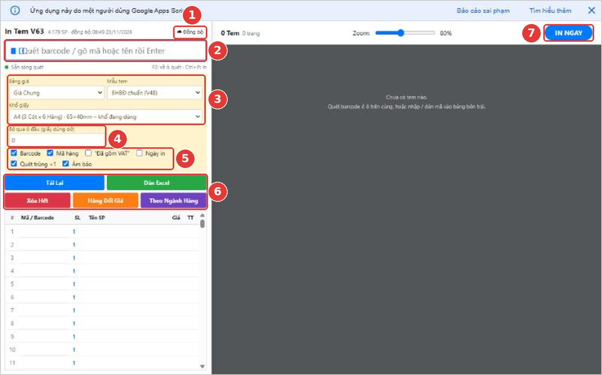
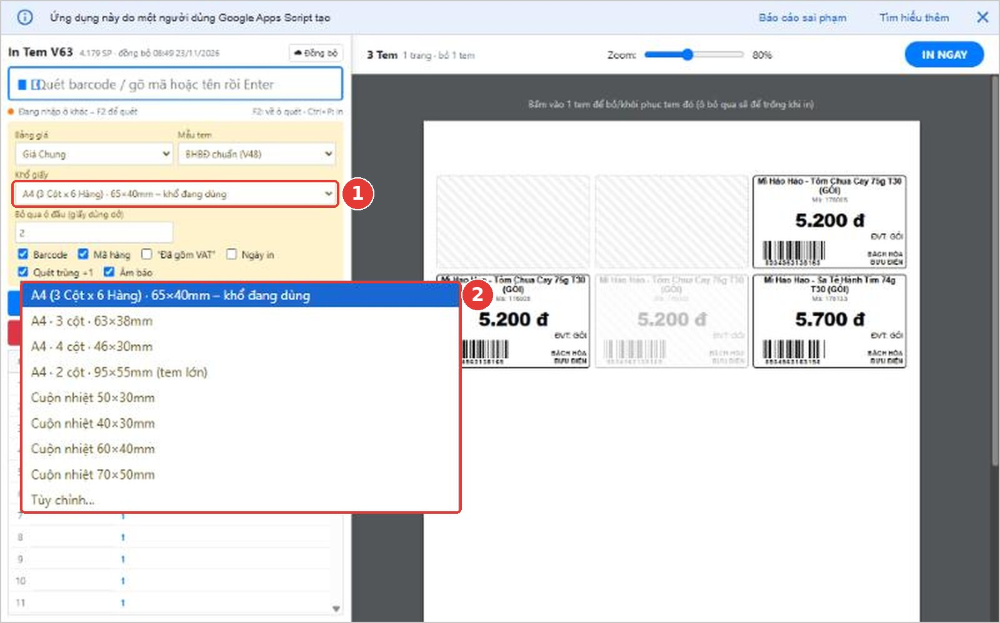
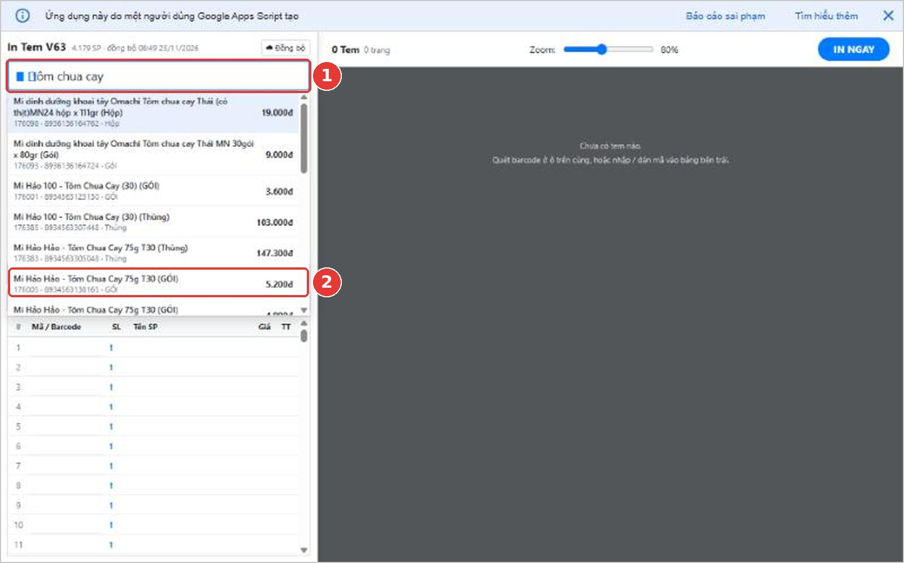
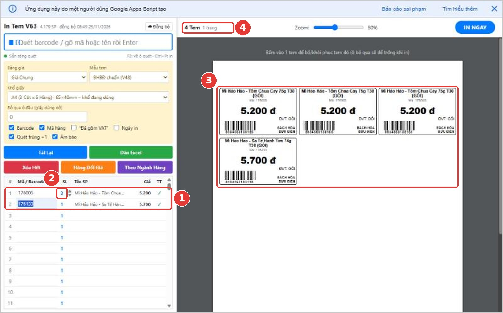
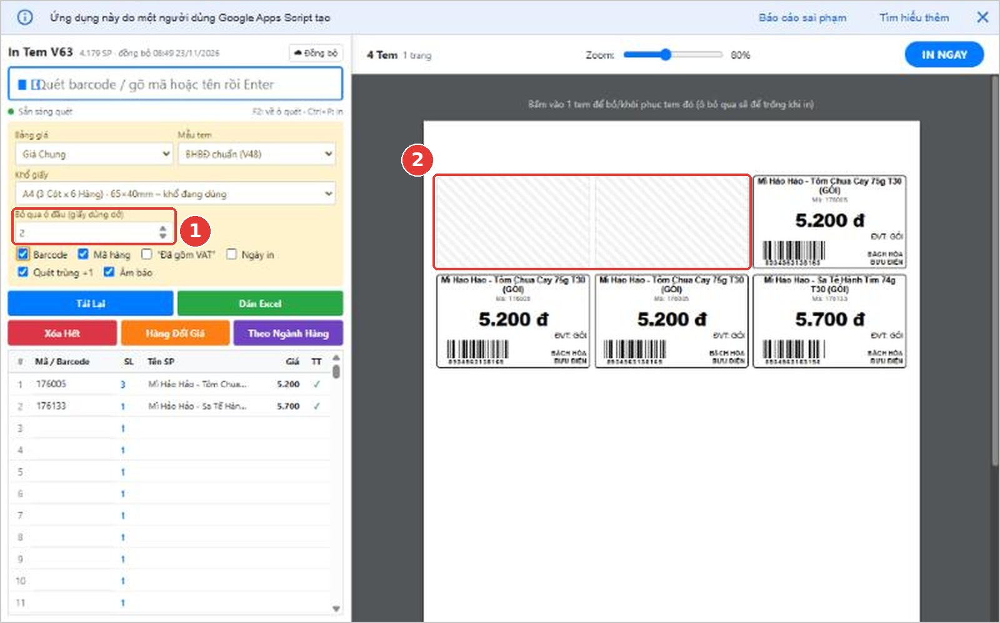
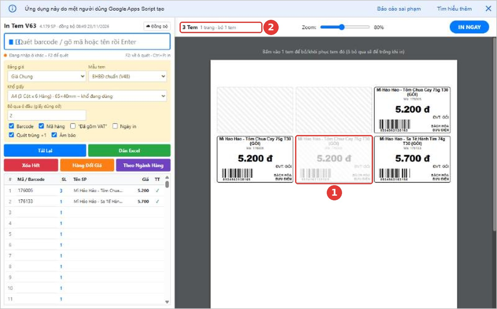
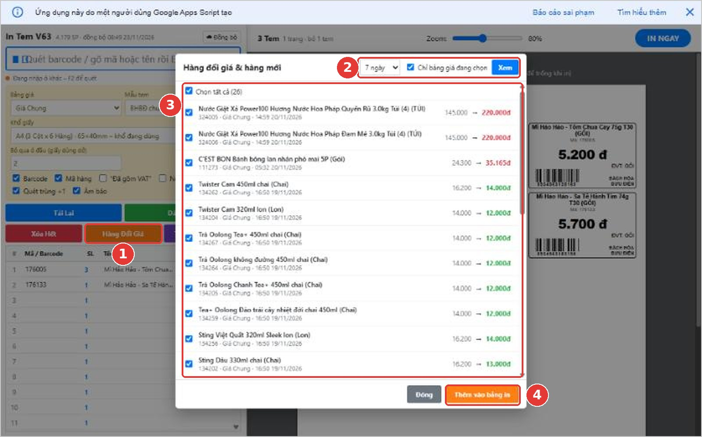
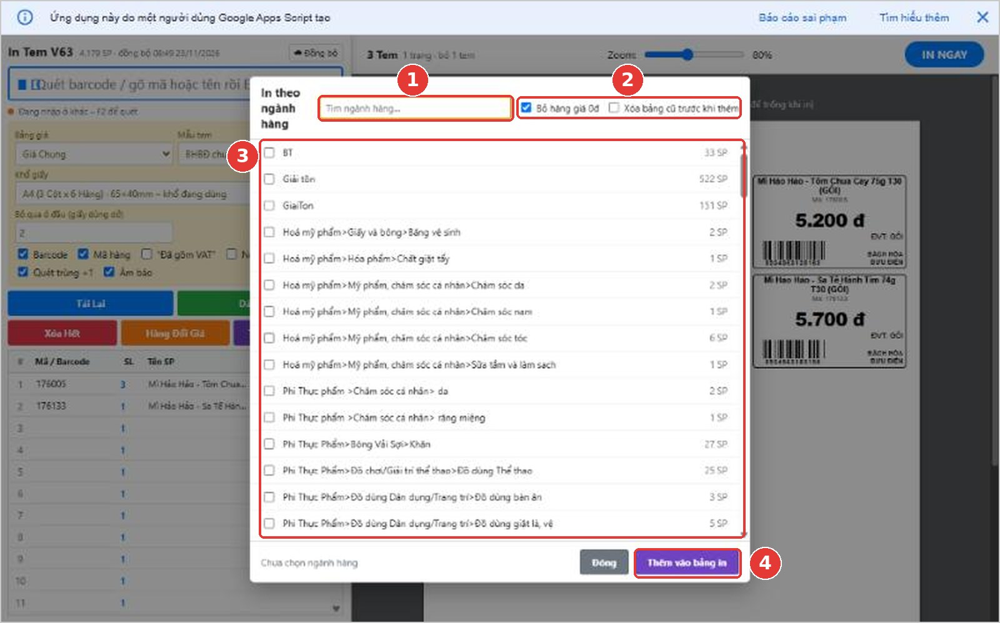
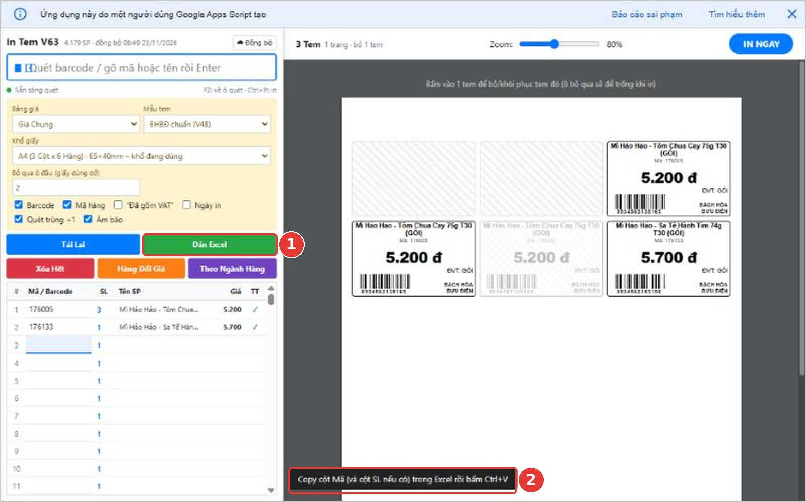

# In tem giá cài kệ

TÀI LIỆU 09 · HƯỚNG DẪN NGHIỆP VỤ KIOTVIET

[:material-tag-outline: Mở ứng dụng In tem giá BHBĐ](https://script.google.com/macros/s/AKfycbwLO1nBi8HrV2fkjHU42S5Fk6Nbz6gUvgh9tOBNMS32fVJOZ33NON_qHXPrjc38h8E5/exec){ .md-button .md-button--primary target="_blank" }

| Thông tin | Nội dung |
|---|---|
| **Mục đích** | In tem giá cài kệ đúng giá bán hiện hành trên KiotViet, đúng mẫu tem và khổ giấy của chuỗi. |
| **Người thực hiện** | Nhân viên cửa hàng, cửa hàng trưởng |
| **Thời điểm** | Khi có hàng mới, hàng đổi giá, tem cũ bị mờ/rách, và khi rà soát giá định kỳ |
| **Đường dẫn ứng dụng** | [Mở ứng dụng In tem giá BHBĐ](https://script.google.com/macros/s/AKfycbwLO1nBi8HrV2fkjHU42S5Fk6Nbz6gUvgh9tOBNMS32fVJOZ33NON_qHXPrjc38h8E5/exec) (mở bằng Chrome trên máy tính quầy và lưu vào dấu trang) |

!!! tip "Cách đọc"
    Số trong **vòng tròn đỏ** trên ảnh tương ứng với mục 1 2 3… trong phần chữ của bước đó; **khung đỏ** khoanh vùng cần bấm hoặc cần kiểm tra.

## Bước 1. Mở ứng dụng và làm quen màn hình

Màn hình chia hai phần: bên trái là bảng điều khiển và danh sách hàng cần in, bên phải là khung xem trước tờ tem.

1 **Đồng bộ**: lấy giá mới nhất từ KiotViet. Dòng bên cạnh cho biết số sản phẩm và giờ đồng bộ gần nhất. Bấm khi vừa đổi giá trên KiotViet mà tem chưa hiện giá mới.  
2 **Ô quét barcode**: quét bằng máy quét tay, hoặc gõ mã/tên hàng rồi Enter.  
3 **Bảng giá**, **Mẫu tem** (BHBĐ chuẩn (V48), Tiêu chuẩn, Khuyến mãi, Tối giản) và **Khổ giấy**.  
4 **Bỏ qua ô đầu**: dùng khi in tiếp trên tờ giấy tem đã dùng dở (Bước 5).  
5 **Tùy chọn hiển thị**: Barcode, Mã hàng, "Đã gồm VAT", Ngày in. **Quét trùng +1**: quét cùng một mã nhiều lần thì số tem tự tăng. **Âm báo**: kêu khi quét.  
6 Các nút: **Tải lại**, **Dán Excel**, **Xóa Hết**, **Hàng Đổi Giá**, **Theo Ngành Hàng**.  
7 **IN NGAY**: in toàn bộ tem đang có trong khung xem trước.  

<figure markdown="span">
  { loading=lazy }
  <figcaption>Hình 1. Màn hình ứng dụng In Tem Giá BHBĐ</figcaption>
</figure>

## Bước 2. Chọn đúng khổ giấy

1 Bấm ô **Khổ giấy**.  
2 Chọn đúng loại giấy đang lắp trong máy in. Khổ chuẩn của chuỗi là **A4 (3 cột × 6 hàng) – 65×40 mm**. Máy in nhiệt chọn đúng kích thước cuộn (50×30, 40×30, 60×40, 70×50 mm).  

<figure markdown="span">
  { loading=lazy }
  <figcaption>Hình 2. Danh sách khổ giấy</figcaption>
</figure>

## Bước 3. Thêm hàng cần in

1 Quét mã vạch sản phẩm vào ô quét, hoặc gõ tên/mã hàng.  
2 Chọn đúng sản phẩm và **đơn vị tính** (Gói, Thùng…). Giá bán hiện bên phải mỗi dòng gợi ý.  

Lặp lại cho từng mặt hàng. Nếu bật **Quét trùng +1**, quét cùng một mã 3 lần sẽ được 3 tem.

<figure markdown="span">
  { loading=lazy }
  <figcaption>Hình 3. Tìm hàng theo tên</figcaption>
</figure>

## Bước 4. Kiểm tra danh sách và xem trước

1 **Danh sách hàng cần in**: dấu ✓ ở cột TT là đã tìm thấy hàng và giá.  
2 Cột **SL** là số tem cần in cho mặt hàng đó; bấm vào để sửa.  
3 **Khung xem trước** hiển thị đúng bố cục sẽ in: tên hàng, giá, mã, ĐVT, barcode.  
4 Tổng **số tem** và **số trang** sẽ in.  

<figure markdown="span">
  { loading=lazy }
  <figcaption>Hình 4. Danh sách hàng cần in và khung xem trước</figcaption>
</figure>

## Bước 5. In tiếp trên tờ giấy đã dùng dở

1 Nhập số ô tem **đã dùng** ở đầu tờ vào ô **Bỏ qua ô đầu** (ví dụ đã dùng 2 ô thì nhập 2).  
2 Các ô đầu chuyển sang **gạch chéo** (để trống khi in), tem bắt đầu in từ ô tiếp theo.  

In xong nhớ đặt lại **Bỏ qua ô đầu = 0** cho tờ giấy mới.

<figure markdown="span">
  { loading=lazy }
  <figcaption>Hình 5. Bỏ qua 2 ô đầu trên tờ giấy tem</figcaption>
</figure>

## Bước 6. Bỏ một tem không muốn in

1 Bấm vào tem trong khung xem trước: tem bị **mờ đi** và sẽ để trống khi in. Bấm lại để khôi phục.  
2 Dòng tổng phía trên hiện số tem bị bỏ (ví dụ "bỏ 1 tem").  

<figure markdown="span">
  { loading=lazy }
  <figcaption>Hình 6. Tem bị bỏ hiển thị mờ trong khung xem trước</figcaption>
</figure>

## Bước 7. In tem cho hàng đổi giá và hàng mới

Dùng khi có đợt điều chỉnh giá, để in nhanh toàn bộ tem cần thay mà không phải quét từng mã.

1 Bấm **Hàng Đổi Giá**.  
2 Chọn khoảng thời gian (**24 giờ, 3 ngày, 7 ngày, 30 ngày**) rồi bấm **Xem**. Nên để tick **Chỉ bảng giá đang chọn**.  
3 Danh sách hiện **giá cũ → giá mới**. Bỏ tick các mặt hàng cửa hàng không bày bán.  
4 Bấm **Thêm vào bảng in**.  

<figure markdown="span">
  { loading=lazy }
  <figcaption>Hình 7. Danh sách hàng đổi giá trong 7 ngày</figcaption>
</figure>

## Bước 8. In tem theo ngành hàng

Dùng khi in lại tem cho cả một quầy, một nhóm hàng.

1 Bấm **Theo Ngành Hàng**, gõ tên ngành hàng vào ô tìm.  
2 Nên tick **Bỏ hàng giá 0đ**. Tick **Xóa bảng cũ trước khi thêm** nếu muốn bắt đầu danh sách mới.  
3 Tick các ngành hàng cần in; số sản phẩm hiện bên phải.  
4 Bấm **Thêm vào bảng in**.  

<figure markdown="span">
  { loading=lazy }
  <figcaption>Hình 8. Chọn ngành hàng cần in tem</figcaption>
</figure>

## Bước 9. Dán danh sách mã hàng từ Excel

1 Bấm **Dán Excel**.  
2 Mở file Excel, copy **cột Mã** (và **cột SL** bên cạnh nếu có), quay lại ứng dụng và bấm **Ctrl+V**.  

<figure markdown="span">
  { loading=lazy }
  <figcaption>Hình 9. Dán danh sách mã hàng từ Excel</figcaption>
</figure>

## Bước 10. In tem

- Bấm **IN NGAY** (hoặc **Ctrl+P**).
- Trong hộp thoại in của trình duyệt: chọn đúng **máy in**, khổ giấy đúng với Bước 2, **Tỷ lệ (Scale) = 100%**, không chọn "Vừa với trang" để tem không bị co lệch.
- Lần đầu dùng loại giấy mới: in thử 1 tờ trên giấy thường, đặt chồng lên tờ giấy tem để kiểm tra tem có nằm đúng ô không, rồi mới in trên giấy tem.
- In xong: cài tem đúng vị trí sản phẩm trên kệ và **thu tem cũ** để tránh khách nhìn nhầm giá.

## Lưu ý và lỗi thường gặp

| Tình huống | Cách xử lý |
|---|---|
| Giá trên tem khác giá trên KiotViet | Bấm Đồng bộ rồi thêm lại hàng. Vẫn sai thì báo Bộ phận Hệ thống, không cài tem sai giá lên kệ. |
| Quét không ra hàng | Gõ tên hoặc mã hàng để tìm. Vẫn không có thì báo Bộ phận Hệ thống kiểm tra mã vạch trên KiotViet. |
| Tem in lệch khỏi ô giấy | Kiểm tra lại Khổ giấy (Bước 2) và Tỷ lệ in = 100% trong hộp thoại in. |
| In nhầm cả tờ khi chỉ cần vài tem | Dùng Bỏ qua ô đầu (Bước 5) và bấm bỏ các tem không cần (Bước 6) trước khi in. |

**Phím tắt:** F2: về ô quét · Ctrl+P: in · Enter: thêm hàng vừa gõ
