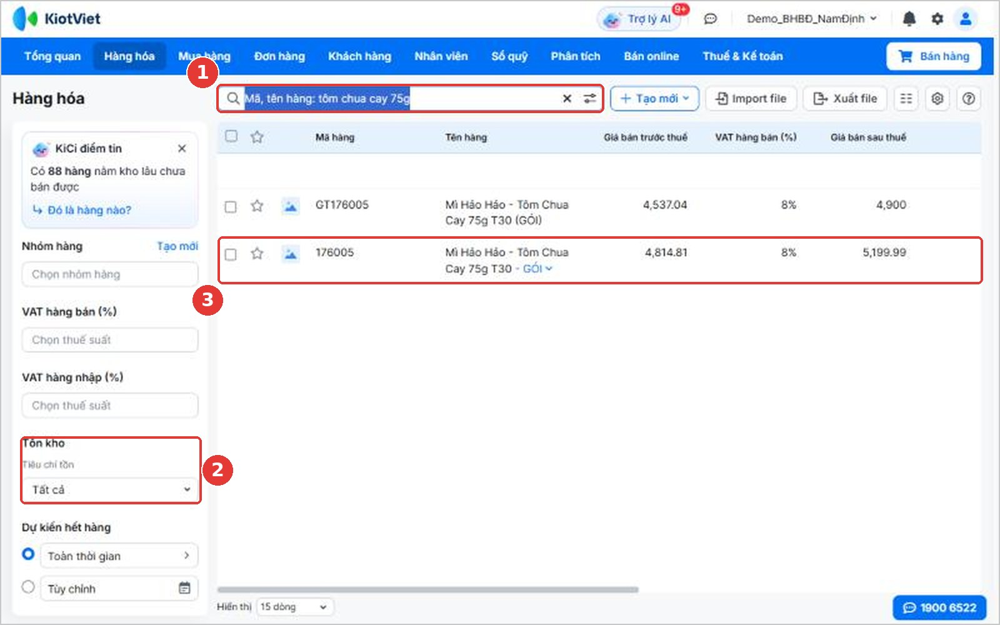
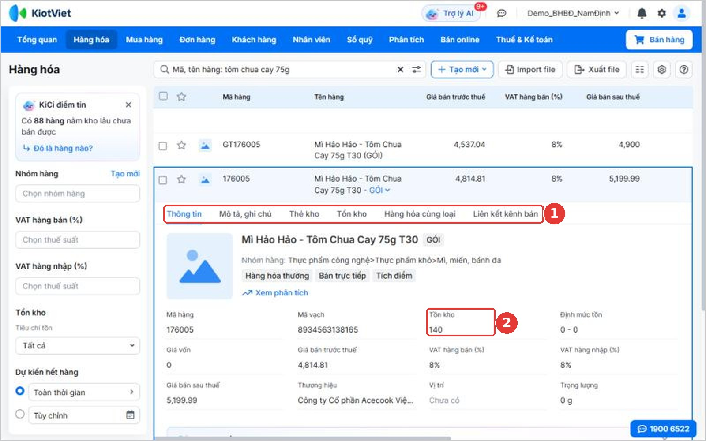
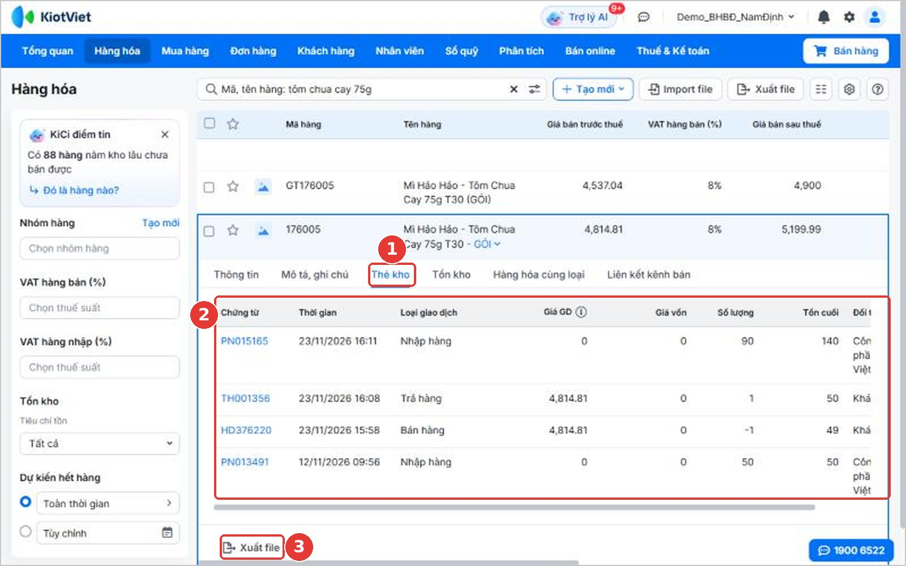
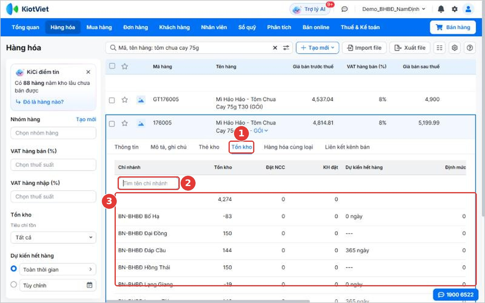
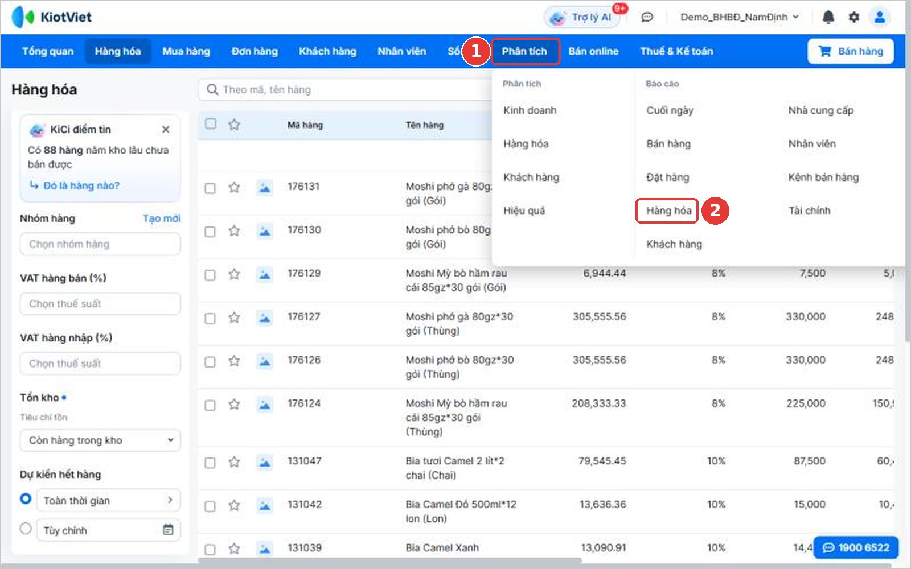
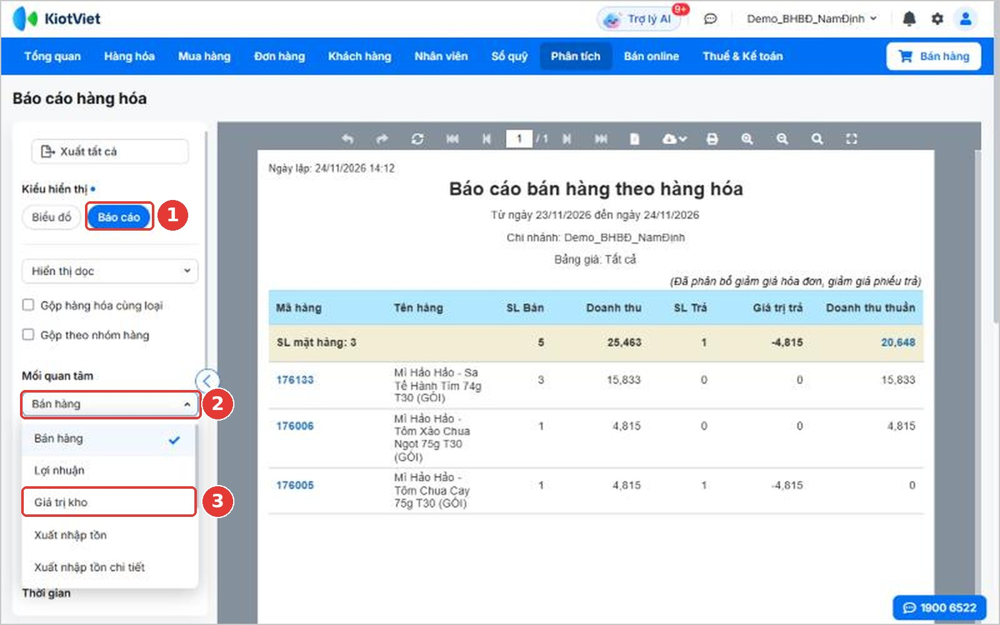
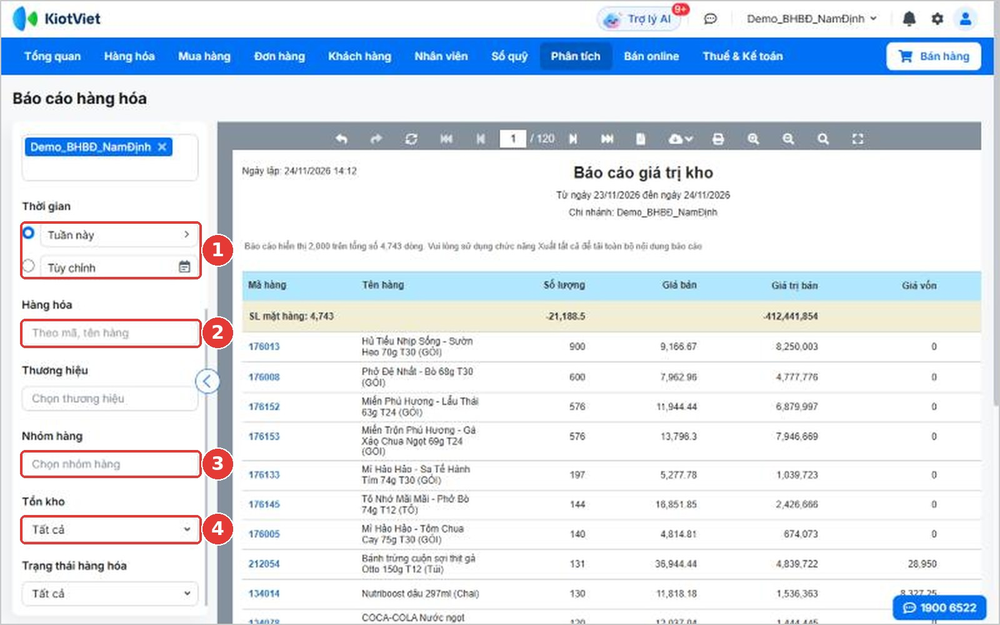
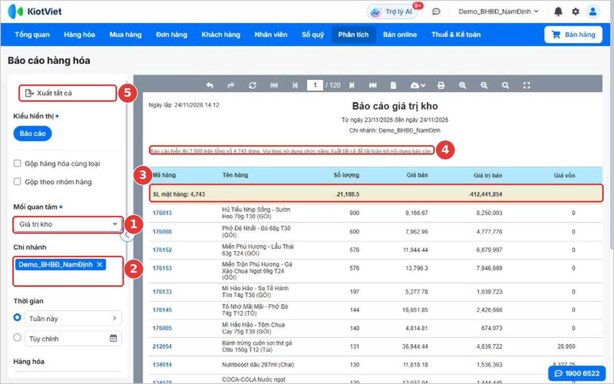
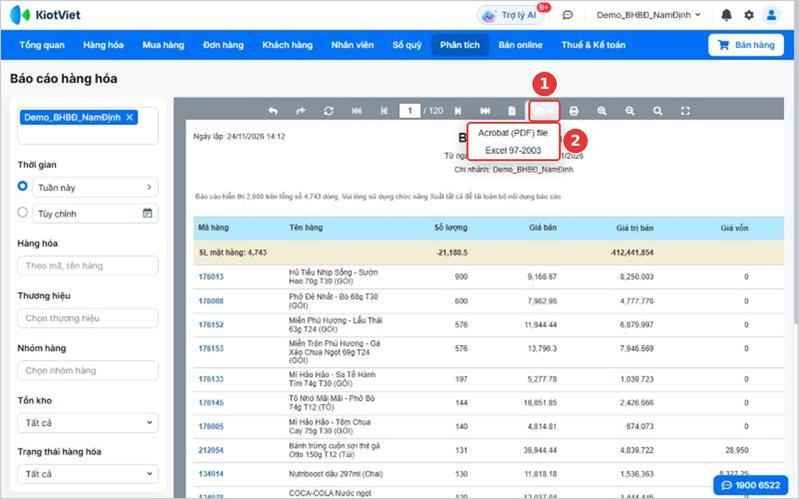

# Kiểm tra tồn kho và xuất dữ liệu tồn kho

TÀI LIỆU 10 · HƯỚNG DẪN NGHIỆP VỤ KIOTVIET

!!! video "Video hướng dẫn (có giọng đọc)"
    <video controls preload="metadata" playsinline style="width:100%;border-radius:8px" src="../video/10.mp4"></video>

    [:material-download: Tải video về máy](video/10.mp4){ download }

| Thông tin | Nội dung |
|---|---|
| **Mục đích** | Tra cứu nhanh tồn kho từng mặt hàng, xem lịch sử nhập – xuất, và xuất báo cáo giá trị kho của cửa hàng ra file Excel/PDF. |
| **Người thực hiện** | Cửa hàng trưởng, nhân viên được phân công |
| **Thời điểm** | Khi cần kiểm tra hàng, trước khi đặt hàng, trước kiểm kho, hoặc khi được yêu cầu gửi số liệu tồn kho |

!!! tip "Cách đọc"
    Số trong **vòng tròn đỏ** trên ảnh tương ứng với mục 1 2 3… trong phần chữ của bước đó; **khung đỏ** khoanh vùng cần bấm hoặc cần kiểm tra.

## PHẦN A. KIỂM TRA NHANH TỒN KHO MỘT MẶT HÀNG

## Bước 1. Tìm mặt hàng

Vào menu **Hàng hóa → Danh sách hàng hóa**.

1 Gõ **mã hoặc tên hàng** vào ô tìm kiếm rồi Enter.  
2 Bộ lọc **Tồn kho** bên trái: chọn **Còn hàng trong kho**, **Hết hàng trong kho**, **Dưới định mức tồn**… để lọc nhanh danh sách.  
3 Bấm vào **dòng mặt hàng** để mở chi tiết.  

<figure markdown="span">
  { loading=lazy }
  <figcaption>Hình 1. Tìm mặt hàng trong Danh sách hàng hóa</figcaption>
</figure>

## Bước 2. Xem số tồn của cửa hàng

1 Các tab chi tiết: **Thông tin, Thẻ kho, Tồn kho**…  
2 Tab **Thông tin** hiện **Tồn kho** hiện tại của chi nhánh đang chọn.  

<figure markdown="span">
  { loading=lazy }
  <figcaption>Hình 2. Số tồn kho trong tab Thông tin</figcaption>
</figure>

## Bước 3. Xem lịch sử nhập – xuất (Thẻ kho)

Dùng khi số tồn không khớp thực tế, để biết hàng tăng/giảm vì phiếu nào.

1 Bấm tab **Thẻ kho**.  
2 Mỗi dòng là một chứng từ: **phiếu nhập (PN), hóa đơn (HD), trả hàng (TH), chuyển hàng, kiểm kho, xuất hủy**…, kèm số lượng thay đổi và **Tồn cuối** sau chứng từ đó.  
3 Bấm **Xuất file** để tải thẻ kho của mặt hàng ra Excel.  

<figure markdown="span">
  { loading=lazy }
  <figcaption>Hình 3. Thẻ kho của mặt hàng</figcaption>
</figure>

## Bước 4. Xem tồn của mặt hàng tại các cửa hàng khác

Dùng khi cửa hàng hết hàng và cần tìm cửa hàng gần còn hàng để đề nghị điều chuyển.

1 Bấm tab **Tồn kho**.  
2 Gõ tên cửa hàng vào ô **Tìm tên chi nhánh** để lọc.  
3 Danh sách tồn kho, đặt NCC, khách đặt và dự kiến hết hàng **theo từng chi nhánh**.  

<figure markdown="span">
  { loading=lazy }
  <figcaption>Hình 4. Tồn kho của mặt hàng theo từng chi nhánh</figcaption>
</figure>

## PHẦN B. BÁO CÁO GIÁ TRỊ KHO VÀ XUẤT DỮ LIỆU

## Bước 5. Mở Báo cáo hàng hóa

1 Rê chuột vào menu **Phân tích**.  
2 Chọn **Hàng hóa** trong nhóm **Báo cáo**.  

<figure markdown="span">
  { loading=lazy }
  <figcaption>Hình 5. Menu Phân tích → Báo cáo Hàng hóa</figcaption>
</figure>

## Bước 6. Chọn mối quan tâm Giá trị kho

1 **Kiểu hiển thị**: chọn **Báo cáo**.  
2 Bấm ô **Mối quan tâm**.  
3 Chọn **Giá trị kho**.  

<figure markdown="span">
  { loading=lazy }
  <figcaption>Hình 6. Chọn Mối quan tâm: Giá trị kho</figcaption>
</figure>

## Bước 7. Lọc báo cáo

Kéo thanh bên trái xuống để thấy thêm bộ lọc:

1 **Thời gian**: chọn kỳ cần xem; khoảng ngày được ghi ở đầu báo cáo.  
2 **Hàng hóa**: gõ mã/tên nếu chỉ cần xem một vài mặt hàng.  
3 **Nhóm hàng**: lọc theo ngành hàng.  
4 **Tồn kho**: lọc hàng còn tồn, hết hàng…  

Ở ô **Chi nhánh** phía trên, chỉ để **đúng cửa hàng của mình**.

<figure markdown="span">
  { loading=lazy }
  <figcaption>Hình 7. Các bộ lọc của báo cáo</figcaption>
</figure>

## Bước 8. Đọc báo cáo Giá trị kho

1 **Mối quan tâm** đang là **Giá trị kho**.  
2 **Chi nhánh**: đúng cửa hàng cần xem.  
3 Dòng tổng: **số mặt hàng**, **tổng số lượng tồn** và **tổng giá trị** của cửa hàng. Các dòng bên dưới là từng mặt hàng: Số lượng, Giá bán, Giá trị bán, Giá vốn…  
4 Khi báo cáo ghi "**Báo cáo hiển thị 2,000 trên tổng số … dòng**", màn hình chỉ hiện 2.000 dòng đầu.  
5 Muốn lấy **toàn bộ** dữ liệu, bấm **Xuất tất cả** (xem Bước 9).  

<figure markdown="span">
  { loading=lazy }
  <figcaption>Hình 8. Báo cáo giá trị kho</figcaption>
</figure>

## Bước 9. Xuất dữ liệu tồn kho

1 Bấm biểu tượng **tải xuống** trên thanh công cụ của báo cáo.  
2 Chọn **Excel 97-2003** để xử lý số liệu, hoặc **Acrobat (PDF)** để in/gửi. Cách này chỉ xuất **phần đang hiển thị** (tối đa 2.000 dòng).  

**Xuất đầy đủ:** bấm nút **Xuất tất cả** ở đầu thanh bên trái (Hình 8, mục 5) để tải **toàn bộ** các dòng của báo cáo ra Excel. Dùng cách này khi cửa hàng có trên 2.000 mặt hàng hoặc khi gửi số liệu tồn kho cho cấp trên.

<figure markdown="span">
  { loading=lazy }
  <figcaption>Hình 9. Xuất báo cáo ra PDF hoặc Excel</figcaption>
</figure>

## Lưu ý và lỗi thường gặp

| Tình huống | Cách xử lý |
|---|---|
| Số tồn trên máy khác số thực tế | Xem Thẻ kho (Bước 3) để tìm chứng từ bất thường; nếu vẫn lệch, báo cửa hàng trưởng lập phiếu Kiểm kho (Lưu tạm) và gửi BU BHBĐ xác nhận (tài liệu 06). |
| Tồn kho hiện số âm | Hàng đã bán nhưng chưa nhập phiếu nhập hoặc nhận chuyển hàng. Kiểm tra phiếu nhập/chuyển hàng còn treo. |
| File xuất ra thiếu mặt hàng | Đã xuất bằng biểu tượng tải xuống (chỉ 2.000 dòng). Dùng Xuất tất cả. |
| Báo cáo ra số liệu nhiều cửa hàng | Ô Chi nhánh đang chọn nhiều chi nhánh; xóa bớt, chỉ để cửa hàng của mình. |
