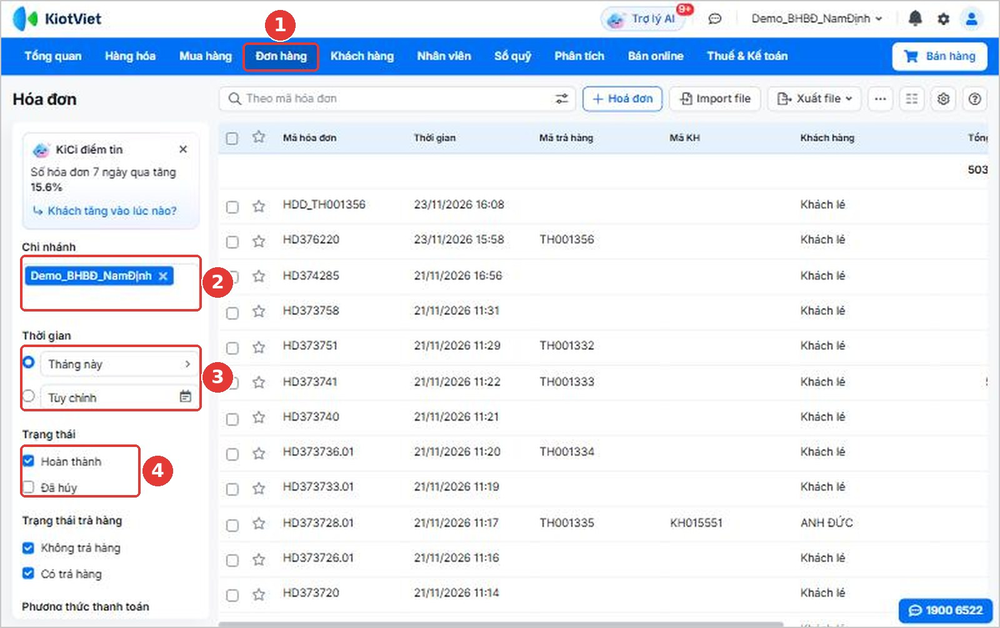
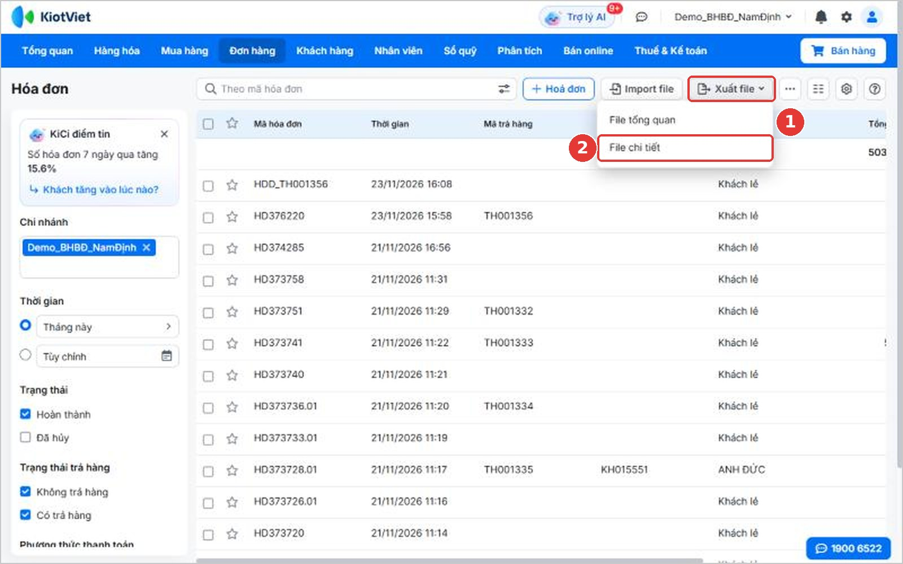
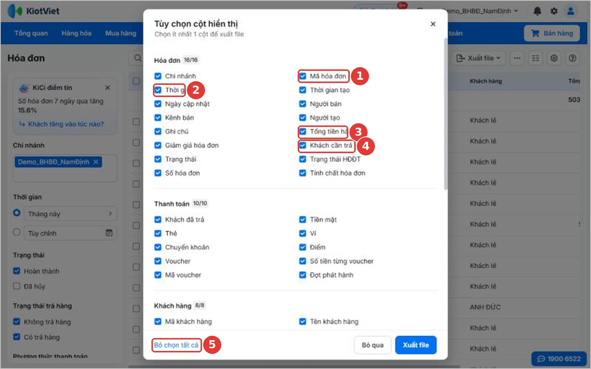
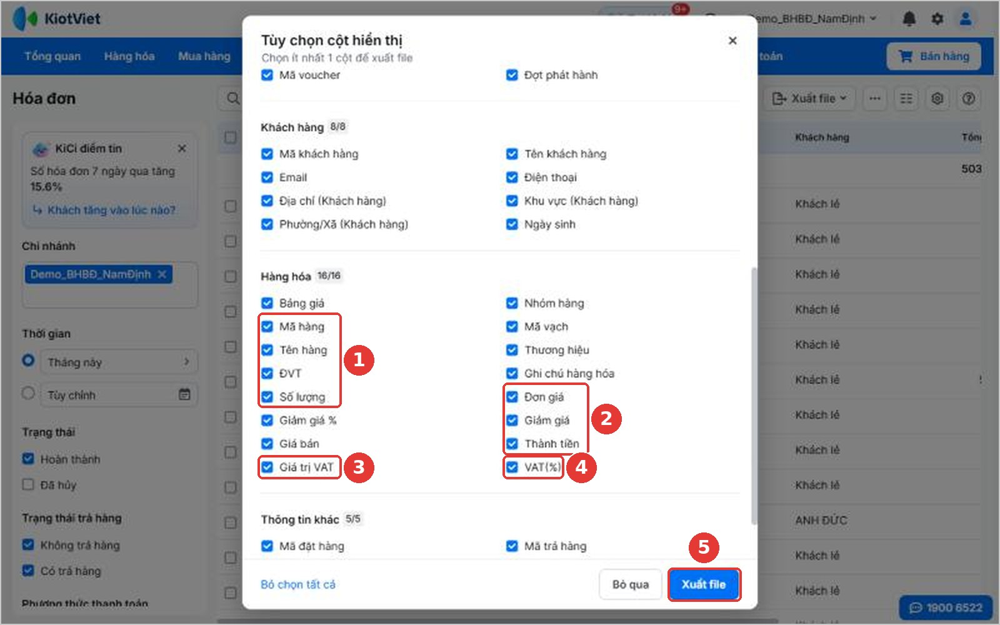
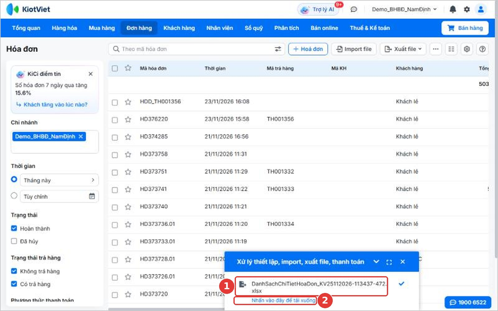

# 11. Xuất chi tiết hóa đơn bán hàng (tách thuế) cho kế toán

| Thông tin | Nội dung |
|---|---|
| **Mục đích** | Xuất file Excel chi tiết từng hóa đơn bán hàng: mã giao dịch, mã hàng, số lượng, thành tiền, thuế suất %, giá trị thuế, giá trị sau thuế, để kế toán xuất hóa đơn và hạch toán doanh thu. |
| **Người thực hiện** | Cửa hàng trưởng, nhân viên được giao lập số liệu cho kế toán |
| **Thời điểm** | Cuối ngày, cuối tuần hoặc cuối tháng theo yêu cầu của kế toán |

!!! tip "Cách đọc"
    Số trong **vòng tròn đỏ** trên ảnh tương ứng với mục 1 2 3… trong phần chữ của bước đó; **khung đỏ** khoanh vùng cần bấm hoặc cần kiểm tra.

## Bước 1. Mở danh sách Hóa đơn và lọc đúng kỳ

1 Vào menu **Đơn hàng → Hóa đơn**.  
2 **Chi nhánh**: chỉ để **đúng cửa hàng** của mình.  
3 **Thời gian**: chọn **Tùy chỉnh** và chọn từ ngày – đến ngày đúng kỳ kế toán yêu cầu.  
4 **Trạng thái**: chỉ tick **Hoàn thành**, **bỏ tick Đã hủy** để không lấy hóa đơn đã hủy.  

<figure markdown="span">
  { loading=lazy }
  <figcaption>Hình 1. Danh sách Hóa đơn và các bộ lọc</figcaption>
</figure>

## Bước 2. Chọn Xuất file chi tiết

1 Bấm **Xuất file**.  
2 Chọn **File chi tiết** (mỗi dòng hàng trong hóa đơn là một dòng trong Excel). Không chọn File tổng quan vì file đó không có chi tiết mặt hàng và thuế từng dòng.  

<figure markdown="span">
  { loading=lazy }
  <figcaption>Hình 2. Xuất file → File chi tiết</figcaption>
</figure>

## Bước 3. Chọn các cột cần xuất – phần Hóa đơn

Cửa sổ **Tùy chọn cột hiển thị** hiện ra, mặc định tick tất cả. **Nên giữ nguyên tick tất cả** để vị trí các cột trong Excel luôn cố định (công thức ở Bước 7 dựa vào vị trí cột). Kiểm tra phần **Hóa đơn** có các cột:

1 **Mã hóa đơn** (mã giao dịch).  
2 **Thời gian** (ngày bán).  
3 **Tổng tiền hàng** (tổng chưa thuế, chưa trừ giảm giá hóa đơn) và **Giảm giá hóa đơn**.  
4 **Khách cần trả** (tổng sau thuế của hóa đơn).  
5 **Không bấm Bỏ chọn tất cả**, để file có đủ cột như mặc định.  

<figure markdown="span">
  { loading=lazy }
  <figcaption>Hình 3. Chọn cột phần Hóa đơn</figcaption>
</figure>

## Bước 4. Chọn các cột cần xuất – phần Hàng hóa

Kéo xuống phần **Hàng hóa**, tick các cột:

1 **Mã hàng, Tên hàng, ĐVT, Số lượng**.  
2 **Đơn giá, Giảm giá, Thành tiền** (thành tiền chưa thuế của từng dòng hàng).  
3 **Giá trị VAT** (tiền thuế của từng dòng hàng).  
4 **VAT(%)** (thuế suất).  
5 Bấm **Xuất file**.  

<figure markdown="span">
  { loading=lazy }
  <figcaption>Hình 4. Chọn cột phần Hàng hóa</figcaption>
</figure>

## Bước 5. Tải file về máy

1 Góc dưới màn hình hiện khung **Xử lý … xuất file** với tên file **DanhSachChiTietHoaDon_KV….xlsx**. Chờ đến khi có dấu ✓.  
2 Bấm **Nhấn vào đây để tải xuống**. File được lưu vào thư mục **Downloads** của máy tính.  

<figure markdown="span">
  { loading=lazy }
  <figcaption>Hình 5. Tải file chi tiết hóa đơn</figcaption>
</figure>

## Bước 6. Đọc file cho kế toán

Đối chiếu các thông tin kế toán cần với cột trong file Excel:

| Kế toán cần | Cột trong file | Ghi chú |
|---|---|---|
| Mã giao dịch | **Mã hóa đơn** | Một hóa đơn nhiều mặt hàng thì lặp lại trên nhiều dòng |
| Mã hàng, tên hàng, ĐVT | **Mã hàng, Tên hàng, ĐVT** |   |
| Số lượng | **Số lượng** |   |
| Đơn giá chưa thuế | **Giá bán** | Đơn giá sau giảm giá, chưa thuế |
| Thành tiền chưa thuế | **Thành tiền** | Của từng dòng hàng, **chưa trừ giảm giá hóa đơn** (xem Bước 7) |
| Thuế suất % | **VAT(%)** | Ví dụ 8, 10 |
| Giá trị thuế | **Giá trị VAT** | Của từng dòng hàng, **đã tính sau** giảm giá hóa đơn |
| Giá trị sau thuế | Không có cột riêng | Hóa đơn không giảm giá: = **Thành tiền + Giá trị VAT**. Hóa đơn có giảm giá: xem Bước 7. Tổng sau thuế cả hóa đơn = cột **Khách cần trả** |

### Ví dụ thực tế (hóa đơn HD376220 trên chi nhánh Demo)

| Mã hóa đơn | Mã hàng | Tên hàng | SL | Giá bán | Thành tiền | VAT % | Giá trị VAT | Sau thuế (tự tính) |
|---|---|---|---|---|---|---|---|---|
| HD376220 | 176133 | Mì Hảo Hảo Sa Tế Hành Tím 74g (Gói) | 3 | 5.277,78 | 15.833 | 8 | 1.267 | 17.100 |
| HD376220 | 176005 | Mì Hảo Hảo Tôm Chua Cay 75g (Gói) | 1 | 4.814,81 | 4.815 | 8 | 385 | 5.200 |
| **Cộng hóa đơn** |   |   |   |   | **20.648** |   | **1.652** | **22.300** |

Kiểm tra: tổng Thành tiền = cột **Tổng tiền hàng** (20.648), tổng Giá trị VAT = cột **VAT** (1.652), tổng sau thuế = cột **Khách cần trả** (22.300) của hóa đơn.

## Bước 7. Hóa đơn có giảm giá tổng hóa đơn: phân bổ giảm giá về từng dòng

Khi thu ngân giảm giá trên **tổng hóa đơn** (cột **Giảm giá hóa đơn** khác 0), file chi tiết ghi như sau: cột **Thành tiền** từng dòng **chưa trừ** khoản giảm giá này, còn cột **Giá trị VAT** từng dòng **đã được tính sau** khi KiotViet phân bổ giảm giá theo tỷ lệ thành tiền. Kế toán cần thêm 3 cột trong Excel để có thành tiền sau giảm giá:

| Cột thêm | Công thức (dòng 2, kéo xuống) | Ý nghĩa |
|---|---|---|
| **AX** – Giảm giá phân bổ | `=IF($U2=0;0;ROUND(AT2/$U2*$V2;0))` | Phần giảm giá hóa đơn chia cho dòng hàng theo tỷ lệ Thành tiền |
| **AY** – Thành tiền sau giảm (chưa thuế) | `=AT2-AX2` | Doanh thu chưa thuế của dòng hàng |
| **AZ** – Giá trị sau thuế | `=AY2+AU2` | Thành tiền sau giảm + Giá trị VAT |

Các cột gốc: **U** = Tổng tiền hàng, **V** = Giảm giá hóa đơn, **AT** = Thành tiền, **AU** = Giá trị VAT (khi xuất đủ cột mặc định). Máy dùng dấu phẩy ngăn tham số thì thay **;** bằng **,** trong công thức.

### Ví dụ: hóa đơn HD378166 (tiền hàng 15.371, giảm giá hóa đơn 1.000)

| Mã hàng | Thành tiền (AT) | Giảm giá HĐ (V) | Giảm giá phân bổ (AX) | Thành tiền sau giảm (AY) | Giá trị VAT (AU) | Sau thuế (AZ) | VAT % |
|---|---|---|---|---|---|---|---|
| 176005 | 4.815 | 1.000 | 313 | 4.502 | 360 | 4.862 | 8 |
| 176133 | 10.556 | 1.000 | 687 | 9.869 | 789 | 10.658 | 8 |
| **Cộng** | **15.371** |   | **1.000** | **14.371** | **1.149** | **15.520** |   |

!!! danger "KIỂM TRA:  Σ SAU THUẾ (AZ)  =  KHÁCH CẦN TRẢ (Y)"
    Tổng cột AX của mỗi hóa đơn phải bằng **Giảm giá hóa đơn**; tổng cột AU bằng cột **VAT**; tổng cột AZ bằng **Khách cần trả**.

    Nếu lệch 1–2 đồng do làm tròn, cộng/trừ phần chênh vào dòng có thành tiền lớn nhất của hóa đơn đó.

## Lưu ý và lỗi thường gặp

| Tình huống | Cách xử lý |
|---|---|
| Hóa đơn có ghi Mã trả hàng | Khách đã trả lại một phần hàng của hóa đơn đó. File chi tiết hóa đơn vẫn ghi số lượng bán ban đầu; xuất thêm danh sách Trả hàng (Đơn hàng → Trả hàng → Xuất file) để kế toán điều chỉnh. |
| Giảm giá trên từng dòng hàng (không phải giảm giá hóa đơn) | Đã được trừ sẵn: cột Giảm giá và Giá bán của dòng đó đã phản ánh, Thành tiền là số sau giảm. Không cần phân bổ. |
| Có hóa đơn mã HDD_… | Đây là hóa đơn đổi hàng phát sinh từ phiếu trả hàng; vẫn là hóa đơn bán, kế toán ghi nhận bình thường. |
| File có cả hóa đơn đã hủy | Kiểm tra lại bộ lọc Trạng thái: chỉ tick Hoàn thành. |
| File có số liệu nhiều cửa hàng | Ô Chi nhánh đang chọn nhiều chi nhánh; xóa bớt, chỉ để cửa hàng của mình. |
| Chỉ cần tổng sản lượng – doanh thu theo mặt hàng, không cần từng hóa đơn | Dùng Phân tích → Báo cáo → Hàng hóa → Mối quan tâm Bán hàng, Hiển thị số liệu Chưa/Đã bao gồm thuế. |
