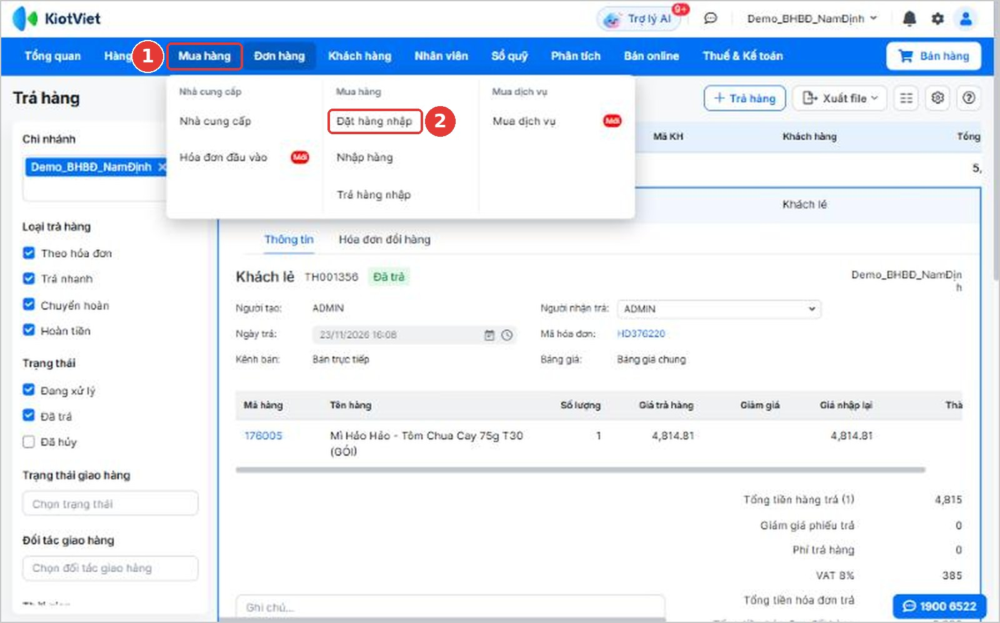
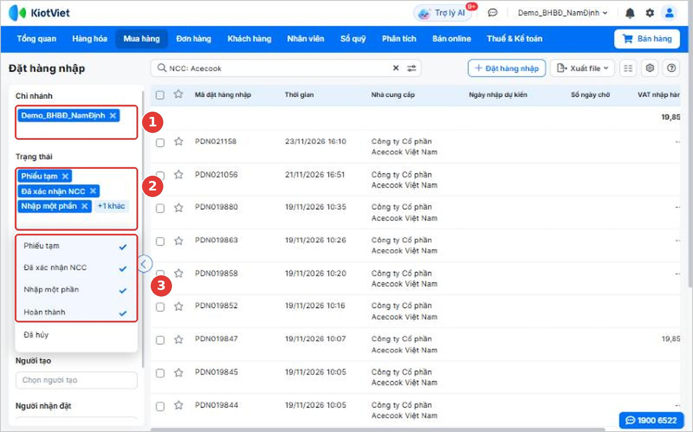
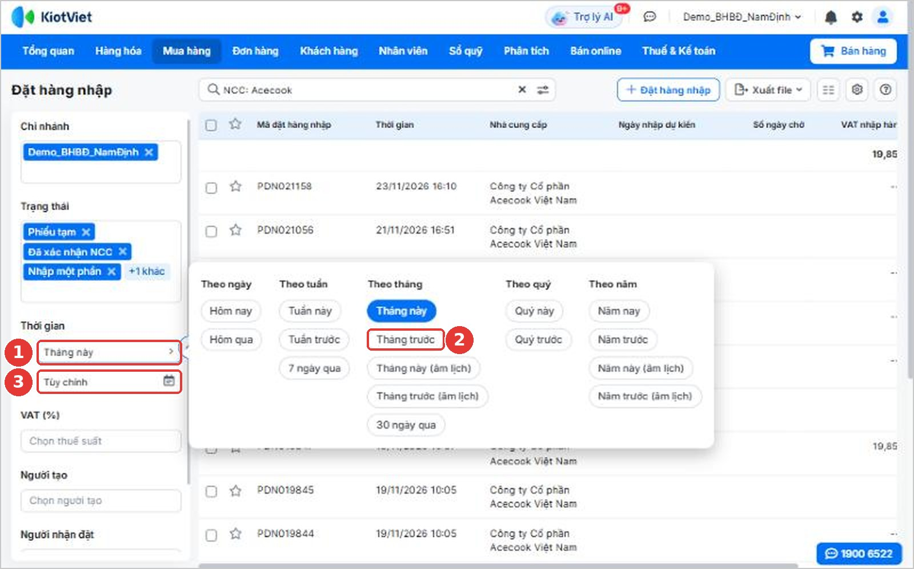
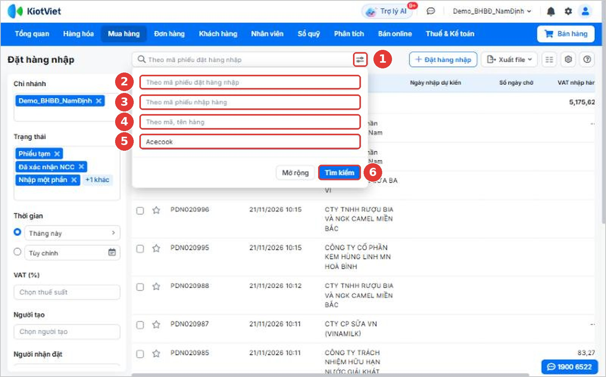
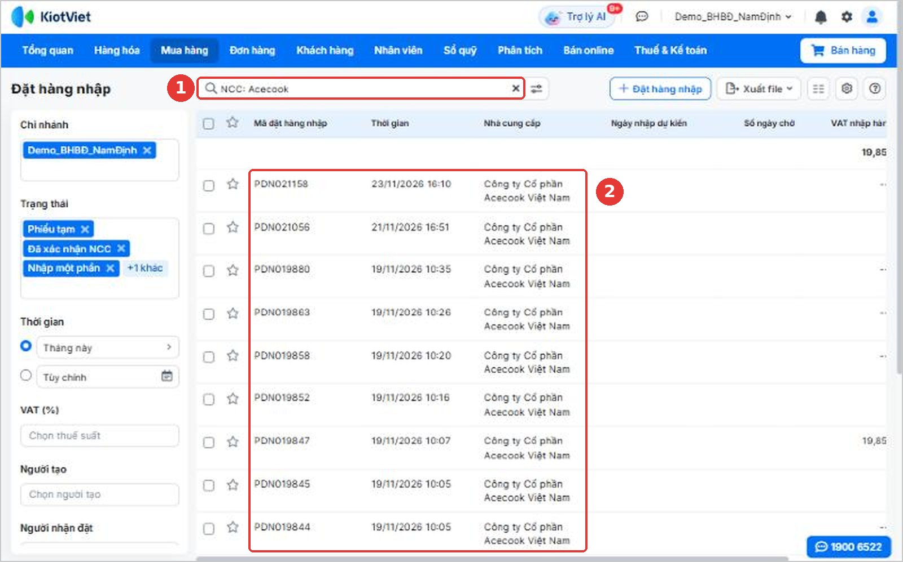
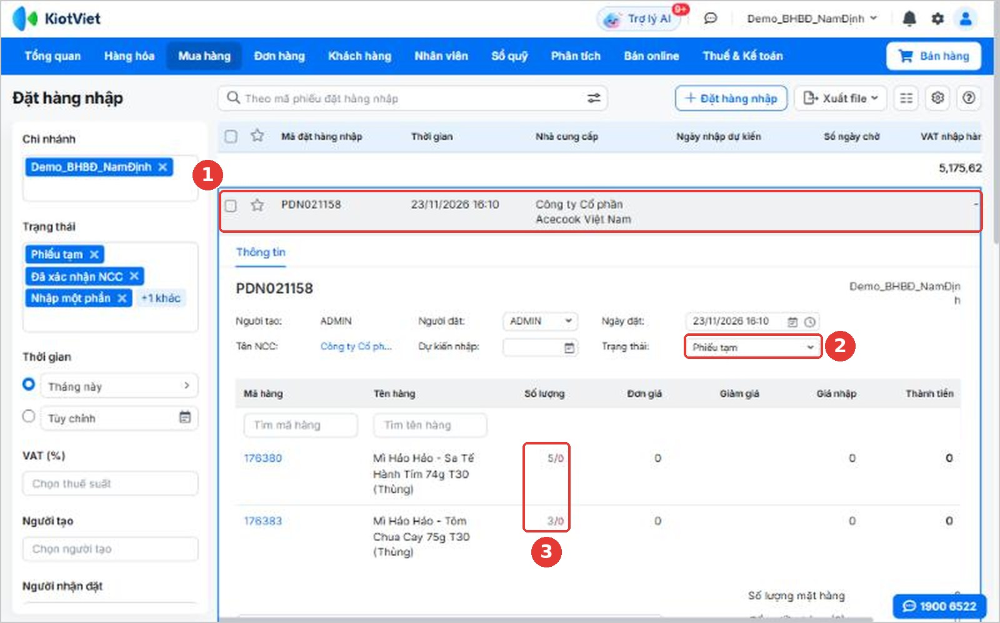
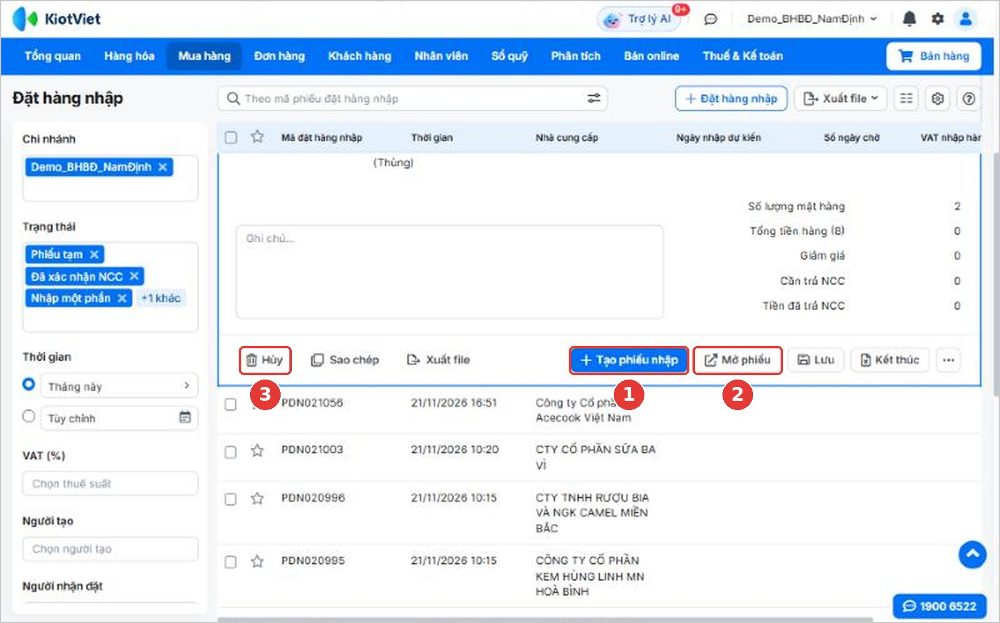
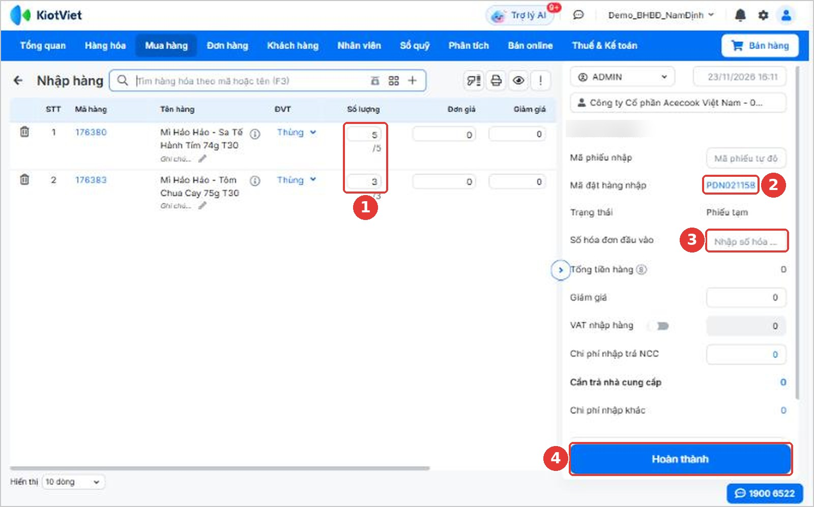
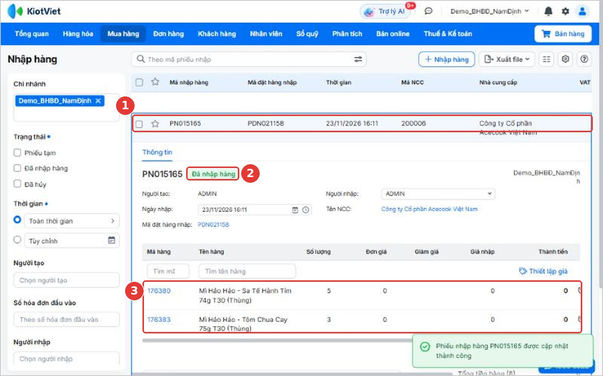

# Tìm phiếu đặt hàng nhập (pdn) và tạo phiếu nhập kho

TÀI LIỆU 12 · HƯỚNG DẪN NGHIỆP VỤ KIOTVIET

!!! video "Video hướng dẫn (có giọng đọc)"
    <video controls preload="metadata" playsinline style="width:100%;border-radius:8px" src="../video/12.mp4"></video>

    [:material-download: Tải video về máy](video/12.mp4){ download }

| Thông tin | Nội dung |
|---|---|
| **Mục đích** | Tìm đúng phiếu đặt hàng nhập (mã PDN…) của nhà cung cấp đang giao hàng, rồi tạo phiếu nhập kho từ chính phiếu đó để phiếu nhập liên kết với phiếu đặt. |
| **Người thực hiện** | Cửa hàng trưởng hoặc nhân viên nhận hàng, đặc biệt cửa hàng mới |
| **Thời điểm** | Khi NCC giao hàng đến cửa hàng |

!!! tip "Cách đọc"
    Số trong **vòng tròn đỏ** trên ảnh tương ứng với mục 1 2 3… trong phần chữ của bước đó; **khung đỏ** khoanh vùng cần bấm hoặc cần kiểm tra.

## PHẦN A. TÌM PHIẾU ĐẶT HÀNG NHẬP (PDN)

## Bước 1. Mở danh sách Đặt hàng nhập

1 Rê chuột vào menu **Mua hàng**.  
2 Chọn **Đặt hàng nhập**.  

<figure markdown="span">
  { loading=lazy }
  <figcaption>Hình 1. Menu Mua hàng → Đặt hàng nhập</figcaption>
</figure>

## Bước 2. Lọc đúng chi nhánh và trạng thái

Bộ lọc bên trái quyết định danh sách hiện những phiếu nào. Cửa hàng mới thường không thấy phiếu vì lọc sai ở đây.

1 **Chi nhánh**: chỉ để **đúng cửa hàng mình**. Phiếu đặt cho cửa hàng nào chỉ hiện khi chọn đúng chi nhánh đó.  
2 **Trạng thái**: bấm vào ô để mở danh sách trạng thái.  
3 Phiếu đang chờ hàng về nằm ở **Phiếu tạm**, **Đã xác nhận NCC** hoặc **Nhập một phần**: giữ tick 3 trạng thái này. **Hoàn thành** là phiếu đã nhập đủ, **Đã hủy** là phiếu không dùng nữa.  

<figure markdown="span">
  { loading=lazy }
  <figcaption>Hình 2. Lọc Chi nhánh và Trạng thái phiếu đặt hàng nhập</figcaption>
</figure>

## Bước 3. Chọn khoảng thời gian

Mặc định danh sách chỉ hiện phiếu tạo trong **Tháng này**. Phiếu đặt từ cuối tháng trước sẽ không hiện nếu không đổi thời gian.

1 Bấm ô **Tháng này** để mở bảng chọn nhanh.  
2 Chọn **Tháng trước**, **30 ngày qua** hoặc **Quý này** khi phiếu đặt đã lâu.  
3 Hoặc chọn **Tùy chỉnh** và chọn từ ngày – đến ngày.  

<figure markdown="span">
  { loading=lazy }
  <figcaption>Hình 3. Chọn khoảng thời gian tạo phiếu</figcaption>
</figure>

## Bước 4. Tìm phiếu bằng tìm kiếm nâng cao

Dùng khi danh sách có nhiều phiếu. Có thể tìm theo mã phiếu, theo hàng hoặc theo nhà cung cấp:

1 Bấm biểu tượng **tìm kiếm nâng cao** ở cuối ô tìm.  
2 **Theo mã phiếu đặt hàng nhập**: gõ mã PDN nếu NCC hoặc phòng mua hàng đã báo mã (ví dụ PDN021158).  
3 **Theo mã phiếu nhập hàng**: gõ mã PN để tìm ngược phiếu đặt từ một phiếu nhập đã có.  
4 **Theo mã, tên hàng**: gõ mã hoặc tên một mặt hàng có trong đơn giao.  
5 **Theo mã, tên NCC**: gõ tên NCC in trên phiếu giao hàng (ví dụ Acecook). Đây là cách nhanh nhất khi chưa biết mã PDN.  
6 Bấm **Tìm kiếm**.  

<figure markdown="span">
  { loading=lazy }
  <figcaption>Hình 4. Tìm kiếm nâng cao phiếu đặt hàng nhập</figcaption>
</figure>

## Bước 5. Chọn đúng phiếu trong kết quả

1 Ô tìm hiển thị điều kiện đang lọc (ví dụ **NCC: Acecook**). Bấm dấu **×** ở cuối ô để bỏ lọc.  
2 Danh sách chỉ còn các phiếu của NCC đó, phiếu mới nhất ở trên cùng. Đối chiếu **ngày đặt** và **mặt hàng** với phiếu giao hàng của NCC để chọn đúng phiếu.  

<figure markdown="span">
  { loading=lazy }
  <figcaption>Hình 5. Kết quả tìm theo nhà cung cấp</figcaption>
</figure>

## Bước 6. Mở phiếu và kiểm tra

1 Bấm vào dòng phiếu **PDN** để mở chi tiết.  
2 **Trạng thái** phải là Phiếu tạm, Đã xác nhận NCC hoặc Nhập một phần.  
3 Cột **Số lượng** dạng "5/0" là **số đặt / số đã nhập**. Số đã nhập bằng số đặt nghĩa là hàng đã nhập rồi, không nhập lại.  

<figure markdown="span">
  { loading=lazy }
  <figcaption>Hình 6. Chi tiết phiếu đặt hàng nhập</figcaption>
</figure>

## PHẦN B. TẠO PHIẾU NHẬP KHO TỪ PDN

## Bước 7. Bấm Tạo phiếu nhập

Kéo xuống cuối phần chi tiết của phiếu PDN đang mở:

1 Bấm **Tạo phiếu nhập**. Hệ thống mở màn hình Nhập hàng, điền sẵn NCC, mặt hàng và số lượng đã đặt.  
2 **Mở phiếu** chỉ dùng để sửa phiếu đặt khi NCC chưa giao, **không** dùng để nhập kho.  
3 **Không bấm Hủy**: nút này hủy phiếu đặt.  

<figure markdown="span">
  { loading=lazy }
  <figcaption>Hình 7. Nút Tạo phiếu nhập trên phiếu đặt hàng nhập</figcaption>
</figure>

## Bước 8. Kiểm đếm, nhập số lượng thực nhận và hoàn thành

1 Đếm hàng thực tế và sửa **Số lượng** theo số thực nhận. Con số "/5" bên dưới là số đã đặt.  
2 Kiểm tra **Mã đặt hàng nhập** đúng là phiếu PDN vừa chọn.  
3 Nhập **Số hóa đơn đầu vào** (số hóa đơn NCC giao kèm hàng).  
4 Bấm **Hoàn thành**. Tồn kho cửa hàng được cộng ngay.  

**Hàng quản lý theo Lô – Hạn sử dụng:** nhập đúng **số lô** và **hạn sử dụng** in trên bao bì cho từng dòng trước khi bấm Hoàn thành.

<figure markdown="span">
  { loading=lazy }
  <figcaption>Hình 8. Phiếu nhập tạo từ PDN</figcaption>
</figure>

## Bước 9. Kiểm tra kết quả

Vào **Mua hàng → Nhập hàng**:

1 Phiếu nhập mới (mã **PN…**) nằm đầu danh sách, cột **Mã đặt hàng nhập** ghi đúng mã PDN.  
2 Trạng thái **Đã nhập hàng** là đã cộng tồn kho.  
3 Đối chiếu **mặt hàng và số lượng** với phiếu giao hàng của NCC.  

Quay lại phiếu PDN: nếu nhận **đủ** hàng, phiếu chuyển sang **Hoàn thành**; nếu nhận **thiếu**, phiếu chuyển sang **Nhập một phần**. Lần NCC giao bù, tìm lại **đúng phiếu PDN đó** (Bước 1–6) và bấm **Tạo phiếu nhập** tiếp.

<figure markdown="span">
  { loading=lazy }
  <figcaption>Hình 9. Phiếu nhập đã liên kết với phiếu đặt</figcaption>
</figure>

## Lưu ý và lỗi thường gặp

| Tình huống | Cách xử lý |
|---|---|
| Không thấy phiếu PDN nào | Kiểm tra lại 3 bộ lọc: Chi nhánh đúng cửa hàng mình, Trạng thái có tick Phiếu tạm / Đã xác nhận NCC / Nhập một phần, Thời gian đủ rộng (Tháng trước, 30 ngày qua hoặc Tùy chỉnh). |
| Ô tìm còn điều kiện cũ nên danh sách bị thiếu | Bấm dấu × ở cuối ô tìm để xóa điều kiện lọc. |
| Có nhiều phiếu của cùng một NCC | Đối chiếu ngày đặt, mặt hàng và số lượng với phiếu giao hàng; hỏi NCC hoặc phòng mua hàng mã PDN nếu vẫn không chắc. |
| Tự tạo phiếu nhập bằng + Nhập hàng | Không được làm: phiếu nhập không liên kết với đơn của TCT, PDN vẫn treo ở trạng thái chờ, dẫn đến lệch hóa đơn thanh toán cho NCC. Luôn tạo phiếu nhập từ nút Tạo phiếu nhập trên PDN. |
| Không có PDN (hàng NCC giao ngoài đơn của TCT) | Không tự tạo phiếu nhập bằng + Nhập hàng, không bày bán. Báo TTĐH và Bộ phận Hệ thống BU BHBĐ (tài liệu 04). |

**Phím tắt:** F3: tìm hàng hóa trên màn hình Nhập hàng
