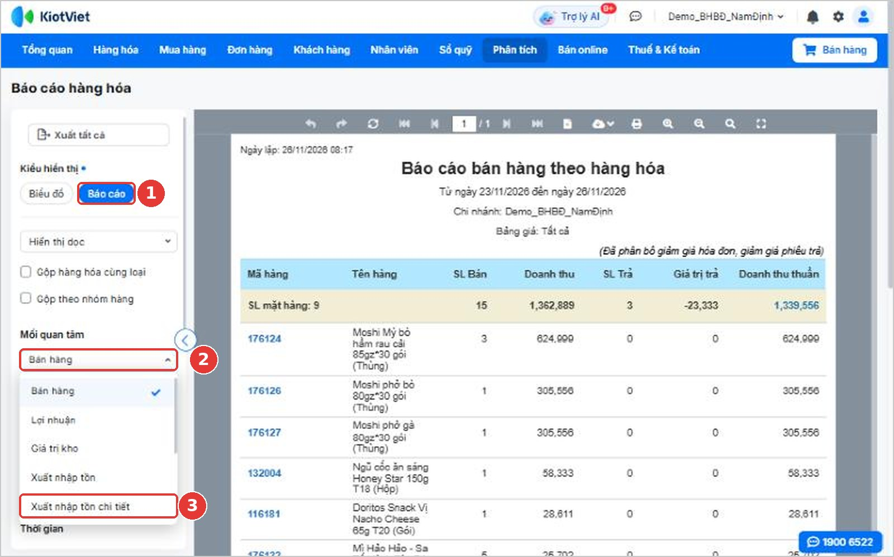
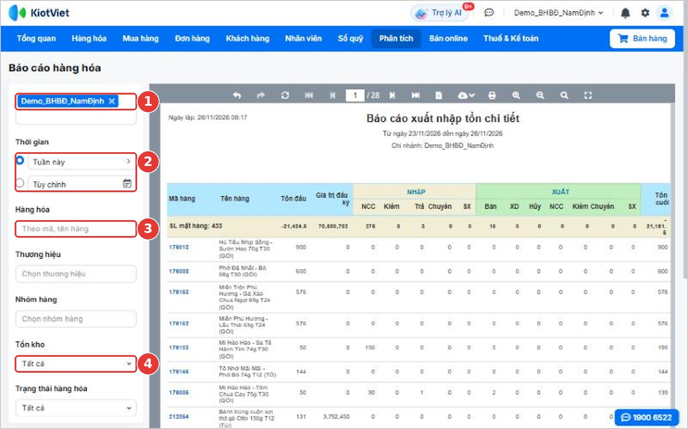
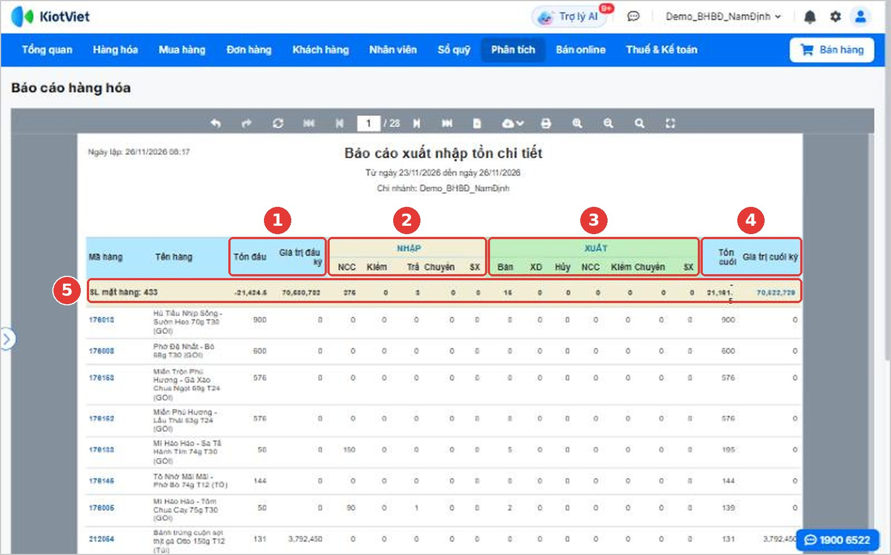
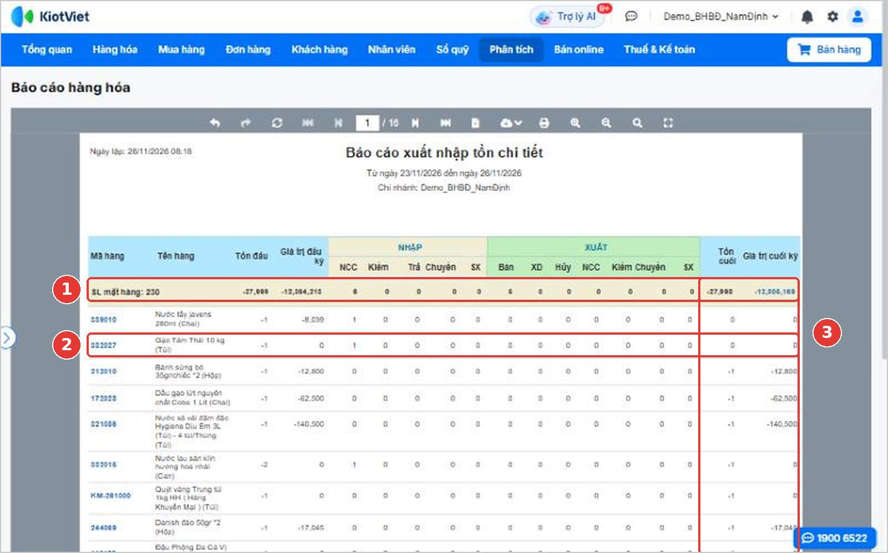
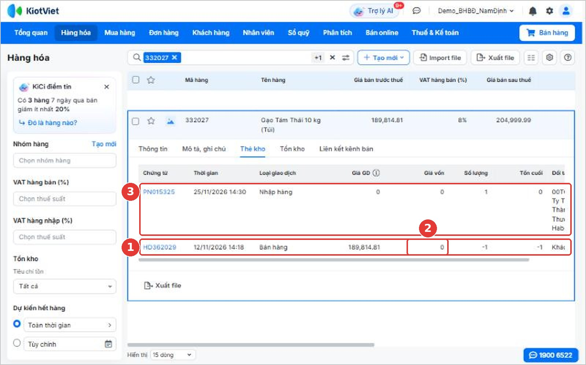

# Báo cáo xuất nhập tồn chi tiết và cảnh báo bán hàng trước khi nhập kho

TÀI LIỆU 13 · HƯỚNG DẪN NGHIỆP VỤ KIOTVIET

| Thông tin | Nội dung |
|---|---|
| **Mục đích** | Xem số lượng và giá trị tồn đầu kỳ, nhập, xuất, tồn cuối kỳ của từng mặt hàng; phát hiện hàng tồn âm do bán trước khi nhập kho. |
| **Người thực hiện** | Cửa hàng trưởng; Đơn vị và kế toán khi đối soát |
| **Thời điểm** | Cuối ngày, cuối tuần, cuối tháng hoặc trước khi kiểm kho |

!!! tip "Cách đọc"
    Số trong **vòng tròn đỏ** trên ảnh tương ứng với mục 1 2 3… trong phần chữ của bước đó; **khung đỏ** khoanh vùng cần bấm hoặc cần kiểm tra.

## PHẦN A. XEM BÁO CÁO XUẤT NHẬP TỒN CHI TIẾT

## Bước 1. Mở báo cáo

Vào **Phân tích → Báo cáo → Hàng hóa** (như tài liệu 10, Bước 5).

1 **Kiểu hiển thị**: chọn **Báo cáo**.  
2 Bấm ô **Mối quan tâm**.  
3 Chọn **Xuất nhập tồn chi tiết**. (Mục *Xuất nhập tồn* phía trên chỉ có số lượng tổng, không tách từng loại nhập – xuất.)  

<figure markdown="span">
  { loading=lazy }
  <figcaption>Hình 1. Chọn Mối quan tâm Xuất nhập tồn chi tiết</figcaption>
</figure>

## Bước 2. Lọc báo cáo

1 **Chi nhánh**: chỉ để đúng cửa hàng của mình.  
2 **Thời gian**: chọn kỳ cần xem (Tuần này, Tháng này…) hoặc **Tùy chỉnh** từ ngày – đến ngày.  
3 **Hàng hóa**: gõ mã hoặc tên để xem riêng một vài mặt hàng (để trống là xem tất cả).  
4 **Tồn kho**: chọn **Hết hàng trong kho** để lọc ra hàng tồn bằng 0 và **tồn âm** (xem Phần B).  

<figure markdown="span">
  { loading=lazy }
  <figcaption>Hình 2. Bộ lọc báo cáo xuất nhập tồn chi tiết</figcaption>
</figure>

## Bước 3. Đọc báo cáo

Bấm mũi tên **‹** ở mép bộ lọc để thu gọn, báo cáo sẽ hiện đủ các cột:

1 **Tồn đầu, Giá trị đầu kỳ**: số lượng và giá trị (theo giá vốn) tại ngày đầu kỳ.  
2 **NHẬP**: **NCC** = nhập từ nhà cung cấp; **Kiểm** = kiểm kho thừa; **Trả** = khách trả hàng; **Chuyển** = nhận chuyển từ cửa hàng khác.  
3 **XUẤT**: **Bán** = bán hàng; **Hủy** = xuất hủy; **NCC** = trả hàng nhà cung cấp; **Kiểm** = kiểm kho thiếu; **Chuyển** = chuyển đi cửa hàng khác. Các cột XD, SX ít phát sinh tại cửa hàng.  
4 **Tồn cuối, Giá trị cuối kỳ**: số lượng và giá trị còn lại cuối kỳ.  
5 Dòng **SL mặt hàng** là tổng của toàn bộ báo cáo.  

<figure markdown="span">
  { loading=lazy }
  <figcaption>Hình 3. Các cột của báo cáo xuất nhập tồn chi tiết</figcaption>
</figure>

## Bước 4. Kiểm tra công thức và xuất file

!!! important "TỒN CUỐI = TỒN ĐẦU + TỔNG NHẬP − TỔNG XUẤT"
    Kiểm tra nhanh trên từng dòng. Nếu **Tồn cuối** khác số đếm thực tế trên kệ, mở **Thẻ kho** của mặt hàng (tài liệu 10, Bước 3) để tìm chứng từ gây lệch.

    Xuất file: bấm biểu tượng tải xuống trên thanh công cụ của báo cáo (chỉ trang đang xem), hoặc nút **Xuất tất cả** đầu bộ lọc để lấy đủ dữ liệu (cách làm như tài liệu 10, Bước 9).

## PHẦN B. CẢNH BÁO: BÁN HÀNG TRƯỚC KHI NHẬP KHO

## Chuyện gì xảy ra khi bán hàng chưa nhập kho?

Khi hàng đã về cửa hàng nhưng **chưa tạo phiếu nhập** mà đã bán, KiotViet vẫn cho bán và trừ kho xuống **số âm**. Hóa đơn lấy **giá vốn hiện có trên hệ thống tại thời điểm bán**: hàng mới chưa từng nhập thì giá vốn = **0**; hàng cũ thì là giá vốn bình quân của các lần nhập trước. Phiếu nhập tạo sau đó **không sửa lại giá vốn của các hóa đơn đã bán trước nó**.

| Hậu quả | Ảnh hưởng |
|---|---|
| **Tồn kho âm** | Báo cáo tồn kho, giá trị kho, xuất nhập tồn hiện **số âm**; đặt hàng, điều chuyển, kiểm kho dựa trên số sai. |
| **Giá vốn hóa đơn sai** | Hàng mới: hóa đơn ghi **giá vốn 0** → lãi gộp bằng **toàn bộ doanh thu** (lãi ảo). Hàng cũ đổi giá nhập: giá vốn theo giá cũ → lãi cao hoặc thấp hơn thực tế. |
| **Báo cáo lợi nhuận sai** | Lợi nhuận gộp của cửa hàng / Đơn vị **bị thổi phồng** (hoặc bị giảm) trong kỳ bán; kế toán đối soát giá vốn với hóa đơn đầu vào sẽ **không khớp**. |
| **Giá trị kho sai** | Giá trị cuối kỳ âm hoặc lệch so với tiền hàng thực tế đã trả NCC. |

## Ví dụ thực tế trên chi nhánh Demo

Lọc **Tồn kho = Hết hàng trong kho**, báo cáo hiện các mặt hàng tồn đầu kỳ **âm**:

1 Dòng tổng: **230 mặt hàng** tồn đầu kỳ âm, tổng giá trị cuối kỳ **âm hơn 12 triệu đồng**. Đây là dấu hiệu bán trước khi nhập rất phổ biến.  
2 Mặt hàng **332027 Gạo Tám Thái 10 kg**: tồn đầu **−1**, giá trị đầu kỳ **0**, sau đó nhập NCC **1**, tồn cuối về **0**.  
3 Cột **Tồn cuối / Giá trị cuối kỳ** còn nhiều dòng **âm**: hàng đã bán nhưng đến cuối kỳ vẫn chưa nhập kho.  

<figure markdown="span">
  { loading=lazy }
  <figcaption>Hình 4. Hàng tồn âm trên báo cáo xuất nhập tồn chi tiết</figcaption>
</figure>

## Xem thẻ kho để thấy giá vốn bị ghi sai

Mở thẻ kho của mặt hàng 332027 (Hàng hóa → tìm mã → tab **Thẻ kho**):

1 Hóa đơn **HD362029** ngày 12/11 bán 1 túi giá **189.815 đ** khi **chưa có hàng trong kho**: tồn cuối **−1**.  
2 **Giá vốn** của hóa đơn này là **0** → hệ thống ghi nhận lãi gộp **189.815 đ (100% doanh thu)**.  
3 Phiếu nhập **PN015325** đến 25/11 mới tạo – **13 ngày sau** khi đã bán. Sau khi nhập, giá vốn trên hóa đơn HD362029 **vẫn là 0**.  

<figure markdown="span">
  { loading=lazy }
  <figcaption>Hình 5. Thẻ kho: bán ngày 12/11, nhập kho ngày 25/11</figcaption>
</figure>

### Minh họa ảnh hưởng đến lợi nhuận

| Một mặt hàng mới, giá bán 10.000 đ, giá nhập 8.000 đ | Nhập trước rồi bán (đúng) | Bán trước rồi nhập (sai) | Chênh lệch |
|---|---|---|---|
| Doanh thu | 10.000 | 10.000 | 0 |
| Giá vốn ghi trên hóa đơn | 8.000 | 0 | −8.000 |
| Lãi gộp trên báo cáo | 2.000 (20%) | 10.000 (100%) | +8.000 lãi ảo |
| Tồn kho trong thời gian chờ nhập | Dương, đúng thực tế | Âm (−1) | Sai số lượng và giá trị |

## Quy định thực hiện tại cửa hàng

!!! important "HÀNG VỀ → KIỂM ĐẾM → TẠO PHIẾU NHẬP (HOÀN THÀNH) → MỚI ĐƯỢC BÀY BÁN"
    Tạo phiếu nhập **ngay trong ngày** hàng về, từ phiếu đặt hàng nhập (tài liệu 12). Hàng chưa có phiếu nhập Hoàn thành thì **chưa đưa ra kệ**.

    Cuối ngày lọc **Tồn kho = Hết hàng trong kho** trên báo cáo này; dòng nào **tồn âm** phải tạo phiếu nhập còn thiếu hoặc báo cửa hàng trưởng kiểm tra ngay.

    Không tự **sửa giá vốn** hay lập **phiếu kiểm kho** để làm tròn số âm. Báo Bộ phận Hệ thống BU BHBĐ để được hướng dẫn xử lý.

## Lưu ý và lỗi thường gặp

| Tình huống | Cách xử lý |
|---|---|
| Báo cáo có dòng tồn âm | Tìm chứng từ trong Thẻ kho: thường là hóa đơn bán trước phiếu nhập. Tạo phiếu nhập còn thiếu (đúng số lượng, giá nhập theo hóa đơn NCC) rồi báo cửa hàng trưởng. |
| Tồn dương nhưng Giá trị = 0 | Hàng đang có giá vốn 0 (nhập không có giá hoặc chưa từng nhập qua phiếu). Báo Bộ phận Hệ thống để kiểm tra giá vốn trước khi bán tiếp. |
| Số liệu không khớp với báo cáo Giá trị kho | Kiểm tra cùng chi nhánh và cùng ngày cuối kỳ ở cả hai báo cáo. |
| Báo cáo chạy chậm hoặc nhiều trang | Thu hẹp thời gian, lọc theo nhóm hàng; muốn đủ dữ liệu thì dùng Xuất tất cả. |
| Cần bán gấp khi hàng vừa về | Tạo phiếu nhập trước, kể cả khi chưa có hóa đơn đầu vào (bổ sung số hóa đơn sau). Không bán trước rồi nhập sau. |
