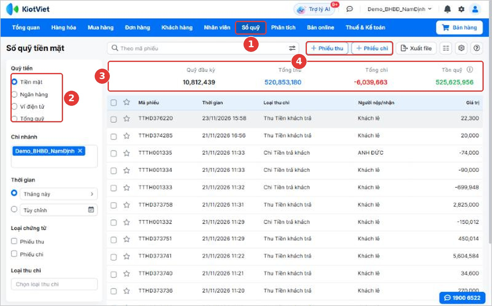
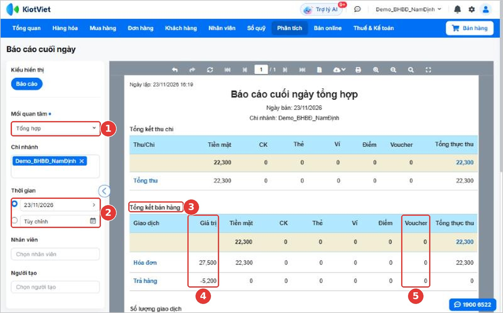
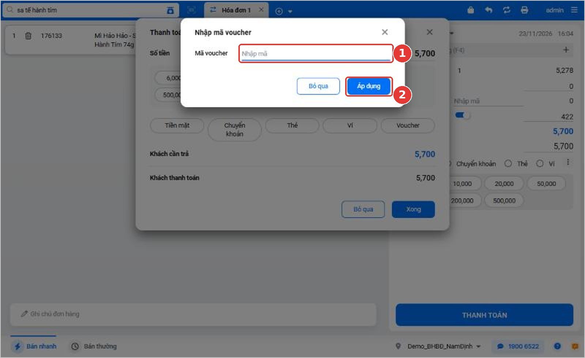
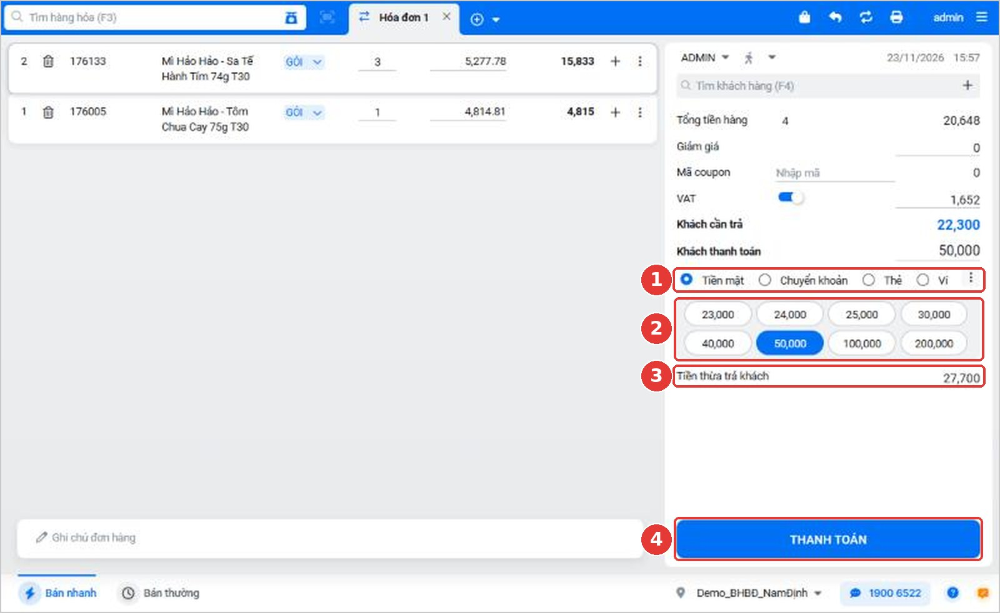

# Xử lý khi chọn sai phương thức thanh toán (voucher, tiền mặt, chuyển khoản)

TÀI LIỆU 14 · HƯỚNG DẪN NGHIỆP VỤ KIOTVIET

| Thông tin | Nội dung |
|---|---|
| **Mục đích** | Hướng dẫn cách nộp tiền đúng khi thu ngân chọn sai hoặc thiếu phương thức thanh toán, và cách phòng tránh lỗi này. |
| **Người thực hiện** | Thu ngân, cửa hàng trưởng |
| **Thời điểm** | Khi thanh toán tại quầy và khi chốt tiền nộp cuối ngày |

!!! tip "Cách đọc"
    Số trong **vòng tròn đỏ** trên ảnh tương ứng với mục 1 2 3… trong phần chữ của bước đó; **khung đỏ** khoanh vùng cần bấm hoặc cần kiểm tra.

## PHẦN A. CÁC LỖI THƯỜNG GẶP

## Các trường hợp chọn sai hoặc thiếu phương thức thanh toán

| Lỗi tại quầy | Thực tế | Sổ quỹ trên KiotViet bị lệch |
|---|---|---|
| Thanh toán **voucher không đủ tiền** nhưng **không chọn thêm** Tiền mặt / Chuyển khoản cho phần còn lại | Khách đã trả phần còn lại bằng tiền mặt hoặc chuyển khoản | Phần tiền còn lại **không được ghi vào quỹ** Tiền mặt / Ngân hàng |
| Khách **chuyển khoản** nhưng thu ngân chọn **Tiền mặt** | Tiền đã vào tài khoản ngân hàng | Quỹ **Tiền mặt dư**, quỹ **Ngân hàng thiếu** đúng số tiền đó |
| Khách trả **tiền mặt** nhưng thu ngân chọn **Chuyển khoản** | Tiền mặt nằm trong két | Quỹ **Ngân hàng dư**, quỹ **Tiền mặt thiếu**: két thừa tiền so với sổ quỹ |

Các lỗi này làm **Sổ quỹ** và các dòng **Tiền mặt / Chuyển khoản** trên báo cáo không khớp với tiền thực tế. Hóa đơn đã thanh toán **không điều chỉnh lại được phương thức thanh toán** trên hệ thống.

## Đối chiếu Sổ quỹ để phát hiện lệch

1 Vào menu **Sổ quỹ**.  
2 Chọn quỹ **Tiền mặt** hoặc **Ngân hàng**.  
3 So **tồn quỹ tiền mặt** với tiền thực tế trong két, và số **ngân hàng** với tiền thực nhận trong tài khoản.  
4 Không tự lập **Phiếu thu / Phiếu chi** để bù chênh lệch.  

Nếu lệch, tìm hóa đơn gây lệch (Đơn hàng → Hóa đơn, xem cột phương thức thanh toán) và **ghi lại mã hóa đơn, số tiền, phương thức đúng** để báo cửa hàng trưởng và Đơn vị đối soát.

<figure markdown="span">
  { loading=lazy }
  <figcaption>Hình 1. Sổ quỹ: đối chiếu tiền mặt và ngân hàng</figcaption>
</figure>

## PHẦN B. CÁCH XỬ LÝ: NỘP TIỀN THEO BÁO CÁO CUỐI NGÀY

## Nộp tiền theo Báo cáo cuối ngày – Tổng hợp

!!! important "KHÔNG SỬA TRÊN HỆ THỐNG → NỘP TIỀN ĐÚNG THEO BÁO CÁO CUỐI NGÀY"
    Số tiền phải nộp **không phụ thuộc** vào việc chọn tiền mặt hay chuyển khoản, nên vẫn đúng dù thu ngân chọn sai phương thức.

    **Số tiền nộp về tỉnh = cột Giá trị (dòng Hóa đơn) − cột Voucher (dòng Hóa đơn)** trên Báo cáo cuối ngày, Mối quan tâm **Tổng hợp** (tài liệu 08, Bước 4).

    **Không** lấy số Tiền mặt / Chuyển khoản trên báo cáo hay trong Sổ quỹ để tính tiền nộp.

## Các bước lấy số tiền phải nộp

1 Vào **Phân tích → Cuối ngày**, **Mối quan tâm** chọn **Tổng hợp**.  
2 **Thời gian**: chọn ngày cần nộp (nhiều ngày thì chọn **Tùy chỉnh**).  
3 Xem phần **Tổng kết bán hàng**.  
4 Lấy số ở cột **Giá trị**, dòng **Hóa đơn**.  
5 Trừ đi số ở cột **Voucher**, dòng **Hóa đơn**. Kết quả là số tiền phải nộp (gồm cả tiền mặt trong két và tiền khách đã chuyển khoản).  

<figure markdown="span">
  { loading=lazy }
  <figcaption>Hình 2. Báo cáo cuối ngày – Tổng hợp: lấy Giá trị trừ Voucher</figcaption>
</figure>

### Ví dụ minh họa

| Hóa đơn 150.000 đ, khách dùng voucher 100.000 đ, chuyển khoản 50.000 đ | Thu ngân làm đúng | Thu ngân quên chọn Chuyển khoản |
|---|---|---|
| Sổ quỹ Ngân hàng ghi nhận | 50.000 | 0 |
| Báo cáo cuối ngày: Giá trị (dòng Hóa đơn) | 150.000 | 150.000 |
| Báo cáo cuối ngày: Voucher (dòng Hóa đơn) | 100.000 | 100.000 |
| **Số tiền phải nộp = Giá trị − Voucher** | **50.000** | **50.000** |

Dù sổ quỹ ghi sai, **số tiền phải nộp vẫn đúng 50.000 đ**. Cửa hàng nộp đủ số này, ghi chú mã hóa đơn bị chọn sai phương thức khi gửi báo cáo nộp tiền.

## PHẦN C. PHÒNG TRÁNH TẠI QUẦY

## Thanh toán voucher không đủ tiền

1 Nhập hoặc quét **mã voucher**.  
2 Bấm **Áp dụng**.  

Nếu voucher **nhỏ hơn** số khách cần trả: **chọn thêm Tiền mặt hoặc Chuyển khoản** cho phần còn thiếu, đúng hình thức khách trả, cho đến khi **Khách thanh toán = Khách cần trả**. Chỉ khi đó mới bấm **Xong** → **THANH TOÁN** (tài liệu 01).

<figure markdown="span">
  { loading=lazy }
  <figcaption>Hình 3. Áp dụng voucher, chọn thêm phương thức cho phần còn lại</figcaption>
</figure>

## Kiểm tra trước khi bấm Thanh toán

1 **Hình thức thanh toán** đúng với cách khách trả: tiền mặt chọn **Tiền mặt**; khách quét QR / chuyển khoản chọn **Chuyển khoản**, và chỉ chọn khi **đã thấy tiền vào tài khoản**.  
2 **Khách thanh toán** bằng **Khách cần trả** (chuyển khoản / voucher không có tiền thừa).  
3 **Tiền thừa trả khách** đúng với số tiền thực trả lại khách.  
4 Kiểm tra xong mới bấm **THANH TOÁN**.  

<figure markdown="span">
  { loading=lazy }
  <figcaption>Hình 4. Kiểm tra hình thức và số tiền trước khi thanh toán</figcaption>
</figure>

## Lưu ý và lỗi thường gặp

| Tình huống | Cách xử lý |
|---|---|
| Đã bấm Thanh toán xong mới phát hiện chọn sai | Không hủy hóa đơn để làm lại, không lập phiếu thu / chi bù. Ghi lại mã hóa đơn, số tiền, phương thức đúng; cuối ngày nộp tiền theo Báo cáo cuối ngày (Giá trị − Voucher). |
| Tiền mặt trong két nhiều hơn Sổ quỹ | Thường do khách trả tiền mặt nhưng chọn Chuyển khoản. Nộp đủ theo Báo cáo cuối ngày, không giữ lại phần chênh lệch. |
| Tiền mặt trong két ít hơn Sổ quỹ | Thường do khách chuyển khoản nhưng chọn Tiền mặt. Kiểm tra sao kê tài khoản để chứng minh tiền đã vào ngân hàng. |
| Nhiều ca, nhiều thu ngân trong ngày | Mỗi thu ngân tự đối chiếu tiền cuối ca; cửa hàng trưởng tổng hợp các hóa đơn bị chọn sai trước khi nộp tiền. |
