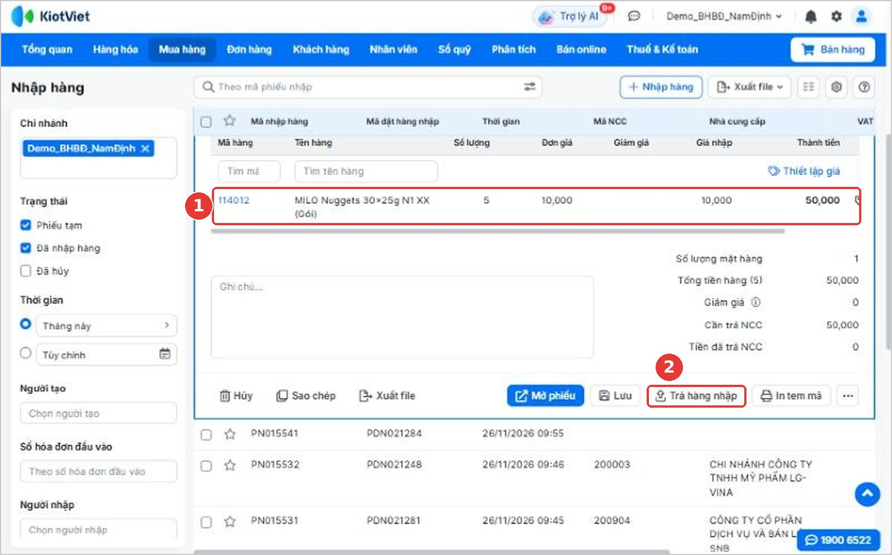
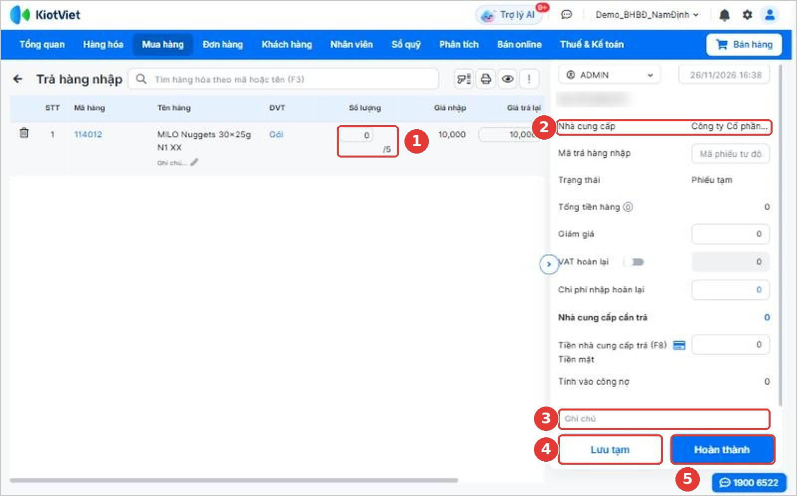

# Trả hàng nhà cung cấp (trả hàng nhập)

TÀI LIỆU 15 · HƯỚNG DẪN NGHIỆP VỤ KIOTVIET

| Thông tin | Nội dung |
|---|---|
| **Mục đích** | Trả lại NCC hàng lỗi, hỏng, cận date hoặc giao thừa **đã nhập kho**, ghi đúng trên phiếu nhập gốc để công nợ và thanh toán NCC khớp. |
| **Người thực hiện** | Cửa hàng trưởng (nhân viên chỉ chuẩn bị hàng và chứng từ) |
| **Thời điểm** | Khi NCC đến nhận lại hàng và đã có xác nhận trả hàng |

!!! tip "Cách đọc"
    Số trong **vòng tròn đỏ** trên ảnh tương ứng với mục 1 2 3… trong phần chữ của bước đó; **khung đỏ** khoanh vùng cần bấm hoặc cần kiểm tra.

## Quy định bắt buộc

!!! important "CHỈ TRẢ HÀNG TỪ PHIẾU NHẬP GỐC – CÓ XÁC NHẬN CỦA TTĐH / NCC"
    Phiếu trả hàng nhập phải tạo bằng nút **Trả hàng nhập** trên **phiếu nhập (PN) gốc** của lô hàng đó. **Không** dùng nút **+ Trả hàng nhập** để tự tạo phiếu không gắn phiếu nhập.

    Chỉ trả khi **NCC đã đồng ý nhận lại** và TTĐH đã được báo; số lượng trả **không vượt** số lượng đã nhập trên phiếu.

    Hàng **chưa nhập kho** (phát hiện lỗi ngay lúc giao): **không nhập phần đó** (tài liệu 04), không cần làm phiếu trả.

## Bước 1. Mở phiếu nhập gốc

Vào **Mua hàng → Nhập hàng**, tìm phiếu PN của lô hàng cần trả (theo mã PN, mã PDN hoặc NCC) và bấm vào dòng phiếu:

1 Kiểm tra mặt hàng cần trả có trong phiếu và số lượng đã nhập.  
2 Bấm **Trả hàng nhập**.  

<figure markdown="span">
  { loading=lazy }
  <figcaption>Hình 1. Phiếu nhập gốc – nút Trả hàng nhập</figcaption>
</figure>

## Bước 2. Nhập số lượng trả và hoàn thành

Hệ thống mở phiếu trả, điền sẵn NCC và các mặt hàng của phiếu nhập gốc:

1 Nhập **số lượng trả** cho từng mặt hàng (con số "/5" là số đã nhập). Mặt hàng không trả để **0**.  
2 Kiểm tra **Nhà cung cấp** đúng với NCC nhận lại hàng.  
3 **Ghi chú** lý do trả: hàng lỗi, hỏng, cận date, giao thừa… kèm số biên bản (nếu có).  
4 **Lưu tạm** nếu còn chờ NCC xác nhận (chưa trừ kho).  
5 Bấm **Hoàn thành** khi NCC đã nhận hàng. Tồn kho cửa hàng bị trừ đúng số trả.  

**Giá trả lại** giữ đúng giá nhập hệ thống điền sẵn, không tự sửa. Không nhập **Tiền NCC trả** nếu NCC không trả tiền mặt trực tiếp tại cửa hàng.

<figure markdown="span">
  { loading=lazy }
  <figcaption>Hình 2. Phiếu trả hàng nhập tạo từ phiếu nhập (công nợ NCC đã làm mờ)</figcaption>
</figure>

## Bước 3. Kiểm tra phiếu trả

Vào **Mua hàng → Trả hàng nhập**: phiếu mới (mã **THN…**) nằm đầu danh sách, trạng thái **Đã trả hàng**. Đối chiếu mặt hàng, số lượng với biên bản giao trả cho NCC và lưu chứng từ.

## Lưu ý và lỗi thường gặp

| Tình huống | Cách xử lý |
|---|---|
| Không tìm thấy phiếu nhập gốc | Không tự tạo phiếu trả. Báo TTĐH và Bộ phận Hệ thống BU BHBĐ kèm tên hàng, số lượng, NCC. |
| Lỡ bấm Hoàn thành sai số lượng | Không tạo thêm phiếu để bù. Báo Bộ phận Hệ thống kèm mã phiếu THN. |
| Hàng cận date / hết hạn NCC không nhận lại | Không làm phiếu trả; xử lý theo tài liệu 07 (Xuất hủy) khi được duyệt. |
| NCC đổi hàng mới (1 đổi 1) | Làm phiếu trả cho hàng cũ; hàng mới nhập theo đơn của TCT (tài liệu 04). |
