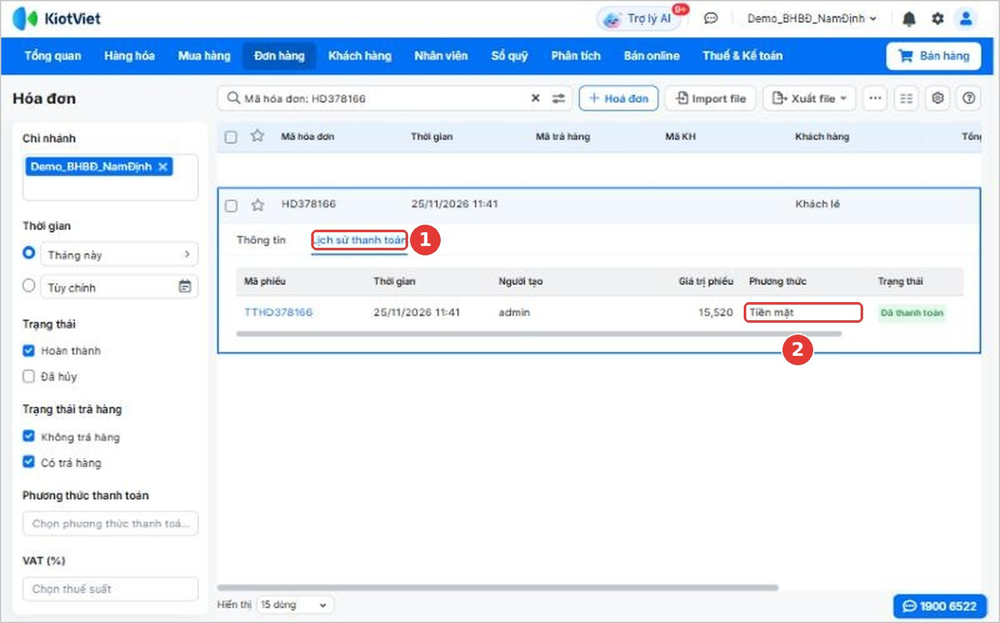
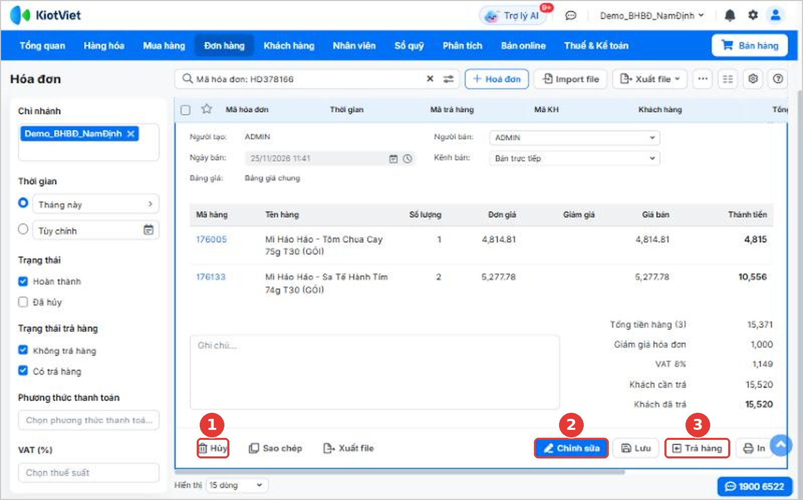
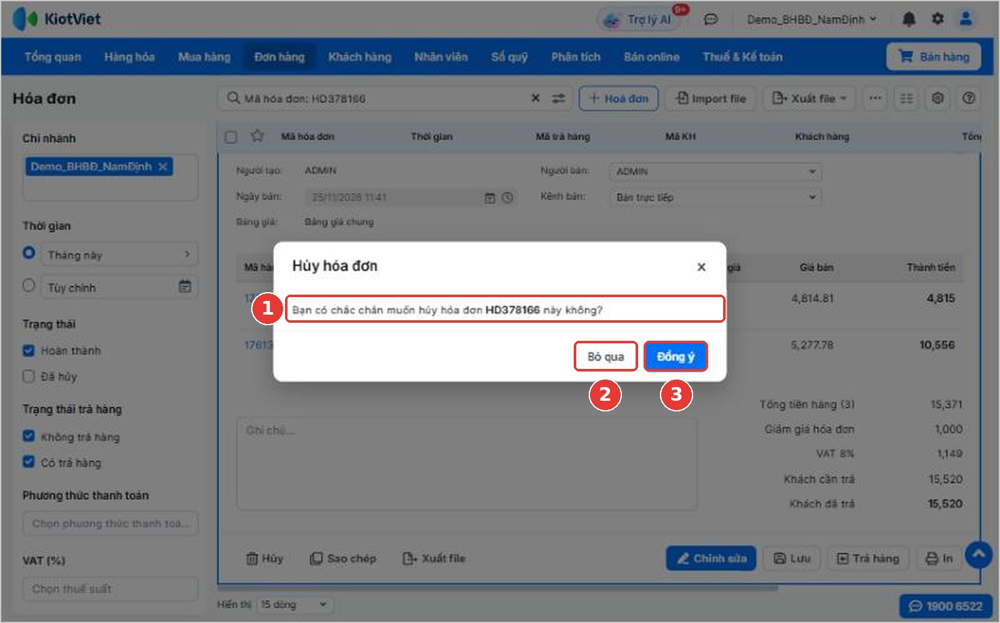

# Xử lý hóa đơn bán sai (hủy, chỉnh sửa, trả hàng)

TÀI LIỆU 16 · HƯỚNG DẪN NGHIỆP VỤ KIOTVIET

| Thông tin | Nội dung |
|---|---|
| **Mục đích** | Thống nhất cách xử lý khi hóa đơn đã thanh toán bị sai hàng, sai số lượng, bán trùng hoặc bán nhầm, để không làm lệch doanh thu, tồn kho và tiền nộp. |
| **Người thực hiện** | Thu ngân phát hiện và báo; cửa hàng trưởng xử lý |
| **Thời điểm** | Ngay khi phát hiện, **trong ngày bán**, trước khi chốt tiền nộp |

!!! tip "Cách đọc"
    Số trong **vòng tròn đỏ** trên ảnh tương ứng với mục 1 2 3… trong phần chữ của bước đó; **khung đỏ** khoanh vùng cần bấm hoặc cần kiểm tra.

## Quy định bắt buộc

!!! important "THU NGÂN KHÔNG TỰ HỦY HOẶC CHỈNH SỬA HÓA ĐƠN"
    Hóa đơn đã thanh toán chỉ được xử lý bởi **cửa hàng trưởng**, **trong ngày bán**. Hóa đơn của ngày trước: báo Bộ phận Hệ thống BU BHBĐ, không tự xử lý.

    Không dùng **Chỉnh sửa** để đổi hàng, đổi giá hay đổi phương thức thanh toán; phương thức thanh toán sai xử lý theo **tài liệu 14**.

    Mọi hóa đơn hủy phải ghi rõ **lý do** và báo lại khi nộp tiền cuối ngày.

## Chọn cách xử lý

| Tình huống | Cách xử lý | Ghi chú |
|---|---|---|
| Khách mang trả một phần hàng / đổi hàng | **Trả hàng** trên hóa đơn (tài liệu 02) | Không hủy cả hóa đơn |
| Quét thừa, sai số lượng, khách chưa rời quầy | **Trả hàng** phần thừa (tài liệu 02), hoặc **hủy** rồi bán lại đúng | Cửa hàng trưởng quyết định |
| Bán **trùng** một hóa đơn (bấm Thanh toán 2 lần) | **Hủy** hóa đơn bị trùng | Kiểm tra kỹ hóa đơn nào là bản thật |
| Khách không lấy hàng sau khi đã thanh toán | **Hủy** hóa đơn và hoàn tiền cho khách | Hoàn đúng hình thức khách đã trả |
| Chọn sai **phương thức thanh toán** | **Không hủy**; nộp tiền theo Báo cáo cuối ngày | Tài liệu 14 |

## Bước 1. Mở hóa đơn và xem lịch sử thanh toán

Vào **Đơn hàng → Hóa đơn**, tìm theo mã hóa đơn và bấm vào dòng hóa đơn:

1 Bấm tab **Lịch sử thanh toán**.  
2 Xem khách đã trả bằng **phương thức** nào (Tiền mặt, Chuyển khoản, Voucher…) để hoàn tiền đúng hình thức nếu hủy.  

<figure markdown="span">
  { loading=lazy }
  <figcaption>Hình 1. Lịch sử thanh toán của hóa đơn</figcaption>
</figure>

## Bước 2. Chọn thao tác trên hóa đơn

1 **Hủy**: hủy toàn bộ hóa đơn (chỉ cửa hàng trưởng).  
2 **Chỉnh sửa**: **không sử dụng** tại cửa hàng.  
3 **Trả hàng**: trả một phần hoặc toàn bộ hàng (tài liệu 02). Ưu tiên cách này khi khách mang hàng trả lại.  

<figure markdown="span">
  { loading=lazy }
  <figcaption>Hình 2. Các nút thao tác trên hóa đơn đã thanh toán</figcaption>
</figure>

## Bước 3. Xác nhận hủy hóa đơn

1 Đọc kỹ **mã hóa đơn** trong câu hỏi xác nhận, đúng hóa đơn cần hủy.  
2 Sai hóa đơn hoặc còn phân vân: bấm **Bỏ qua**.  
3 Bấm **Đồng ý** để hủy. **Thao tác này không hoàn tác được.**  

Sau khi hủy: hóa đơn chuyển sang trạng thái **Đã hủy**, hàng được **cộng lại tồn kho**, doanh thu và phiếu thu của hóa đơn bị loại khỏi báo cáo, nên **số tiền phải nộp trên Báo cáo cuối ngày tự giảm** tương ứng. Hoàn tiền cho khách đúng số và đúng hình thức đã trả, ghi lại mã hóa đơn và lý do hủy.

<figure markdown="span">
  { loading=lazy }
  <figcaption>Hình 3. Hộp thoại xác nhận hủy hóa đơn</figcaption>
</figure>

## Lưu ý và lỗi thường gặp

| Tình huống | Cách xử lý |
|---|---|
| Muốn xem lại các hóa đơn đã hủy | Đơn hàng → Hóa đơn, bộ lọc Trạng thái tick Đã hủy. |
| Hóa đơn có dùng voucher | Hủy hóa đơn không trả lại voucher cho khách; báo Bộ phận Hệ thống trước khi hủy. |
| Hóa đơn đã xuất hóa đơn điện tử | Không tự hủy; báo kế toán / Bộ phận Hệ thống để xử lý hóa đơn điện tử trước. |
| Hóa đơn của ngày trước | Không tự hủy; báo Bộ phận Hệ thống BU BHBĐ kèm mã hóa đơn và lý do. |
