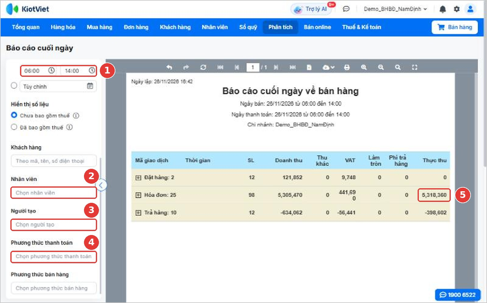
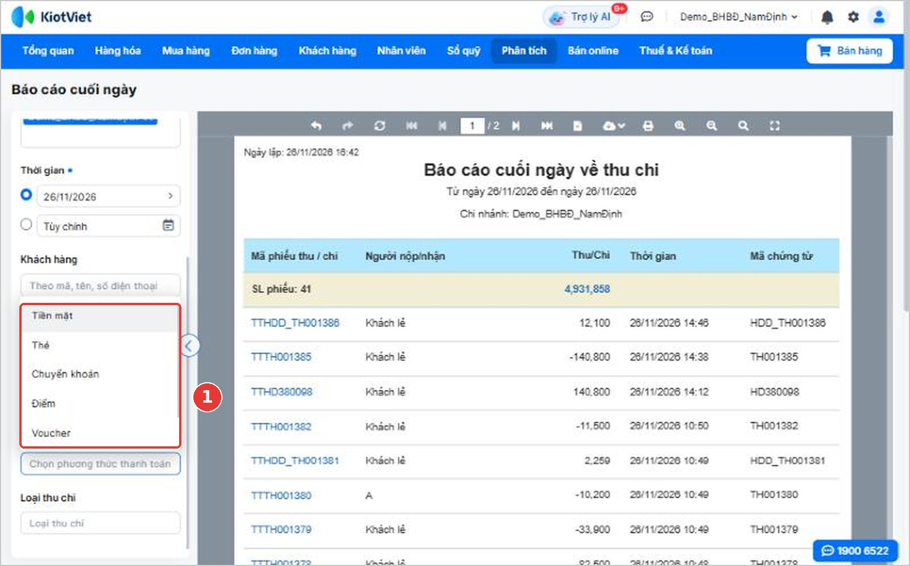
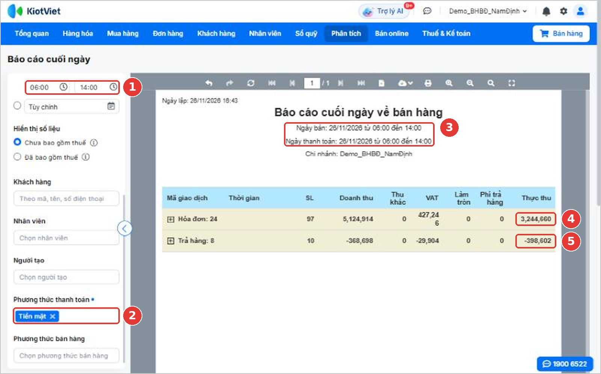
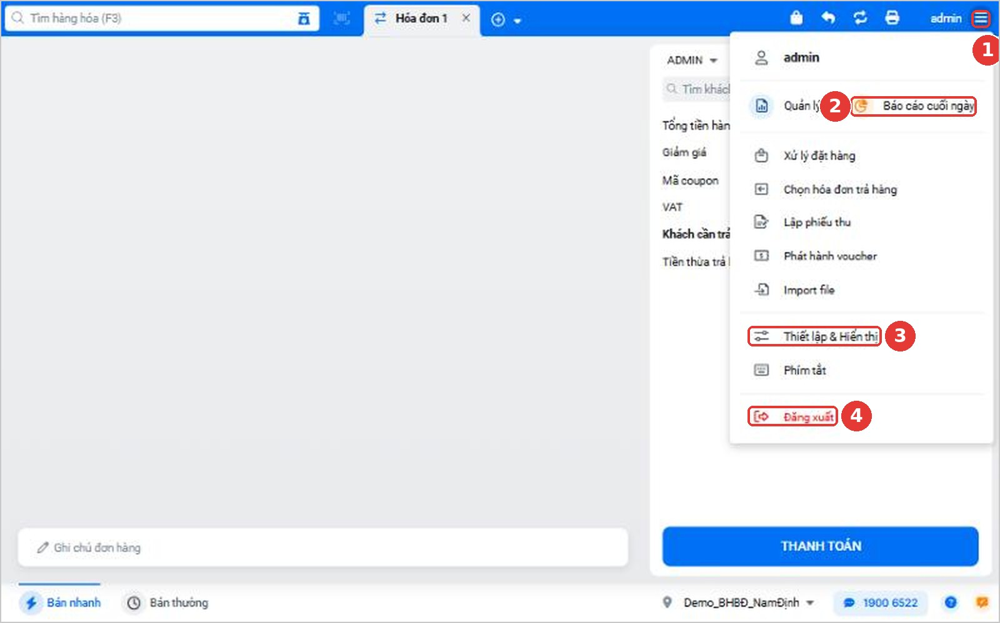

# Giao ca – chốt tiền cuối ca thu ngân

TÀI LIỆU 18 · HƯỚNG DẪN NGHIỆP VỤ KIOTVIET

| Thông tin | Nội dung |
|---|---|
| **Mục đích** | Mỗi ca tự đối chiếu tiền mặt, chuyển khoản, voucher với KiotViet trước khi bàn giao, để phát hiện sai sót ngay trong ca. |
| **Người thực hiện** | Thu ngân ca giao và ca nhận; cửa hàng trưởng ký xác nhận |
| **Thời điểm** | Cuối mỗi ca bán hàng |

!!! tip "Cách đọc"
    Số trong **vòng tròn đỏ** trên ảnh tương ứng với mục 1 2 3… trong phần chữ của bước đó; **khung đỏ** khoanh vùng cần bấm hoặc cần kiểm tra.

## Bước 1. Mở báo cáo cuối ngày theo giờ của ca

Tại màn hình bán hàng bấm **☰ → Báo cáo cuối ngày**, hoặc tại trang quản lý vào **Phân tích → Cuối ngày**. **Mối quan tâm** chọn **Bán hàng**, chọn đúng ngày rồi:

1 Nhập **Từ** giờ – **Đến** giờ của ca (ví dụ 06:00 – 14:00).  
2 **Nhân viên**: chọn thu ngân của ca (nếu mỗi người dùng một tài khoản).  
3 **Người tạo**: hoặc chọn theo người tạo hóa đơn.  
4 **Phương thức thanh toán**: để trống để xem tổng cả ca.  
5 Cột **Thực thu** dòng **Hóa đơn** là tổng tiền thu của ca (đã trừ voucher).  

<figure markdown="span">
  { loading=lazy }
  <figcaption>Hình 1. Báo cáo cuối ngày lọc theo giờ của ca</figcaption>
</figure>

## Bước 2. Lọc theo từng phương thức thanh toán

1 Bấm ô **Phương thức thanh toán**, chọn lần lượt **Tiền mặt**, **Chuyển khoản**, **Voucher**…  

<figure markdown="span">
  { loading=lazy }
  <figcaption>Hình 2. Chọn phương thức thanh toán</figcaption>
</figure>

## Bước 3. Đối chiếu tiền mặt của ca

1 Giữ đúng giờ của ca.  
2 Phương thức chọn **Tiền mặt**.  
3 Tiêu đề báo cáo hiện đúng khung giờ đã chọn.  
4 **Thực thu** dòng **Hóa đơn**: tiền mặt thu được trong ca.  
5 **Thực thu** dòng **Trả hàng** (số âm): tiền mặt đã trả lại khách.  

**Tiền mặt phải có trong két = Tiền lẻ đầu ca + Thực thu Hóa đơn + Thực thu Trả hàng (số âm)**. Ví dụ trên Demo: 3.244.660 − 398.602 = 2.846.058 đ (chưa gồm tiền lẻ đầu ca). Làm tương tự với **Chuyển khoản** (đối chiếu app/sao kê ngân hàng) và **Voucher** (đếm phiếu voucher giấy đã thu).

<figure markdown="span">
  { loading=lazy }
  <figcaption>Hình 3. Thực thu tiền mặt của ca 06:00 – 14:00</figcaption>
</figure>

## Bước 4. Lập biên bản giao ca

| Khoản mục | Theo KiotViet | Thực tế | Chênh lệch |
|---|---|---|---|
| Tiền lẻ đầu ca | – |   |   |
| Tiền mặt (Thực thu Hóa đơn + Trả hàng) |   |   |   |
| Chuyển khoản |   |   |   |
| Voucher (số phiếu / giá trị) |   |   |   |
| **Tổng tiền mặt bàn giao** |   |   |   |

Hai thu ngân và cửa hàng trưởng **ký xác nhận**. Có chênh lệch: ghi rõ **mã hóa đơn** nghi sai và xử lý theo **tài liệu 14** (chọn sai phương thức) hoặc **tài liệu 16** (hóa đơn sai). Cuối ngày vẫn **nộp tiền theo Báo cáo cuối ngày – Tổng hợp** (tài liệu 08).

## Bước 5. Đăng xuất khi hết ca

1 Bấm **☰** ở góc phải màn hình bán hàng.  
2 **Báo cáo cuối ngày**: mở nhanh báo cáo ở Bước 1.  
3 **Thiết lập & Hiển thị**: không tự thay đổi (tài liệu 23).  
4 **Đăng xuất** để ca sau đăng nhập bằng tài khoản của mình.  

<figure markdown="span">
  { loading=lazy }
  <figcaption>Hình 4. Menu màn hình bán hàng</figcaption>
</figure>

## Lưu ý và lỗi thường gặp

| Tình huống | Cách xử lý |
|---|---|
| Két thừa tiền so với KiotViet | Thường do khách trả tiền mặt nhưng chọn Chuyển khoản (tài liệu 14). Không giữ lại phần thừa. |
| Két thiếu tiền so với KiotViet | Kiểm tra hóa đơn khách chuyển khoản nhưng chọn Tiền mặt; đối chiếu app ngân hàng trước khi kết luận thiếu tiền. |
| Các ca dùng chung một tài khoản | Không lọc được theo người; lọc theo giờ của ca. Nên mỗi thu ngân dùng tài khoản riêng. |
| Khung giờ báo cáo | Báo cáo tính theo giờ tạo hóa đơn; chọn giờ đúng thời điểm bàn giao thực tế. |
