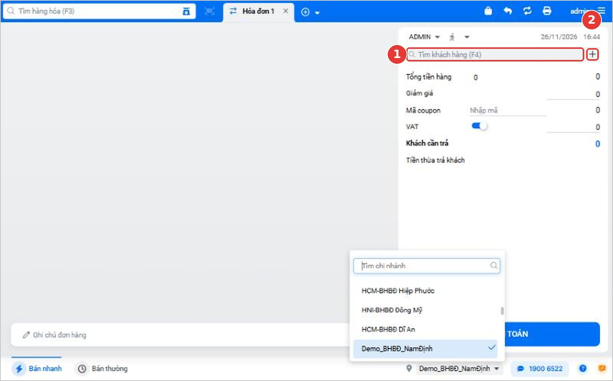
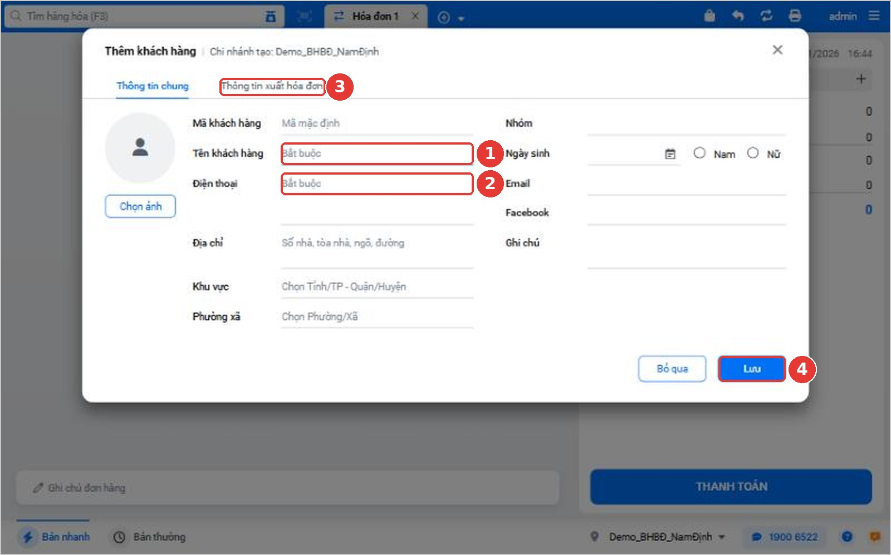
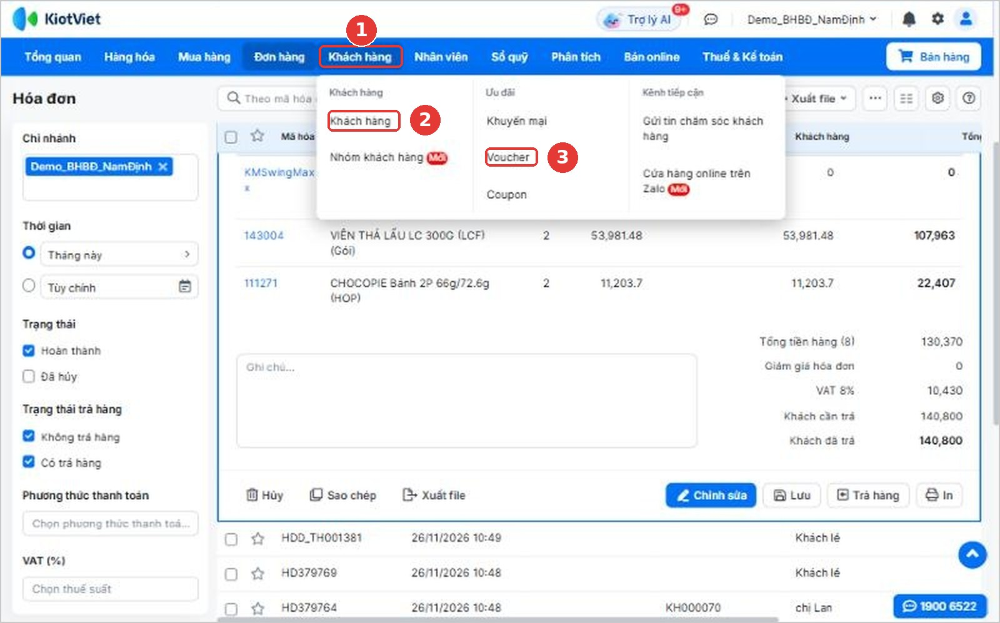

# Khách hàng thành viên và tích điểm

TÀI LIỆU 21 · HƯỚNG DẪN NGHIỆP VỤ KIOTVIET

| Thông tin | Nội dung |
|---|---|
| **Mục đích** | Tạo và gắn khách hàng thành viên vào hóa đơn đúng cách để khách được tích điểm, dùng voucher và để chuỗi có dữ liệu khách hàng chính xác. |
| **Người thực hiện** | Thu ngân |
| **Thời điểm** | Khi bán hàng cho khách có số điện thoại hoặc khách muốn đăng ký thành viên |

!!! tip "Cách đọc"
    Số trong **vòng tròn đỏ** trên ảnh tương ứng với mục 1 2 3… trong phần chữ của bước đó; **khung đỏ** khoanh vùng cần bấm hoặc cần kiểm tra.

## Quy định

!!! important "MỖI KHÁCH MỘT SỐ ĐIỆN THOẠI – TÌM TRƯỚC, CHỈ TẠO KHI CHƯA CÓ"
    Luôn **tìm khách theo số điện thoại** trước. Chỉ tạo mới khi chắc chắn chưa có, để không bị trùng khách.

    Chỉ nhập thông tin khách **đồng ý cung cấp**; không chụp hoặc ghi giấy tờ tùy thân của khách.

    Không gắn hóa đơn của khách lẻ vào số điện thoại của nhân viên hoặc của khách khác để tích điểm.

## Bước 1. Tìm khách hàng trên màn hình bán hàng

1 Bấm ô **Tìm khách hàng (F4)**, gõ **số điện thoại** của khách, chọn đúng khách trong danh sách. Tên khách hiện trên hóa đơn là đã gắn.  
2 Không có kết quả: bấm **+** để tạo khách mới (Bước 2).  

<figure markdown="span">
  { loading=lazy }
  <figcaption>Hình 1. Tìm hoặc thêm khách hàng trên màn hình bán hàng</figcaption>
</figure>

## Bước 2. Tạo khách hàng mới

1 **Tên khách hàng** (bắt buộc): ghi đúng tên khách xưng.  
2 **Điện thoại** (bắt buộc): đọc lại số cho khách xác nhận.  
3 **Thông tin xuất hóa đơn**: chỉ nhập khi khách (doanh nghiệp) cần hóa đơn điện tử: tên đơn vị, mã số thuế, địa chỉ.  
4 Bấm **Lưu**. Khách được gắn ngay vào hóa đơn đang bán.  

**Mã khách hàng** để trống, hệ thống tự sinh. Các ô khác (ngày sinh, địa chỉ…) không bắt buộc.

<figure markdown="span">
  { loading=lazy }
  <figcaption>Hình 2. Thêm khách hàng mới</figcaption>
</figure>

## Bước 3. Tích điểm và dùng điểm

Khi hóa đơn đã gắn khách thành viên, điểm được **tự cộng** theo chương trình tích điểm của chuỗi sau khi thanh toán (chỉ với mặt hàng có áp dụng tích điểm).

- Khách muốn **dùng điểm**: mở **Thanh toán nhiều phương thức** (nút ⋮ như với voucher, tài liệu 01), chọn **Điểm** và nhập số điểm khách dùng; phần còn thiếu chọn Tiền mặt / Chuyển khoản.
- Nút **Điểm** chỉ hiện khi hóa đơn đã gắn khách và khách có đủ điểm theo quy định của chương trình.
- Thông báo cho khách **số điểm còn lại** sau giao dịch nếu khách hỏi.

## Xem danh sách và ưu đãi khách hàng

1 Menu **Khách hàng** trên trang quản lý.  
2 **Khách hàng**: danh sách, tìm theo tên / số điện thoại để kiểm tra thông tin, điểm, lịch sử mua.  
3 **Voucher**: các đợt voucher đang phát hành (xem thông tin, không tự tạo).  

Cửa hàng **không tự sửa, gộp hoặc xóa** khách hàng; khách báo sai thông tin thì ghi lại và báo Bộ phận Hệ thống BU BHBĐ.

<figure markdown="span">
  { loading=lazy }
  <figcaption>Hình 3. Menu Khách hàng</figcaption>
</figure>

## Lưu ý và lỗi thường gặp

| Tình huống | Cách xử lý |
|---|---|
| Khách có 2 mã khách hàng (trùng) | Không tự gộp hoặc xóa. Báo Bộ phận Hệ thống kèm 2 mã khách hàng. |
| Quên gắn khách vào hóa đơn đã thanh toán | Không hủy hóa đơn để bán lại. Ghi mã hóa đơn và số điện thoại khách, báo Bộ phận Hệ thống. |
| Khách đổi số điện thoại | Báo Bộ phận Hệ thống để cập nhật; không tạo khách mới với số mới. |
| Khách cần hóa đơn điện tử | Nhập đủ Thông tin xuất hóa đơn khi tạo khách, kiểm tra mã số thuế trước khi thanh toán. |

**Phím tắt:** F4: tìm khách hàng
