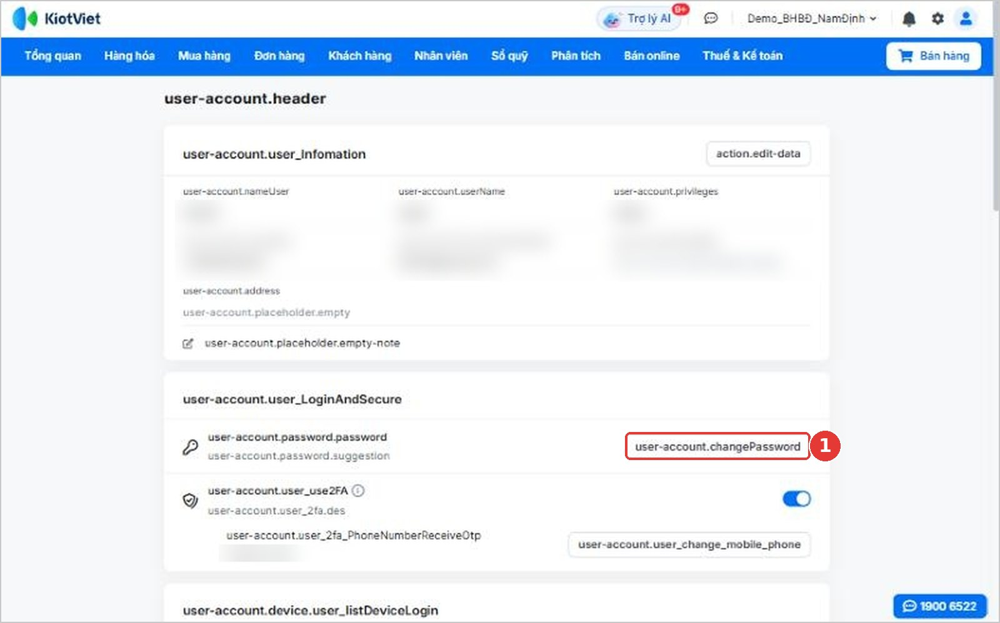
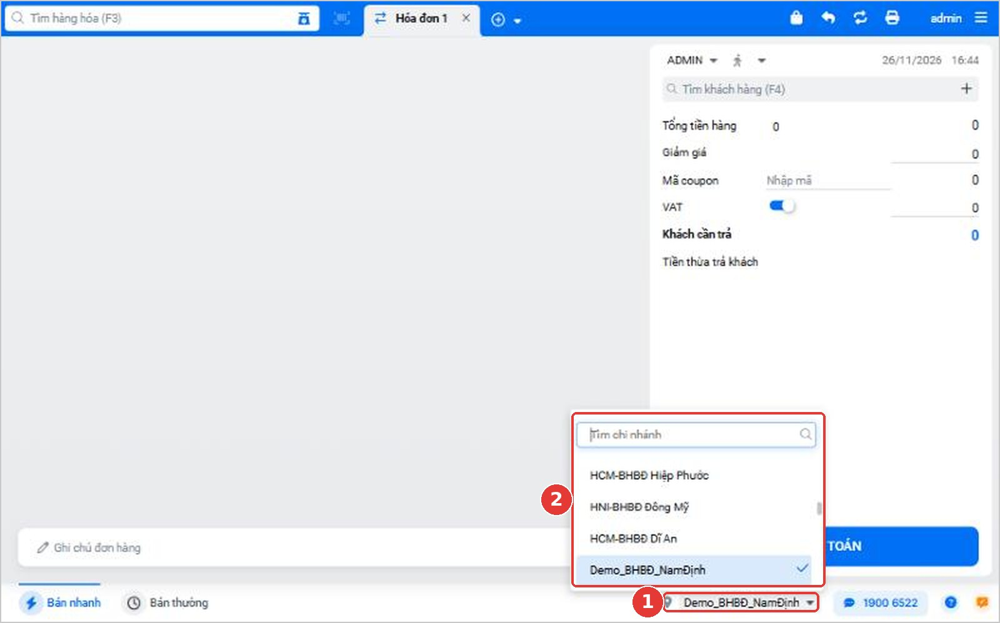
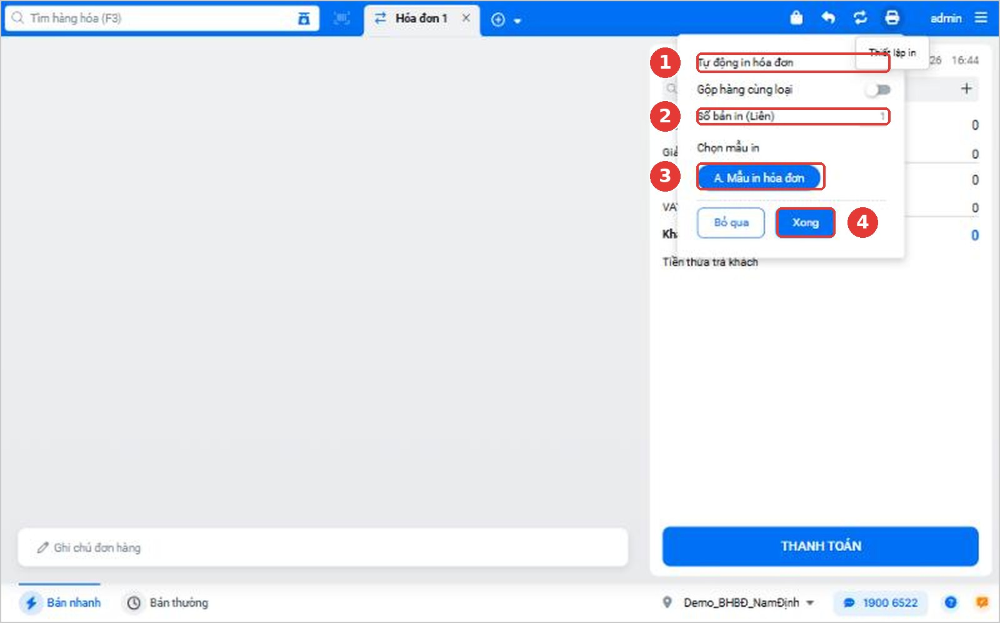
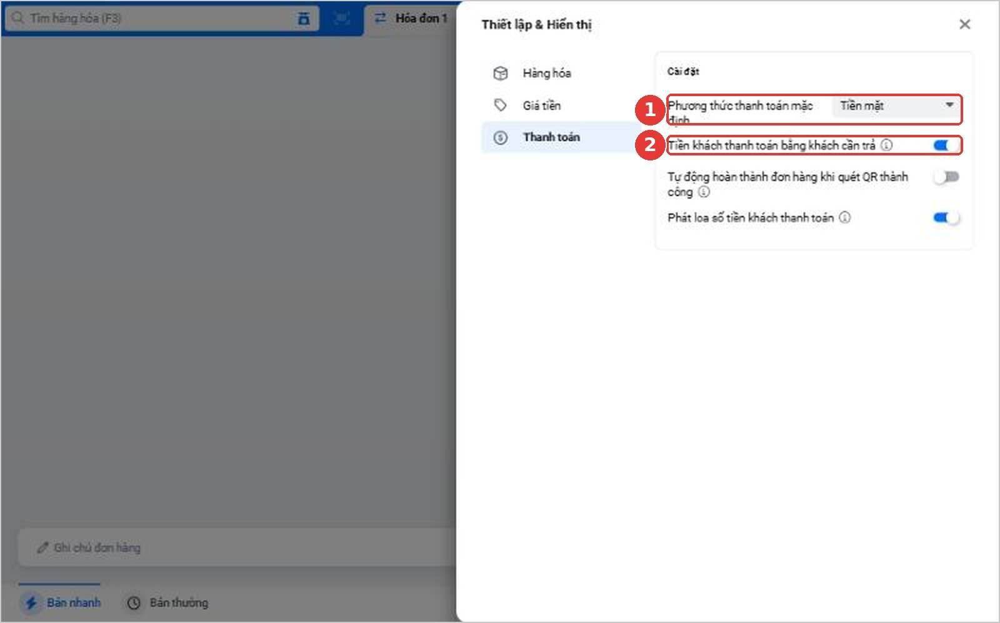

# Bắt đầu với KiotViet cho cửa hàng mới

TÀI LIỆU 23 · HƯỚNG DẪN NGHIỆP VỤ KIOTVIET

| Thông tin | Nội dung |
|---|---|
| **Mục đích** | Chuẩn bị tài khoản, chi nhánh, máy in và máy quét trước ngày bán hàng đầu tiên. |
| **Người thực hiện** | Cửa hàng trưởng và thu ngân của cửa hàng mới |
| **Thời điểm** | Trước khai trương và mỗi khi có nhân viên mới |

!!! tip "Cách đọc"
    Số trong **vòng tròn đỏ** trên ảnh tương ứng với mục 1 2 3… trong phần chữ của bước đó; **khung đỏ** khoanh vùng cần bấm hoặc cần kiểm tra.

## Bước 1. Đăng nhập và bảo mật tài khoản

- Đăng nhập tại **bhbd.kiotviet.vn** bằng tài khoản Bộ phận Hệ thống BU BHBĐ cấp cho **từng người**. **Không dùng chung** tài khoản, không ghi mật khẩu lên máy.
- Lần đầu đăng nhập: **đổi mật khẩu**. Bấm biểu tượng **tài khoản** góc trên bên phải → bấm **tên tài khoản** → mục Đăng nhập & bảo mật:
1 Bấm nút **Đổi mật khẩu** và đặt mật khẩu mới.  

Quên mật khẩu hoặc nhân viên nghỉ việc: báo Bộ phận Hệ thống để cấp lại hoặc khóa tài khoản.

<figure markdown="span">
  { loading=lazy }
  <figcaption>Hình 1. Trang tài khoản – nút Đổi mật khẩu (thông tin cá nhân đã làm mờ)</figcaption>
</figure>

## Bước 2. Kiểm tra đúng chi nhánh

1 Trên màn hình bán hàng, tên **chi nhánh** ở góc dưới bên phải phải là **cửa hàng của mình**.  
2 Nếu sai, bấm vào để chọn đúng chi nhánh. Tài khoản chỉ được cấp chi nhánh nào thì mới bán cho chi nhánh đó.  

Trên trang quản lý, tên chi nhánh hiện ở **góc trên bên phải** và trong ô **Chi nhánh** của mỗi báo cáo. Bán sai chi nhánh làm lệch tồn kho và doanh thu của cả hai cửa hàng.

<figure markdown="span">
  { loading=lazy }
  <figcaption>Hình 2. Chọn chi nhánh trên màn hình bán hàng</figcaption>
</figure>

## Bước 3. Thiết lập in hóa đơn

Bấm biểu tượng **máy in** trên thanh trên cùng của màn hình bán hàng:

1 **Tự động in hóa đơn**: bật nếu cửa hàng in hóa đơn cho mọi khách.  
2 **Số bản in (Liên)**: để **1**.  
3 **Chọn mẫu in**: dùng mẫu hóa đơn chuẩn của chuỗi đã được cài sẵn.  
4 Bấm **Xong**.  

**Máy in nhiệt**: cài driver máy in trên máy tính, đặt làm **máy in mặc định**, khổ giấy **K80** (hoặc K57 theo máy). In thử một hóa đơn; chữ bị cắt hoặc quá nhỏ thì kiểm tra lại khổ giấy và tỷ lệ in **100%** trong hộp thoại in của trình duyệt.

<figure markdown="span">
  { loading=lazy }
  <figcaption>Hình 3. Thiết lập in hóa đơn</figcaption>
</figure>

## Bước 4. Không tự đổi thiết lập thanh toán

**☰ → Thiết lập & Hiển thị → Thanh toán** là thiết lập dùng chung của chuỗi:

1 **Phương thức thanh toán mặc định: Tiền mặt**. Khách chuyển khoản phải **chọn lại Chuyển khoản** mỗi lần (tài liệu 14).  
2 **Tiền khách thanh toán bằng khách cần trả**: hệ thống tự điền đủ tiền, thu ngân vẫn phải kiểm tra trước khi bấm Thanh toán.  

Cửa hàng **không tự thay đổi** các thiết lập này. Cần thay đổi thì đề xuất Bộ phận Hệ thống BU BHBĐ.

<figure markdown="span">
  { loading=lazy }
  <figcaption>Hình 4. Thiết lập thanh toán (chỉ xem)</figcaption>
</figure>

## Bước 5. Máy quét mã vạch và kiểm tra cuối

- Cắm máy quét vào cổng USB, mở màn hình bán hàng, bấm vào ô **Tìm hàng hóa (F3)** rồi quét thử một sản phẩm: hàng hiện vào giỏ là máy quét hoạt động.
- Quét ra chữ lạ: chuyển bộ gõ tiếng Việt (Unikey/EVKey) sang **tiếng Anh (E)** khi bán hàng.
- Bán thử: **không** bán thử trên chi nhánh thật. Muốn tập, báo Bộ phận Hệ thống để dùng chi nhánh Demo.
- Đọc trước các tài liệu **01** (bán hàng), **04 – 12** (nhập hàng theo đơn), **08** (nộp tiền) và **24** (lịch công việc hằng ngày).

## Lưu ý và lỗi thường gặp

| Tình huống | Cách xử lý |
|---|---|
| Đăng nhập báo sai mật khẩu nhiều lần | Dừng lại, báo Bộ phận Hệ thống để cấp lại; không thử tiếp tránh bị khóa. |
| Không thấy chi nhánh của cửa hàng | Tài khoản chưa được phân quyền chi nhánh; báo Bộ phận Hệ thống. |
| Không in được hóa đơn | Kiểm tra máy in đang bật, có giấy, là máy in mặc định; trình duyệt không chặn cửa sổ in. |
| Thiết bị đăng nhập lạ | Báo ngay Bộ phận Hệ thống và đổi mật khẩu. |

**Phím tắt:** F3: tìm hàng hóa · F4: tìm khách hàng
