# Hủy hóa đơn đã có phiếu trả hàng

TÀI LIỆU 25 · HƯỚNG DẪN NGHIỆP VỤ KIOTVIET

| Thông tin | Nội dung |
|---|---|
| **Mục đích** | Hủy đúng thứ tự một hóa đơn bán đã phát sinh phiếu trả hàng (và hóa đơn đổi hàng), để tồn kho, doanh thu và sổ quỹ không bị lệch. |
| **Người thực hiện** | Cửa hàng trưởng (theo quy định ở tài liệu 16) |
| **Thời điểm** | Trong ngày bán, khi cần hủy hóa đơn mà KiotViet báo "Hóa đơn đã có trả hàng, không thể hủy" |

!!! tip "Cách đọc"
    Số trong **vòng tròn đỏ** trên ảnh tương ứng với mục 1 2 3… trong phần chữ của bước đó; **khung đỏ** khoanh vùng cần bấm hoặc cần kiểm tra.

## Quy định và thứ tự bắt buộc

!!! important "HỦY PHIẾU TRẢ HÀNG (TH) TRƯỚC → RỒI MỚI HỦY HÓA ĐƠN GỐC (HD)"
    KiotViet **không cho hủy** hóa đơn đang có phiếu trả hàng. Phải hủy **phiếu trả hàng TH…** trước; nếu phiếu trả có **hóa đơn đổi hàng HDD_TH…**, hệ thống **tự hủy luôn** hóa đơn đổi hàng.

    Hủy phiếu trả nghĩa là coi như **khách chưa trả hàng**: hàng trả bị **trừ lại khỏi tồn kho**, tiền đã trả lại khách bị hủy khỏi sổ quỹ. Chỉ làm khi đã chắc chắn sẽ hủy cả hóa đơn gốc.

    Chỉ **cửa hàng trưởng** thực hiện, **trong ngày bán**; ghi lại mã HD, TH, HDD và lý do hủy. Hóa đơn của ngày trước: báo Bộ phận Hệ thống BU BHBĐ.

## Bước 1. Nhận biết hóa đơn đã có phiếu trả hàng

Trong **Đơn hàng → Hóa đơn**, hóa đơn có phiếu trả sẽ hiện mã phiếu ở cột **Mã trả hàng**:

1 Cột **Mã trả hàng** có mã **TH…** là hóa đơn này đã có phiếu trả.  

<figure markdown="span">
  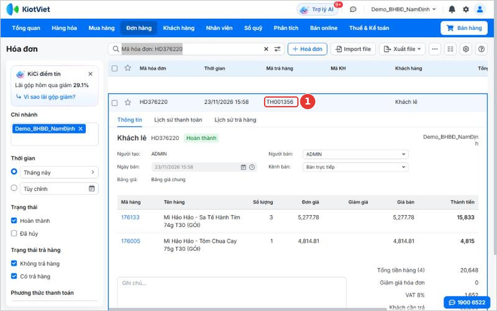{ loading=lazy }
  <figcaption>Hình 1. Hóa đơn có mã phiếu trả hàng</figcaption>
</figure>

### Nếu bấm Hủy ngay trên hóa đơn

1 KiotViet báo **"Hóa đơn đã có trả hàng, không thể hủy"**. Làm tiếp từ Bước 2.  

<figure markdown="span">
  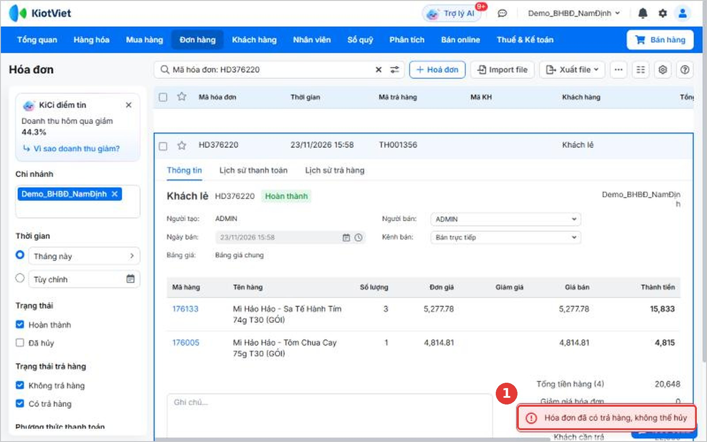{ loading=lazy }
  <figcaption>Hình 2. Thông báo không thể hủy hóa đơn đã có trả hàng</figcaption>
</figure>

## Bước 2. Xem các phiếu trả hàng của hóa đơn

1 Mở hóa đơn, bấm tab **Lịch sử trả hàng**.  
2 Ghi lại **tất cả** mã phiếu trả **TH…** (một hóa đơn có thể có nhiều lần trả). Bấm vào mã để mở phiếu.  

<figure markdown="span">
  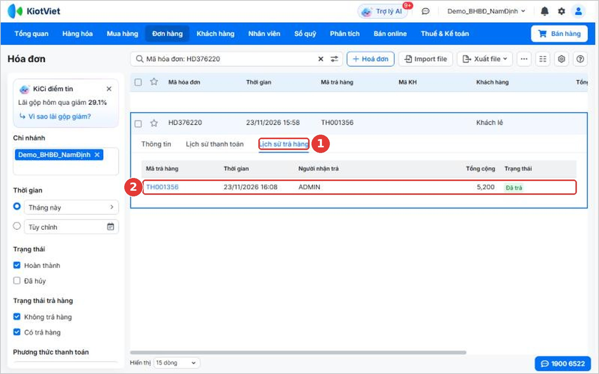{ loading=lazy }
  <figcaption>Hình 3. Lịch sử trả hàng của hóa đơn</figcaption>
</figure>

## Bước 3. Kiểm tra phiếu trả hàng

Phiếu trả mở ở **Đơn hàng → Trả hàng**:

1 **Mã hóa đơn** phải đúng hóa đơn gốc cần hủy.  
2 Tab **Hóa đơn đổi hàng**: có tab này là khách đã **đổi** sang hàng khác (hóa đơn **HDD_TH…**).  

<figure markdown="span">
  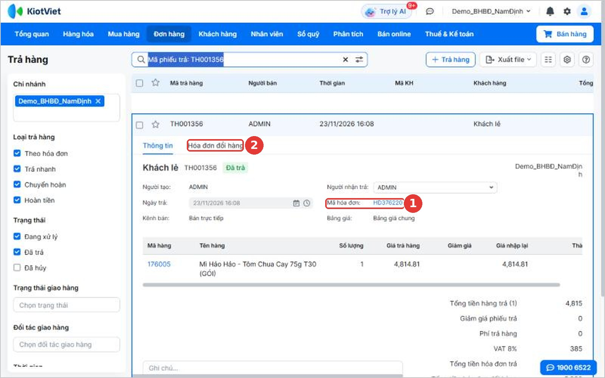{ loading=lazy }
  <figcaption>Hình 4. Phiếu trả hàng liên kết với hóa đơn gốc</figcaption>
</figure>

### Hóa đơn đổi hàng đi kèm phiếu trả

1 Mã **HDD_TH…** và trạng thái của hóa đơn đổi hàng.  
2 **Tổng tiền hóa đơn trả** dẫn về phiếu trả **TH…**. Hóa đơn này sẽ bị hủy cùng phiếu trả.  

<figure markdown="span">
  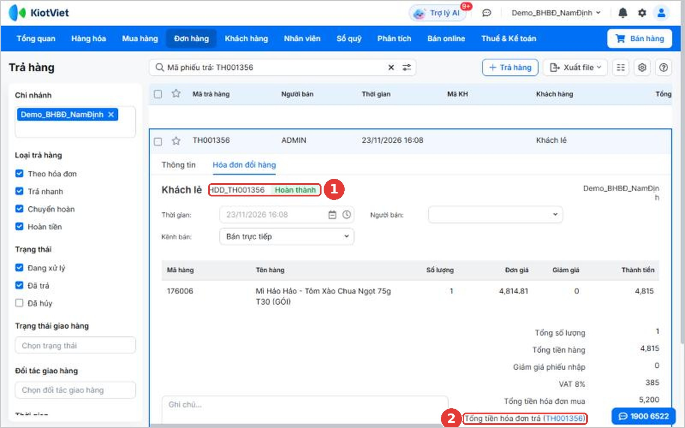{ loading=lazy }
  <figcaption>Hình 5. Hóa đơn đổi hàng HDD_TH…</figcaption>
</figure>

## Bước 4. Hủy phiếu trả hàng

1 Kéo xuống cuối phiếu trả, bấm **Hủy**.  

<figure markdown="span">
  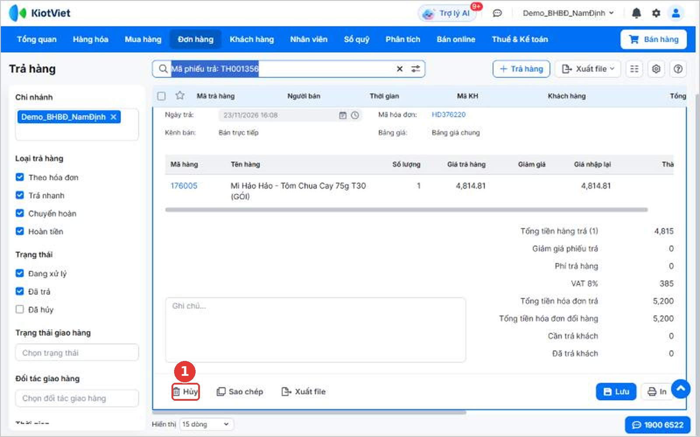{ loading=lazy }
  <figcaption>Hình 6. Nút Hủy trên phiếu trả hàng</figcaption>
</figure>

### Xác nhận hủy phiếu trả (và hóa đơn đổi hàng)

1 Đọc kỹ thông báo: phiếu trả có hóa đơn đổi hàng thì **hệ thống sẽ hủy luôn hóa đơn đổi hàng**.  
2 Bấm **Đồng ý**.  

<figure markdown="span">
  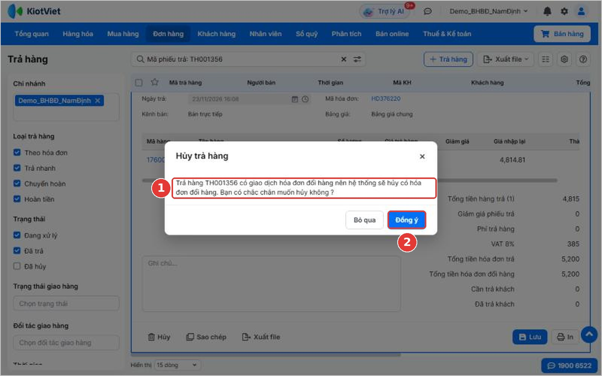{ loading=lazy }
  <figcaption>Hình 7. Hủy phiếu trả có hóa đơn đổi hàng</figcaption>
</figure>

### Hủy các phiếu thanh toán liên quan

1 Hệ thống hỏi **"Bạn có muốn hủy những phiếu thanh toán liên quan?"**: bấm **Đồng ý** để sổ quỹ không còn phiếu tiền của chứng từ đã hủy.  

<figure markdown="span">
  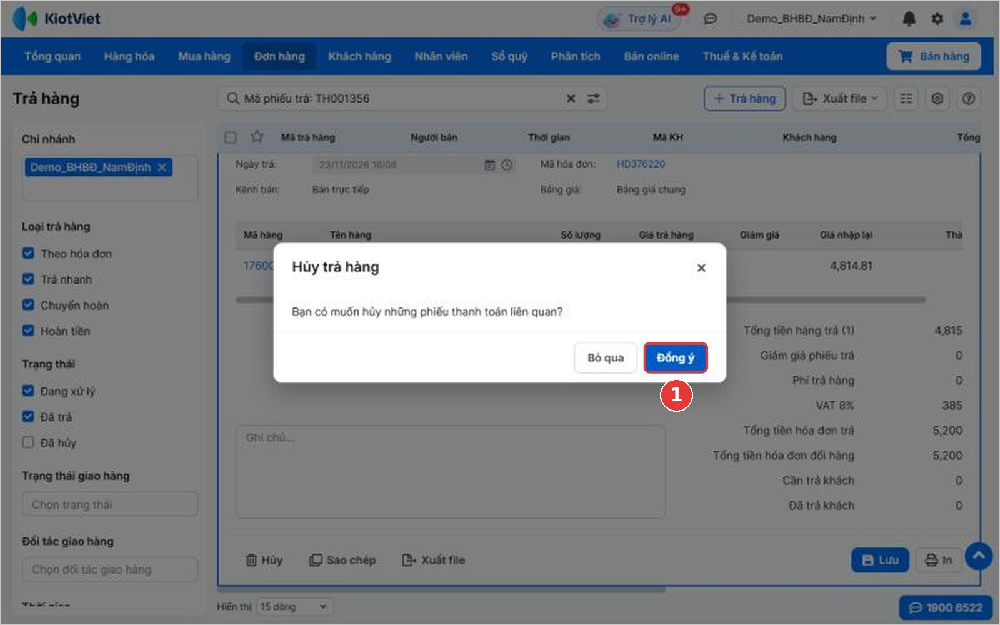{ loading=lazy }
  <figcaption>Hình 8. Hủy phiếu thanh toán của phiếu trả</figcaption>
</figure>

### Kết quả

1 Thông báo **"Hủy trả hàng: TH… thành công"**. Có nhiều phiếu trả thì lặp lại Bước 3 – 4 cho từng phiếu.  

<figure markdown="span">
  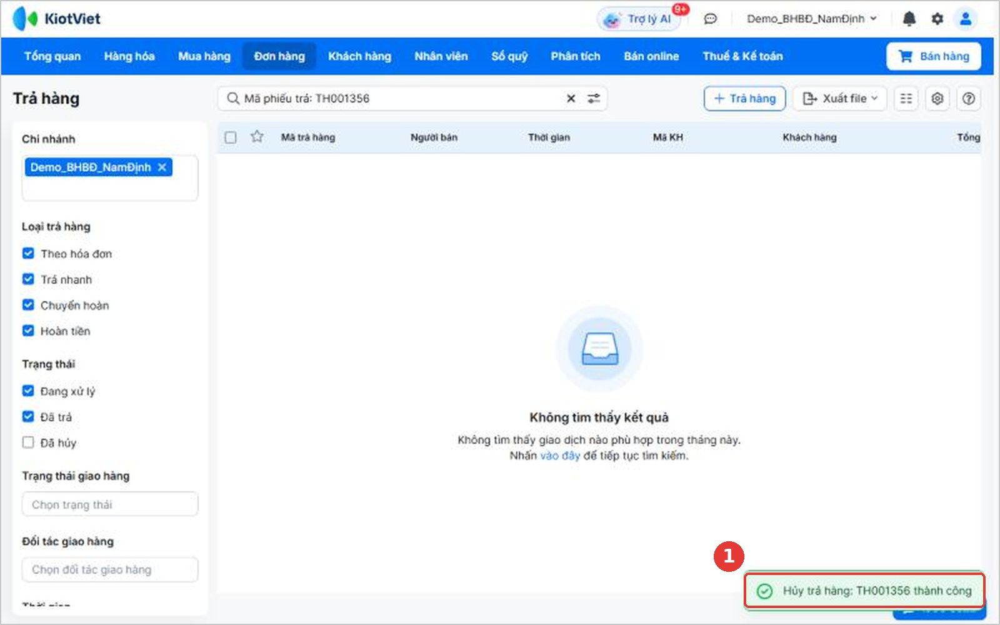{ loading=lazy }
  <figcaption>Hình 9. Hủy phiếu trả thành công</figcaption>
</figure>

## Bước 5. Hủy hóa đơn gốc

Quay lại **Đơn hàng → Hóa đơn**, mở hóa đơn gốc, kéo xuống cuối và bấm **Hủy**:

1 Kiểm tra đúng **mã hóa đơn** trong câu hỏi.  
2 Bấm **Đồng ý**.  

<figure markdown="span">
  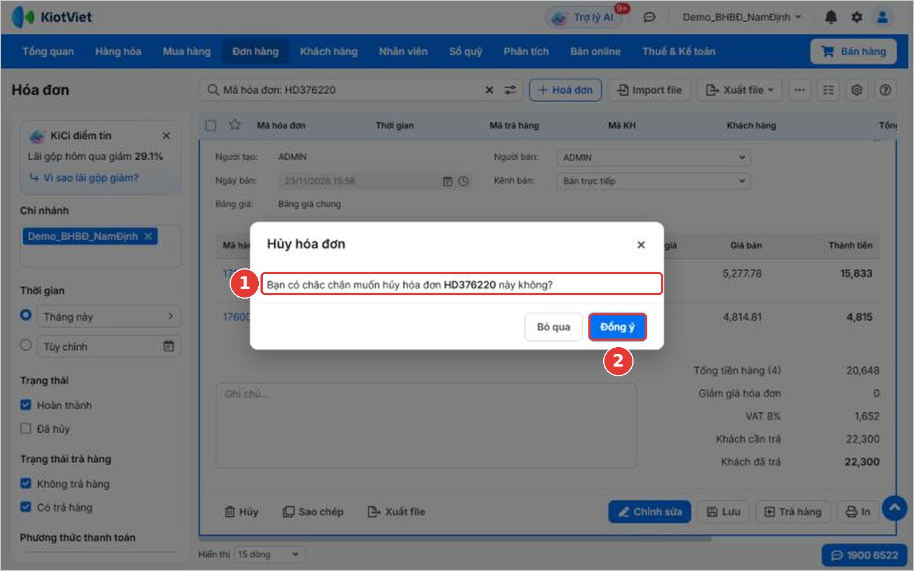{ loading=lazy }
  <figcaption>Hình 10. Xác nhận hủy hóa đơn gốc</figcaption>
</figure>

### Hủy phiếu thanh toán của hóa đơn

1 Hộp thoại **"Hủy thanh toán?"**: bấm **Xác nhận** để hủy luôn phiếu thu tiền của hóa đơn.  

Nếu bấm **Bỏ qua**, phiếu thu vẫn nằm trong **Sổ quỹ** dù hóa đơn đã hủy, làm sổ quỹ lệch với Báo cáo cuối ngày.

<figure markdown="span">
  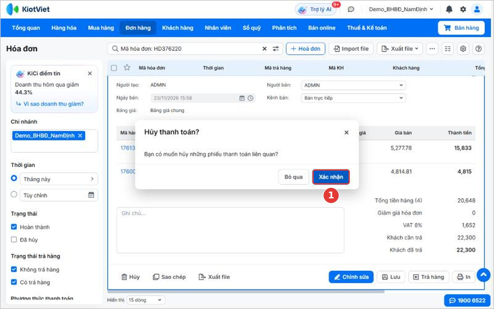{ loading=lazy }
  <figcaption>Hình 11. Hủy phiếu thanh toán liên quan</figcaption>
</figure>

### Kết quả

1 Thông báo **"Hủy hóa đơn: HD… thành công"**.  

<figure markdown="span">
  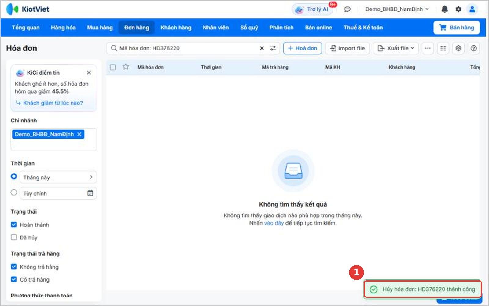{ loading=lazy }
  <figcaption>Hình 12. Hủy hóa đơn gốc thành công</figcaption>
</figure>

## Bước 6. Kiểm tra lại

Trong **Đơn hàng → Hóa đơn**, tick bộ lọc **Trạng thái: Đã hủy**, tìm lại các mã vừa hủy:

1 Hóa đơn gốc **HD…** và hóa đơn đổi hàng **HDD_TH…** đều ở trạng thái **Đã hủy**. Phiếu trả xem ở **Đơn hàng → Trả hàng**, bộ lọc **Đã hủy**.  

<figure markdown="span">
  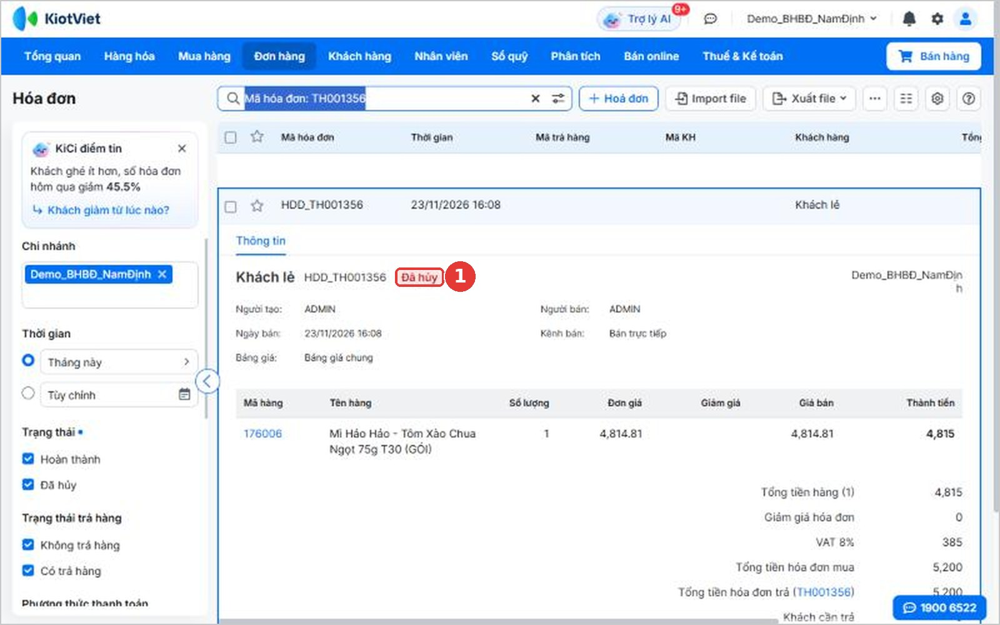{ loading=lazy }
  <figcaption>Hình 13. Hóa đơn đổi hàng đã được hủy tự động</figcaption>
</figure>

## Ảnh hưởng sau khi hủy

| Hạng mục | Thay đổi |
|---|---|
| **Tồn kho** | Hàng khách đã trả bị **trừ lại**; hàng của hóa đơn đổi hàng và hóa đơn gốc được **cộng lại**. Kết quả: tồn kho như chưa từng bán. |
| **Doanh thu** | Hóa đơn gốc, hóa đơn đổi hàng và phiếu trả đều **bị loại khỏi báo cáo**. |
| **Sổ quỹ / tiền nộp** | Các phiếu thanh toán đã hủy không còn trong sổ quỹ; **số tiền phải nộp trên Báo cáo cuối ngày tự điều chỉnh** (tài liệu 08). Thu / hoàn tiền với khách theo đúng thực tế. |
| **Voucher** | Voucher đã dùng trên hóa đơn **không được trả lại** cho khách: báo Bộ phận Hệ thống **trước** khi hủy. |

## Lưu ý và lỗi thường gặp

| Tình huống | Cách xử lý |
|---|---|
| Chỉ muốn sửa lại phiếu trả (trả sai số lượng) | Không cần hủy hóa đơn gốc: chỉ hủy phiếu trả sai (Bước 2 – 4) rồi làm lại phiếu trả đúng (tài liệu 02). |
| Hóa đơn có nhiều phiếu trả | Phải hủy hết tất cả phiếu TH trong tab Lịch sử trả hàng thì mới hủy được hóa đơn gốc. |
| Lỡ bấm Bỏ qua ở bước hủy phiếu thanh toán | Không tự lập phiếu thu / chi bù. Báo Bộ phận Hệ thống kèm mã chứng từ. |
| Hóa đơn đổi hàng đã có phiếu trả tiếp | Hủy phiếu trả mới nhất trước, lần lượt ngược về hóa đơn gốc; vướng thì báo Bộ phận Hệ thống. |
| Hóa đơn đã xuất hóa đơn điện tử | Không tự hủy; báo kế toán / Bộ phận Hệ thống xử lý hóa đơn điện tử trước. |
