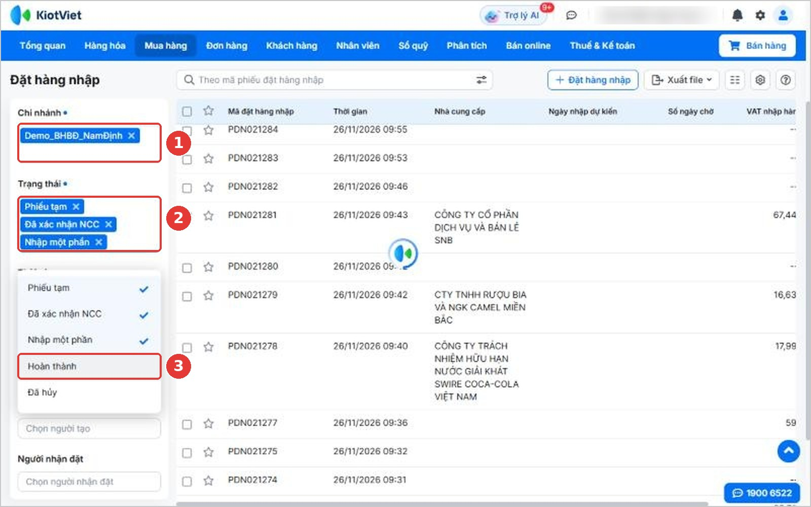
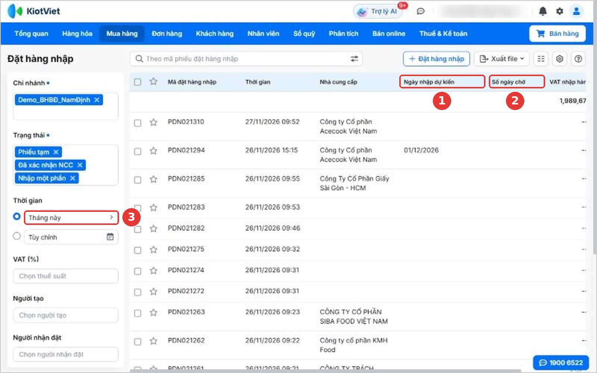
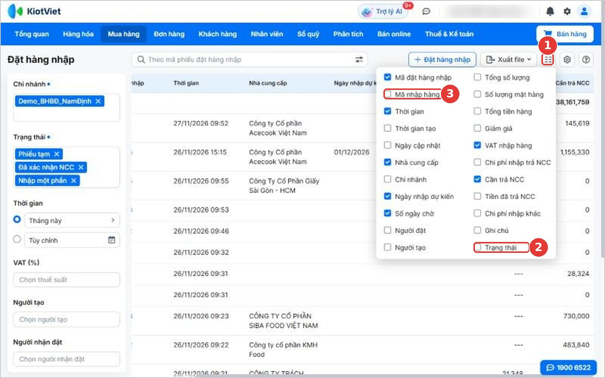
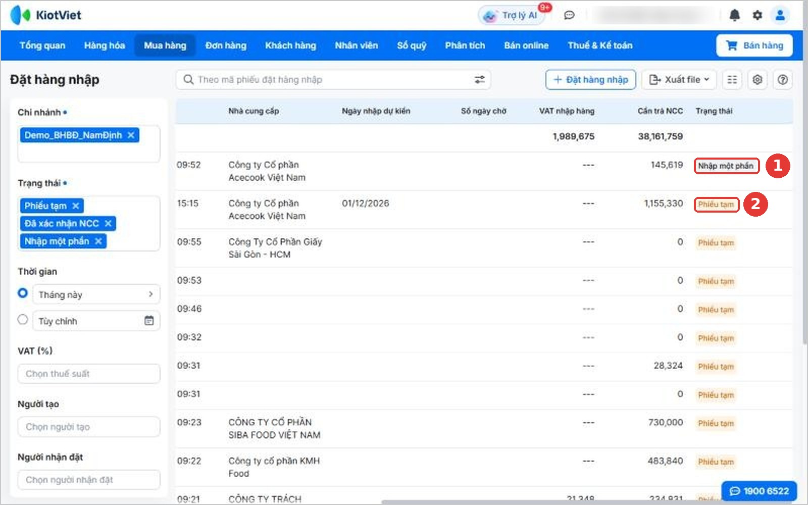
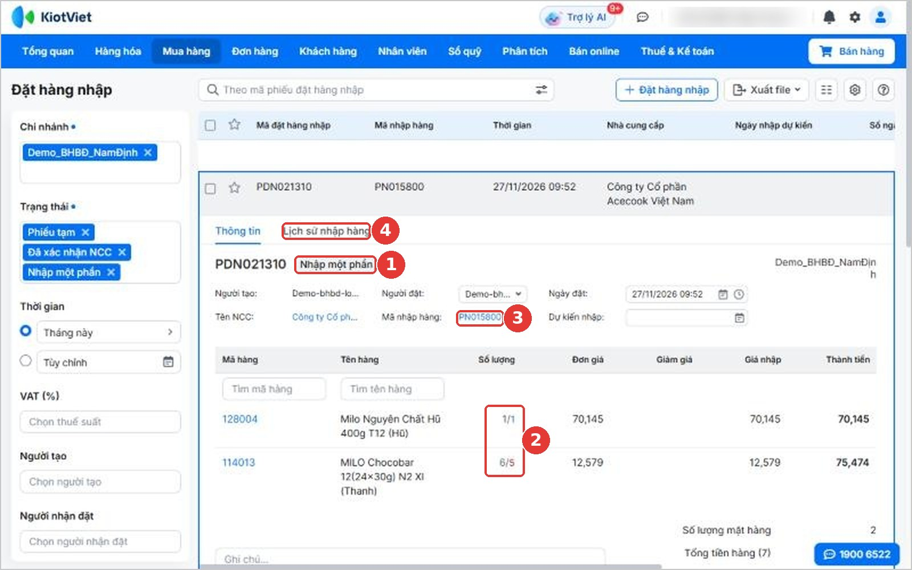
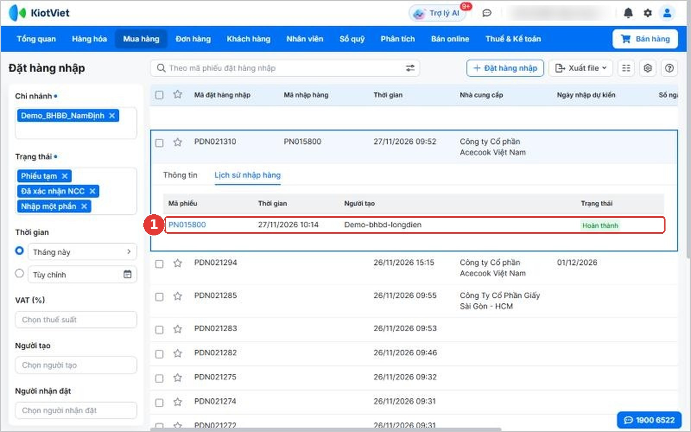
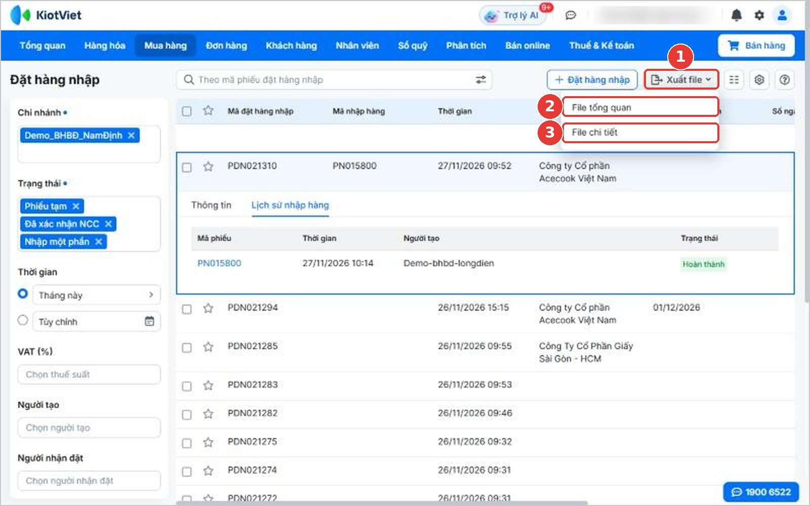

# Kiểm tra đơn đặt hàng chưa nhập kho

TÀI LIỆU 26 · HƯỚNG DẪN NGHIỆP VỤ KIOTVIET

| Thông tin | Nội dung |
|---|---|
| **Mục đích** | Rà soát các đơn đặt hàng nhập (PDN) của TCT/TTĐH **chưa nhập kho hoặc mới nhập một phần**, để không bỏ sót phiếu nhập, không bán hàng chưa nhập kho và báo kịp đơn NCC giao chậm. |
| **Người thực hiện** | Cửa hàng trưởng; Đơn vị khi giám sát các cửa hàng |
| **Thời điểm** | Cuối mỗi ngày (cùng lúc lọc tồn âm ở tài liệu 13) và khi NCC báo đã giao hàng |

!!! tip "Cách đọc"
    Số trong **vòng tròn đỏ** trên ảnh tương ứng với mục 1 2 3… trong phần chữ của bước đó; **khung đỏ** khoanh vùng cần bấm hoặc cần kiểm tra.

## Ý nghĩa trạng thái đơn đặt hàng nhập

| Trạng thái | Ý nghĩa | Cửa hàng cần làm |
|---|---|---|
| **Phiếu tạm** | Đơn đã tạo, **chưa nhập kho** lần nào | Hàng đã về: tạo phiếu nhập ngay (tài liệu 12). Chưa về: theo dõi ngày dự kiến |
| **Đã xác nhận NCC** | NCC đã xác nhận đơn, **chưa nhập kho** | Như Phiếu tạm |
| **Nhập một phần** | Đã nhập **một phần**, còn thiếu hàng | Chờ NCC giao bù rồi tạo tiếp phiếu nhập từ **chính đơn này**; NCC không giao nữa: báo TTĐH |
| **Hoàn thành** | Đã nhập **đủ** số lượng đặt | Không làm gì thêm |
| **Đã hủy** | Đơn không còn hiệu lực | Không nhập theo đơn này |

## Bước 1. Lọc các đơn chưa nhập xong

Vào **Mua hàng → Đặt hàng nhập**. Ở bộ lọc bên trái:

1 **Chi nhánh**: chỉ để **đúng cửa hàng của mình** (Đơn vị giám sát có thể chọn nhiều cửa hàng).  
2 **Trạng thái**: giữ **Phiếu tạm**, **Đã xác nhận NCC**, **Nhập một phần**.  
3 Bỏ tick **Hoàn thành** (mặc định đang được chọn) để danh sách chỉ còn đơn **chưa nhập xong**.  

<figure markdown="span">
  { loading=lazy }
  <figcaption>Hình 1. Lọc trạng thái: bỏ Hoàn thành</figcaption>
</figure>

## Bước 2. Chọn thời gian và đọc danh sách

1 **Ngày nhập dự kiến**: ngày NCC hẹn giao.  
2 **Số ngày chờ**: số ngày đơn đã chờ kể từ khi đặt; số càng lớn càng cần kiểm tra.  
3 **Thời gian**: mặc định **Tháng này**. Chọn **Tháng trước**, **30 ngày qua** hoặc **Tùy chỉnh** để không bỏ sót đơn đặt từ cuối tháng trước.  

Đơn đã **quá ngày nhập dự kiến** mà vẫn ở Phiếu tạm / Đã xác nhận NCC: kiểm tra hàng đã về chưa. **Đã về** → tạo phiếu nhập ngay; **chưa về** → báo TTĐH.

<figure markdown="span">
  { loading=lazy }
  <figcaption>Hình 2. Danh sách đơn chưa nhập kho</figcaption>
</figure>

## Bước 3. Hiện thêm cột Trạng thái (nếu cần)

Danh sách mặc định không có cột trạng thái. Để nhìn nhanh đơn nào đã nhập một phần:

1 Bấm biểu tượng **chọn cột** (☷) cạnh nút Xuất file.  
2 Tick **Trạng thái**.  
3 Tick **Mã nhập hàng** để thấy phiếu nhập đã tạo từ đơn.  

<figure markdown="span">
  { loading=lazy }
  <figcaption>Hình 3. Chọn thêm cột hiển thị</figcaption>
</figure>

### Danh sách có cột Trạng thái

1 **Nhập một phần**: đơn đã nhập nhưng còn thiếu hàng.  
2 **Phiếu tạm**: đơn chưa nhập lần nào.  

<figure markdown="span">
  { loading=lazy }
  <figcaption>Hình 4. Cột Trạng thái của đơn đặt hàng</figcaption>
</figure>

## Bước 4. Kiểm tra chi tiết đơn nhập một phần

Bấm vào dòng đơn để mở chi tiết:

1 Trạng thái **Nhập một phần**.  
2 Cột **Số lượng** dạng **số đặt / số đã nhập**; số màu đỏ là **chưa nhập đủ** (ví dụ 6/5: đặt 6, mới nhập 5).  
3 **Mã nhập hàng**: phiếu nhập đã tạo từ đơn này.  
4 Tab **Lịch sử nhập hàng**: xem tất cả các lần nhập.  

<figure markdown="span">
  { loading=lazy }
  <figcaption>Hình 5. Chi tiết đơn đặt hàng nhập một phần</figcaption>
</figure>

### Lịch sử nhập hàng của đơn

1 Mỗi dòng là một phiếu nhập **PN…** đã tạo từ đơn này, trạng thái **Hoàn thành**. Bấm vào mã PN để mở phiếu nhập.  

<figure markdown="span">
  { loading=lazy }
  <figcaption>Hình 6. Các phiếu nhập đã tạo từ đơn</figcaption>
</figure>

## Bước 5. Xuất danh sách để báo cáo (khi cần)

1 Giữ nguyên bộ lọc ở Bước 1 – 2, bấm **Xuất file**.  
2 **File tổng quan**: mỗi đơn một dòng (mã đơn, NCC, ngày, giá trị).  
3 **File chi tiết**: mỗi mặt hàng của đơn một dòng, có số lượng đặt và đã nhập.  

File tải về thư mục **Downloads**. Dùng khi Đơn vị / TTĐH yêu cầu báo cáo đơn tồn đọng.

<figure markdown="span">
  { loading=lazy }
  <figcaption>Hình 7. Xuất danh sách đơn chưa nhập</figcaption>
</figure>

## Xử lý kết quả kiểm tra

!!! important "HÀNG ĐÃ VỀ → TẠO PHIẾU NHẬP NGAY · HÀNG CHƯA VỀ QUÁ HẠN → BÁO TTĐH"
    Hàng đã về và đã bày bán nhưng đơn còn **Phiếu tạm**: tạo phiếu nhập **ngay trong ngày** từ đơn (tài liệu 12), rồi kiểm tra tồn âm (tài liệu 13).

    Đơn **Nhập một phần** NCC không giao bù nữa: báo TTĐH để xử lý phần còn thiếu, **không tự hủy hoặc sửa đơn**.

    Không tự tạo phiếu nhập bằng **+ Nhập hàng** cho hàng của đơn này (tài liệu 04).

## Lưu ý và lỗi thường gặp

| Tình huống | Cách xử lý |
|---|---|
| Danh sách trống nhưng biết chắc có đơn | Kiểm tra lại chi nhánh, thời gian (đơn đặt từ tháng trước) và ô tìm kiếm còn điều kiện cũ (bấm × để xóa). |
| Đơn ở trạng thái Phiếu tạm nhưng hàng đã nhập rồi | Có thể phiếu nhập bị tạo bằng + Nhập hàng (không gắn đơn). Báo Bộ phận Hệ thống kèm mã PN, không tạo thêm phiếu nhập. |
| Đơn trùng (2 đơn cho cùng một lô hàng) | Chỉ nhập theo một đơn; báo TTĐH hủy đơn còn lại. |
| Cột chọn thêm làm bảng rộng | Bỏ tick cột không cần trong biểu tượng chọn cột; thiết lập này chỉ áp dụng cho tài khoản của mình. |
