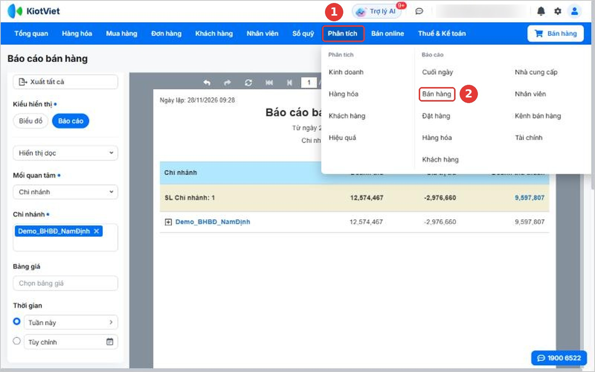
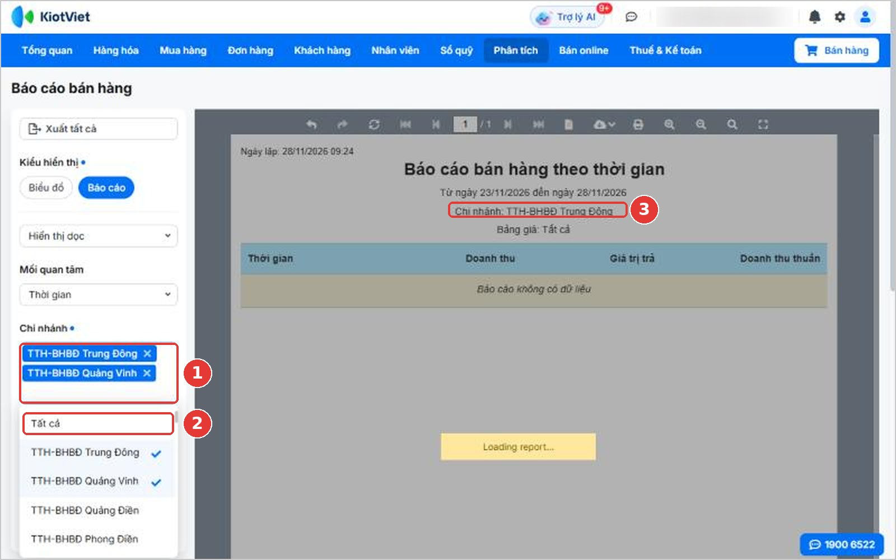
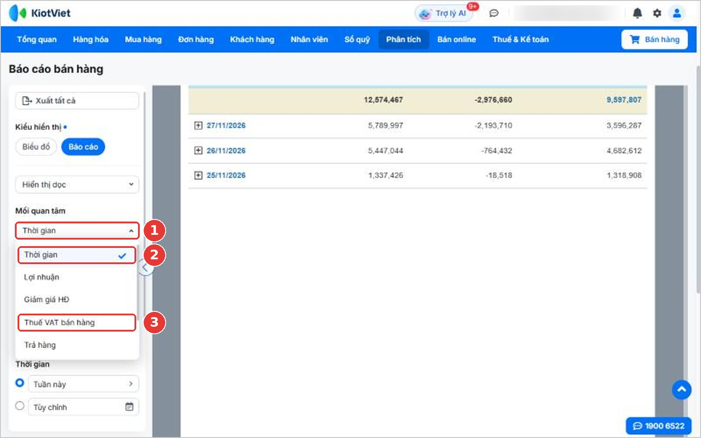
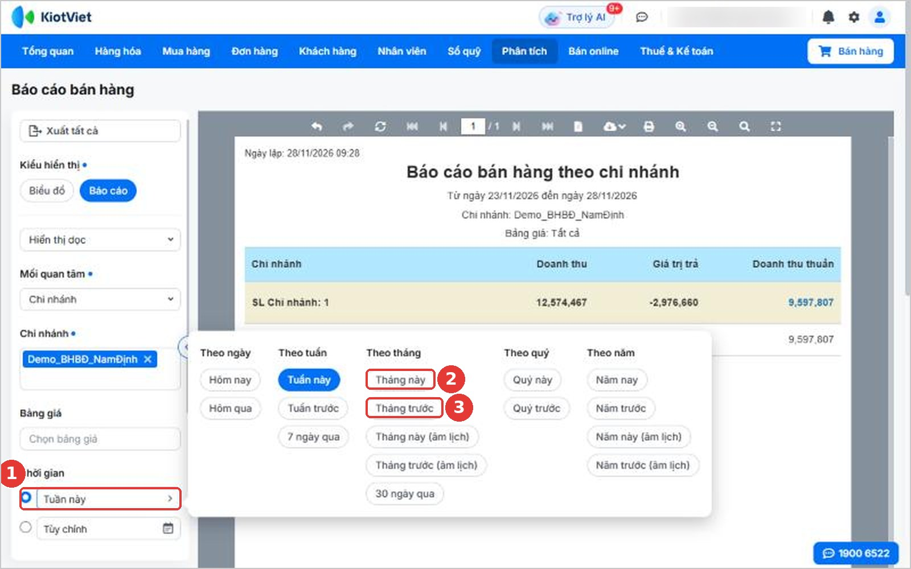
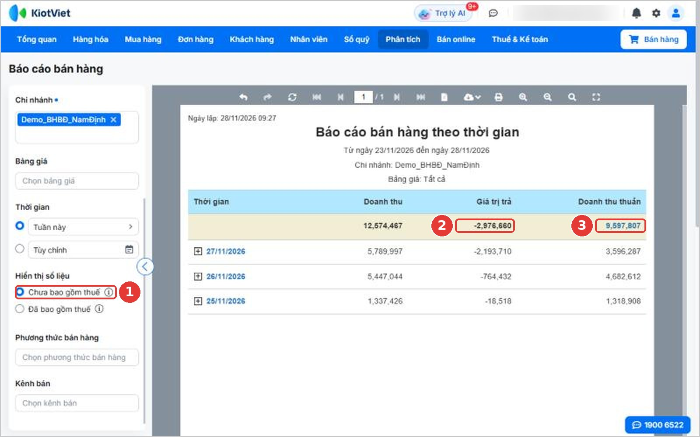
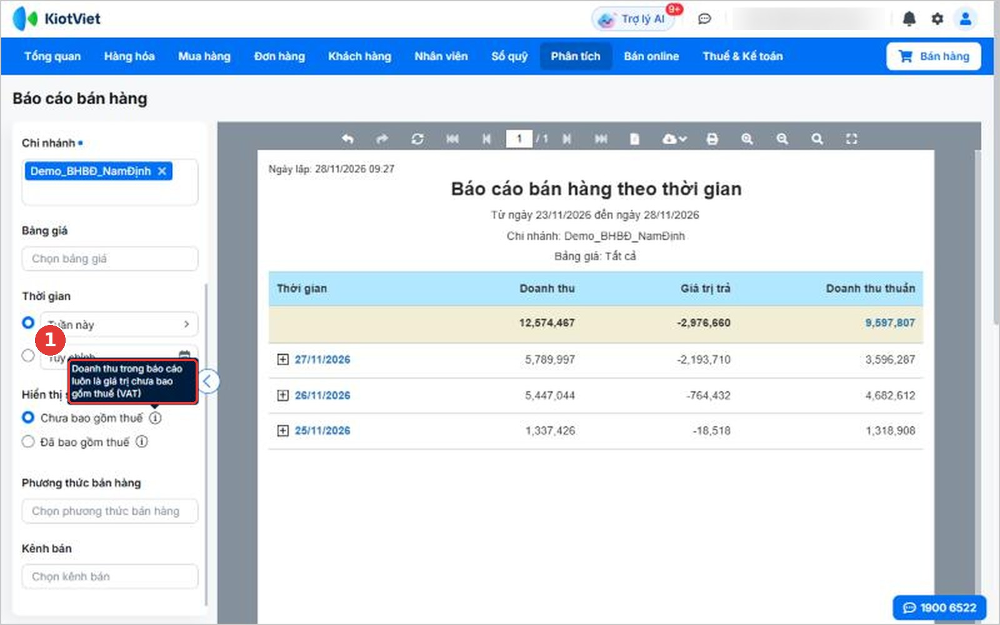
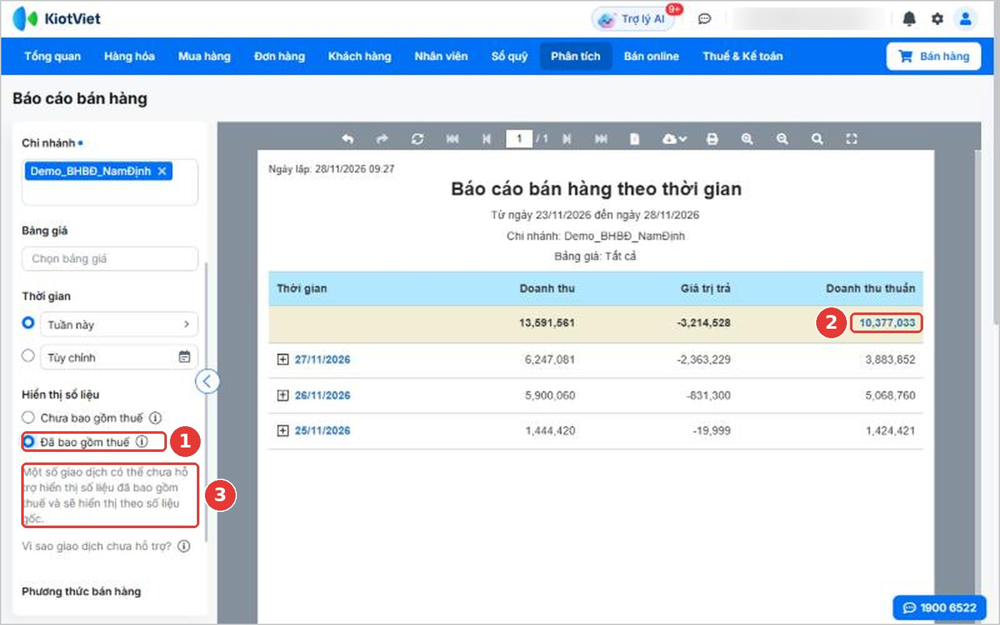
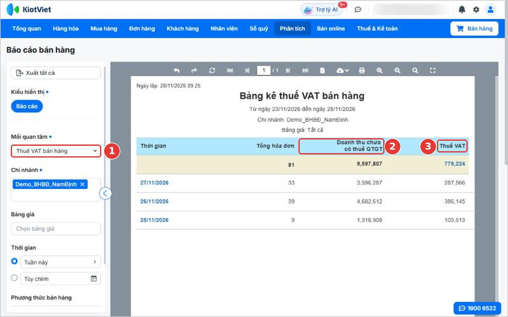
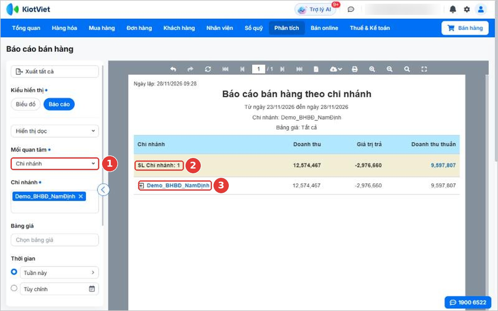

# Kế toán tỉnh lấy báo cáo doanh thu (có thuế / chưa thuế)

TÀI LIỆU 27 · HƯỚNG DẪN NGHIỆP VỤ KIOTVIET

| Thông tin | Nội dung |
|---|---|
| **Mục đích** | Lấy đúng doanh thu bán hàng của **tất cả cửa hàng thuộc tỉnh**, phân biệt rõ số **chưa bao gồm thuế VAT** và **đã bao gồm thuế VAT**, để hạch toán và đối chiếu. |
| **Người thực hiện** | Kế toán tỉnh, Kinh doanh tỉnh (Đơn vị) |
| **Thời điểm** | Khi chốt doanh thu ngày / tuần / tháng, khi đối chiếu với hóa đơn GTGT và sổ quỹ |

!!! tip "Cách đọc"
    Số trong **vòng tròn đỏ** trên ảnh tương ứng với mục 1 2 3… trong phần chữ của bước đó; **khung đỏ** khoanh vùng cần bấm hoặc cần kiểm tra.

## Hai loại số liệu cần phân biệt

| Số liệu | Ý nghĩa | Dùng để |
|---|---|---|
| **Chưa bao gồm thuế** (mặc định) | Doanh thu **không có thuế VAT** (thuế GTGT) | Hạch toán doanh thu, đối chiếu **Bảng kê thuế VAT** / hóa đơn GTGT |
| **Đã bao gồm thuế** | Doanh thu **gồm cả thuế VAT**, gần với số tiền khách trả | Đối chiếu tiền thu: **sổ quỹ**, **báo cáo cuối ngày** (tài liệu 08) |
| **Thuế VAT bán hàng** | Bảng kê theo ngày: doanh thu chưa thuế + tiền thuế VAT | Lấy số thuế VAT đầu ra; kiểm tra chưa thuế + VAT = đã thuế |

!!! important "ĐÃ BAO GỒM THUẾ = CHƯA BAO GỒM THUẾ + THUẾ VAT"
    Ví dụ trên Demo (tuần 23 – 28/11/2026): chưa thuế **9.597.807** + VAT **779.224** ≈ đã thuế **10.377.033** (lệch vài đồng do làm tròn).

    **Doanh thu thuần = Doanh thu − Giá trị trả** (hàng khách trả lại), ở cả hai chế độ.

    Khi gửi số liệu luôn ghi rõ **"chưa thuế"** hay **"đã thuế"**; không cộng lẫn hai loại.

## Bước 1. Mở báo cáo bán hàng

1 Đưa chuột vào **Phân tích**.  
2 Ở cột **Báo cáo**, chọn **Bán hàng**.  

Ở bên trái, **Kiểu hiển thị** chọn **Báo cáo** (dạng bảng) thay vì Biểu đồ.

<figure markdown="span">
  { loading=lazy }
  <figcaption>Hình 1. Phân tích → Báo cáo → Bán hàng</figcaption>
</figure>

## Bước 2. Chọn đủ danh sách cửa hàng của tỉnh

Ô **Chi nhánh** của báo cáo là ô **chọn nhiều**. Chọn ở đây chỉ lọc báo cáo, **không đổi chi nhánh làm việc** ở góc trên.

1 Bấm vào ô **Chi nhánh**, xóa (×) chi nhánh đang có, rồi lần lượt bấm từng cửa hàng của tỉnh. Danh sách vẫn mở sau mỗi lần chọn, cửa hàng đã chọn có dấu ✓ và hiện thành thẻ xanh.  
2 **Không chọn "Tất cả"** và **không để trống ô**: cả hai đều là **toàn chuỗi BHBĐ**, không phải riêng tỉnh.  
3 Dòng **Chi nhánh:** trên tiêu đề báo cáo có thể chỉ hiện tên cửa hàng đầu tiên. Kiểm tra số cửa hàng đã chọn ở Bước 5.  

<figure markdown="span">
  { loading=lazy }
  <figcaption>Hình 2. Chọn nhiều cửa hàng cùng tỉnh (ví dụ tỉnh có tiền tố TTH-)</figcaption>
</figure>

### Lưu ý khi chọn cửa hàng của tỉnh

!!! important "CHỌN THEO TIỀN TỐ TỈNH – ĐẾM ĐỦ SỐ CỬA HÀNG"
    Tên cửa hàng có dạng **[Tiền tố tỉnh]-BHBĐ [Tên cửa hàng]**, ví dụ **HNI-BHBĐ …**, **HCM-BHBĐ …**, **TTH-BHBĐ …**, **NA-BHBĐ …**. Danh sách xếp theo nhóm tiền tố nên các cửa hàng cùng tỉnh nằm liền nhau.

    **Gõ tên vào ô không lọc được danh sách**: phải cuộn xuống nhóm tiền tố của tỉnh và bấm chọn từng cửa hàng.

    Chọn **hết** cửa hàng trong nhóm, gồm cả cửa hàng **mới khai trương** và cửa hàng **đã đóng** nhưng còn doanh thu trong kỳ cần lấy.

    Đối chiếu số cửa hàng đã chọn với **danh sách cửa hàng của tỉnh** do Đơn vị quản lý. Thiếu hoặc thừa cửa hàng, hoặc có cửa hàng thuộc tỉnh mà tiền tố khác: báo **Bộ phận Hệ thống**.

    Không chọn **Demo_BHBĐ_NamĐịnh** và **Chi nhánh trung tâm** (không phải cửa hàng bán hàng).

## Bước 3. Chọn mối quan tâm và thời gian

1 Bấm ô **Mối quan tâm**.  
2 **Thời gian**: doanh thu theo từng ngày của cả nhóm cửa hàng.  
3 **Thuế VAT bán hàng**: bảng kê doanh thu chưa thuế và tiền thuế VAT theo ngày.  

Mối quan tâm **Chi nhánh** cho doanh thu từng cửa hàng, dùng ở Bước 5.

<figure markdown="span">
  { loading=lazy }
  <figcaption>Hình 3. Các mối quan tâm của báo cáo bán hàng</figcaption>
</figure>

### Chọn kỳ báo cáo

1 Bấm ô **Thời gian** (mặc định **Tuần này**).  
2 Chốt tháng đang chạy: **Tháng này**.  
3 Chốt tháng đã qua: **Tháng trước**. Kỳ khác: chọn **Tùy chỉnh** và nhập từ ngày – đến ngày.  

Dùng **Tháng này / Tháng trước** (dương lịch), không chọn các mục **(âm lịch)**.

<figure markdown="span">
  { loading=lazy }
  <figcaption>Hình 4. Chọn kỳ báo cáo</figcaption>
</figure>

## Bước 4. Chọn hiển thị chưa thuế hoặc đã thuế

Ở mục **Hiển thị số liệu** bên trái (kéo thanh bộ lọc xuống):

1 **Chưa bao gồm thuế** (mặc định): số liệu không có VAT.  
2 **Giá trị trả**: tiền hàng khách trả lại, đã trừ khỏi doanh thu.  
3 **Doanh thu thuần** chưa thuế: số dùng để hạch toán.  

<figure markdown="span">
  { loading=lazy }
  <figcaption>Hình 5. Báo cáo theo thời gian – chưa bao gồm thuế</figcaption>
</figure>

### Giải thích của KiotViet

1 Rê chuột vào biểu tượng ⓘ: doanh thu trong báo cáo **luôn là giá trị chưa bao gồm thuế (VAT)** khi chọn chế độ này.  

<figure markdown="span">
  { loading=lazy }
  <figcaption>Hình 6. Chú thích của chế độ Chưa bao gồm thuế</figcaption>
</figure>

### Chế độ đã bao gồm thuế

1 Chọn **Đã bao gồm thuế**: báo cáo tự tải lại.  
2 **Doanh thu thuần** tăng thêm đúng phần thuế VAT (ví dụ 9.597.807 → 10.377.033).  
3 KiotViet lưu ý: một số giao dịch (tạo trước khi có tính năng giá sau thuế, hoặc từ kênh bán chưa hỗ trợ) **vẫn hiện số liệu gốc**. Vì vậy số VAT chính thức lấy ở **Bảng kê thuế VAT bán hàng**.  

<figure markdown="span">
  { loading=lazy }
  <figcaption>Hình 7. Báo cáo theo thời gian – đã bao gồm thuế</figcaption>
</figure>

### Bảng kê thuế VAT bán hàng

1 Mối quan tâm **Thuế VAT bán hàng**.  
2 **Doanh thu chưa có thuế GTGT**: phải bằng Doanh thu thuần ở chế độ **Chưa bao gồm thuế**.  
3 **Thuế VAT**: tiền thuế đầu ra của kỳ.  

<figure markdown="span">
  { loading=lazy }
  <figcaption>Hình 8. Bảng kê thuế VAT bán hàng</figcaption>
</figure>

## Bước 5. Kiểm tra đủ cửa hàng và xuất file

1 Đổi Mối quan tâm sang **Chi nhánh**.  
2 Dòng **SL Chi nhánh** phải bằng số cửa hàng của tỉnh. Lưu ý: cửa hàng **không phát sinh doanh thu** trong kỳ sẽ không có dòng.  
3 Mỗi cửa hàng một dòng doanh thu; rà xem có cửa hàng tỉnh khác lẫn vào không.  

Bấm **Xuất tất cả** (trên cùng bên trái) để tải file Excel về thư mục **Downloads**. Ghi rõ trong tên file kỳ báo cáo và **chưa thuế / đã thuế**.

<figure markdown="span">
  { loading=lazy }
  <figcaption>Hình 9. Báo cáo theo chi nhánh: kiểm tra số cửa hàng</figcaption>
</figure>

## Lưu ý và lỗi thường gặp

| Tình huống | Cách xử lý |
|---|---|
| Số của tỉnh lớn bất thường | Ô Chi nhánh đang để trống hoặc chọn "Tất cả" (toàn chuỗi). Chọn lại từng cửa hàng của tỉnh. |
| SL Chi nhánh ít hơn số cửa hàng của tỉnh | Kiểm tra lại cửa hàng bị sót trong danh sách; nếu đã chọn đủ thì cửa hàng đó không có doanh thu trong kỳ. |
| Chưa thuế + VAT lệch vài đồng so với đã thuế | Do làm tròn từng hóa đơn; số thuế chính thức lấy theo Bảng kê thuế VAT bán hàng. |
| Doanh thu báo cáo khác tiền nộp | Báo cáo bán hàng tính theo hàng đã bán; tiền nộp theo phương thức thanh toán ở báo cáo cuối ngày (tài liệu 08, 14). |
| Lần sau mở lại phải chọn lại cửa hàng | Bộ lọc không tự lưu danh sách tỉnh; giữ sẵn danh sách tên cửa hàng của tỉnh để chọn nhanh. |
