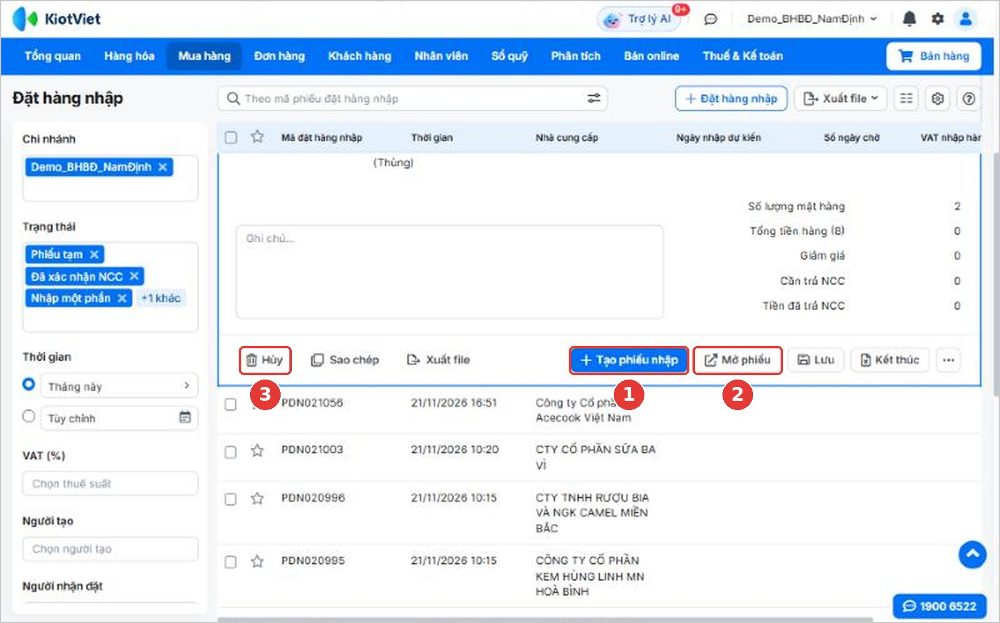
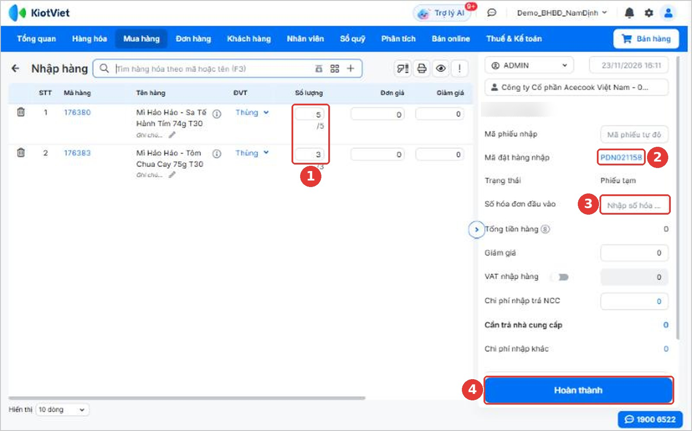
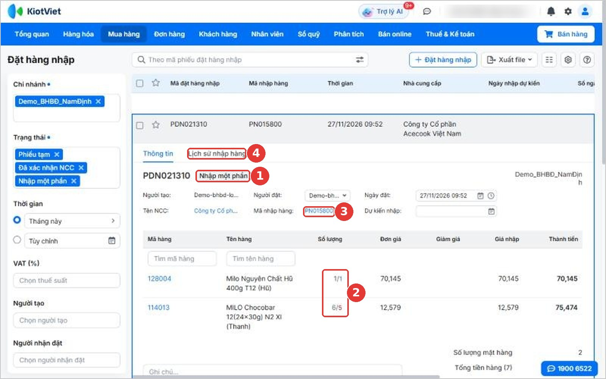

# Nhận hàng thiếu, thừa, hỏng so với đơn đặt hàng

TÀI LIỆU 28 · HƯỚNG DẪN NGHIỆP VỤ KIOTVIET

| Thông tin | Nội dung |
|---|---|
| **Mục đích** | Nhập kho **đúng số thực nhận** khi NCC giao thiếu, thừa, sai mặt hàng hoặc hàng hỏng, để tồn kho đúng và không lệch hóa đơn thanh toán NCC. |
| **Người thực hiện** | Cửa hàng trưởng, nhân viên nhận hàng |
| **Thời điểm** | Ngay khi nhận hàng, trước khi bày bán |

!!! tip "Cách đọc"
    Số trong **vòng tròn đỏ** trên ảnh tương ứng với mục 1 2 3… trong phần chữ của bước đó; **khung đỏ** khoanh vùng cần bấm hoặc cần kiểm tra.

## Nguyên tắc chung

!!! important "NHẬP ĐÚNG SỐ THỰC NHẬN – CHỈ NHẬP HÀNG CÓ TRONG ĐƠN – BÁO TTĐH PHẦN CHÊNH LỆCH"
    Luôn tạo phiếu nhập từ **đơn đặt hàng (PDN) của TCT/TTĐH** bằng nút **Tạo phiếu nhập** (tài liệu 04, 12). Không dùng **+ Nhập hàng**.

    Đếm hàng **trước khi ký** phiếu giao của NCC. Chênh lệch phải được NCC (người giao) ký xác nhận trên phiếu giao.

    Cửa hàng **không tự sửa, hủy hay kết thúc** đơn đặt hàng; mọi chênh lệch báo **TTĐH** xử lý.

## Cách xử lý từng trường hợp

| Trường hợp | Trên KiotViet | Báo / lưu chứng từ |
|---|---|---|
| **Giao thiếu** | Sửa **Số lượng** = số thực nhận. Đơn chuyển **Nhập một phần** | Báo TTĐH: NCC giao bù hay chốt thiếu. Giao bù thì tạo tiếp phiếu nhập từ **chính đơn đó** |
| **Giao thừa** | Chỉ nhập **đúng số lượng đặt**, không nhập vượt | Trả lại phần thừa cho người giao, hoặc báo TTĐH nếu NCC muốn để lại |
| **Hàng ngoài đơn** (mặt hàng không có trong PDN) | **Không nhập**, không bày bán | Trả lại NCC hoặc báo TTĐH bổ sung đơn |
| **Hàng hỏng, móp, rách, cận date** khi nhận | **Không nhận**, không nhập phần hàng đó | Ghi rõ trên phiếu giao, chụp ảnh, báo TTĐH |
| **Phát hiện hỏng sau khi đã nhập kho** | Không sửa phiếu nhập; làm **Trả hàng nhập** (tài liệu 15) theo xác nhận của TTĐH | Chụp ảnh, giữ hàng lại chờ NCC |
| **Sai giá nhập** so với hóa đơn NCC | Không tự sửa giá | Báo TTĐH / Bộ phận Hệ thống kèm ảnh hóa đơn |

## Bước 1. Mở đơn và bấm Tạo phiếu nhập

1 Tìm đúng đơn PDN (tài liệu 12), mở chi tiết rồi bấm **Tạo phiếu nhập**.  

Nếu hiện thông báo *"Phiếu đặt hàng nhập bạn chọn thuộc chi nhánh …"*: chi nhánh làm việc ở góc trên đang sai, chọn lại đúng cửa hàng rồi làm lại.

<figure markdown="span">
  { loading=lazy }
  <figcaption>Hình 1. Tạo phiếu nhập từ đơn đặt hàng</figcaption>
</figure>

## Bước 2. Sửa số lượng theo số thực nhận

1 Ô **Số lượng**: nhập **số đếm được thực tế**. Số **/5** bên dưới là số đã đặt; giao thiếu thì nhập nhỏ hơn, **không nhập lớn hơn** số đặt.  
2 Kiểm tra **Mã đặt hàng nhập** đúng đơn.  
3 Nhập **Số hóa đơn đầu vào** của NCC. Ghi chú chênh lệch (ví dụ: *thiếu 2 thùng, NCC hẹn giao bù 05/12*).  
4 Kiểm tra lại rồi mới bấm **Hoàn thành**.  

<figure markdown="span">
  { loading=lazy }
  <figcaption>Hình 2. Phiếu nhập: sửa số lượng theo thực nhận</figcaption>
</figure>

## Bước 3. Theo dõi đơn nhập một phần

1 Đơn giao thiếu chuyển sang **Nhập một phần**.  
2 Cột Số lượng dạng **đặt/đã nhập**, số đỏ là còn thiếu.  
3 Lần giao bù: mở **chính đơn này** và bấm Tạo phiếu nhập cho phần còn lại.  
4 Tab **Lịch sử nhập hàng** liệt kê các lần nhập.  

Rà các đơn nhập một phần hằng ngày theo tài liệu 26. NCC không giao bù nữa: báo TTĐH, **không tự kết thúc đơn**.

<figure markdown="span">
  { loading=lazy }
  <figcaption>Hình 3. Đơn đặt hàng nhập một phần</figcaption>
</figure>

## Lưu ý và lỗi thường gặp

| Tình huống | Cách xử lý |
|---|---|
| Đã bấm Hoàn thành với số lượng sai | Không tạo thêm phiếu nhập để bù hay sửa. Báo Bộ phận Hệ thống BU BHBĐ kèm mã PN. |
| Hàng đã về nhưng chưa kịp kiểm đếm | Để riêng, chưa bày bán. Kiểm đếm và nhập kho trong ngày (bán trước khi nhập gây lệch giá vốn – tài liệu 13). |
| NCC không chịu ký xác nhận thiếu / hỏng | Chụp ảnh hàng và phiếu giao, ghi giờ giao, báo TTĐH ngay trong ngày. |
