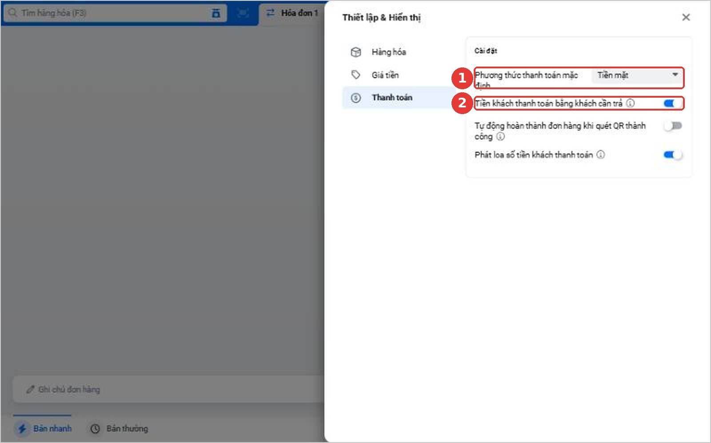
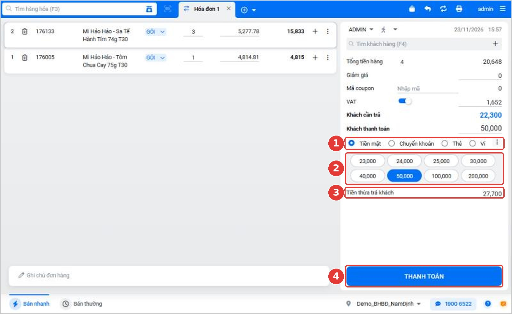
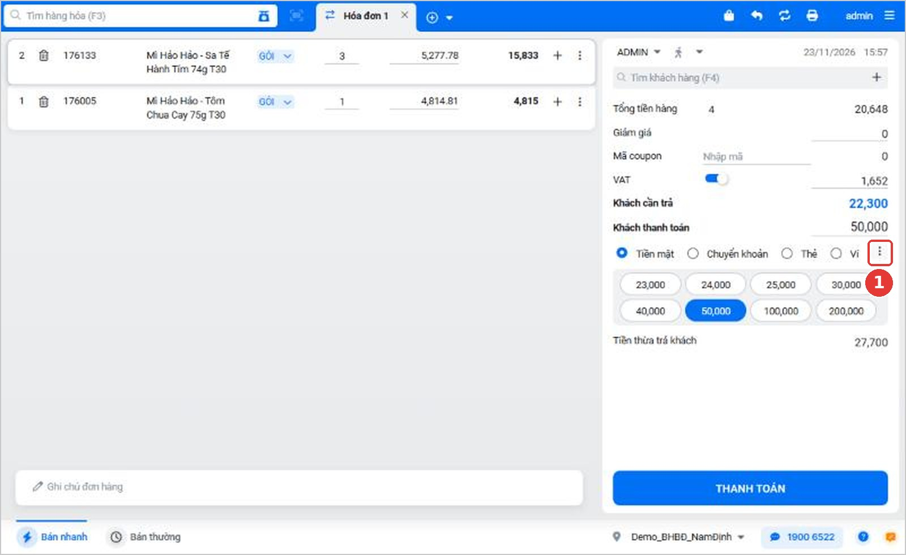
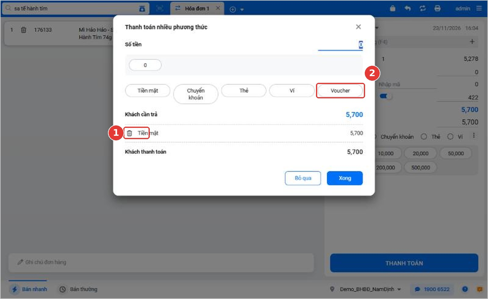
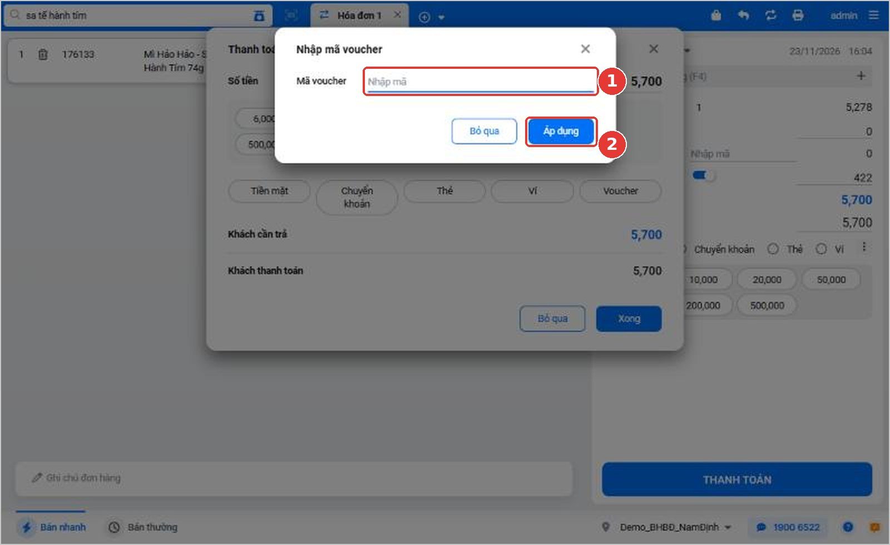

# Thanh toán chuyển khoản, qr và voucher đúng cách tại quầy

TÀI LIỆU 29 · HƯỚNG DẪN NGHIỆP VỤ KIOTVIET

| Thông tin | Nội dung |
|---|---|
| **Mục đích** | Chọn **đúng phương thức thanh toán ngay khi bán**, để sổ quỹ, báo cáo cuối ngày và tiền nộp khớp nhau (phòng lỗi ở tài liệu 14). |
| **Người thực hiện** | Thu ngân, cửa hàng trưởng |
| **Thời điểm** | Mỗi lần thanh toán hóa đơn |

!!! tip "Cách đọc"
    Số trong **vòng tròn đỏ** trên ảnh tương ứng với mục 1 2 3… trong phần chữ của bước đó; **khung đỏ** khoanh vùng cần bấm hoặc cần kiểm tra.

## Ba quy tắc tại quầy

!!! important "KHÁCH TRẢ BẰNG GÌ – CHỌN ĐÚNG CÁI ĐÓ – KIỂM TRA TRƯỚC KHI BẤM THANH TOÁN"
    Máy bán hàng **mặc định Tiền mặt** và tự điền đủ tiền. Khách chuyển khoản / quét QR phải **chọn lại Chuyển khoản** mỗi lần.

    Chỉ bấm Thanh toán với Chuyển khoản khi **đã thấy tiền vào tài khoản** (thông báo app ngân hàng / loa báo tiền).

    Voucher không đủ tiền: phần còn lại **phải chọn tiếp** Tiền mặt hoặc Chuyển khoản đúng với cách khách trả.

## Bảng chọn phương thức

| Khách trả | Chọn trên KiotViet | Kiểm tra |
|---|---|---|
| Tiền mặt | **Tiền mặt** (mặc định) | Nhập số tiền khách đưa, xem **Tiền thừa trả khách** |
| Chuyển khoản / quét QR | **Chuyển khoản** | Tiền đã vào tài khoản, đúng số tiền; **không có tiền thừa** |
| Voucher đủ giá trị hóa đơn | **Voucher** (nhập mã, Áp dụng) | Khách cần trả còn **0** |
| Voucher + tiền mặt | Voucher + **Tiền mặt** cho phần còn lại | Tổng hai dòng bằng Khách cần trả |
| Voucher + chuyển khoản | Voucher + **Chuyển khoản** cho phần còn lại | Tiền chuyển khoản đã vào đúng số còn lại |
| Một phần tiền mặt, một phần chuyển khoản | Mở **nhiều phương thức**, nhập từng số | Tổng đúng bằng Khách cần trả |

## Bước 1. Thiết lập máy bán hàng (không tự đổi)

1 Phương thức mặc định **Tiền mặt** và **Tiền khách thanh toán bằng khách cần trả** đang bật. Không tự đổi thiết lập này (tài liệu 23).  

<figure markdown="span">
  { loading=lazy }
  <figcaption>Hình 1. Thiết lập thanh toán của máy bán hàng</figcaption>
</figure>

## Bước 2. Khách chuyển khoản hoặc quét QR

1 Ở màn hình thanh toán, chọn **Chuyển khoản** thay cho Tiền mặt.  
2 Cho khách quét mã QR của cửa hàng; chờ thấy **tiền vào tài khoản** đúng số tiền.  
3 **Khách thanh toán** bằng **Khách cần trả**, không có tiền thừa.  
4 Bấm **THANH TOÁN**.  

<figure markdown="span">
  { loading=lazy }
  <figcaption>Hình 2. Màn hình thanh toán</figcaption>
</figure>

## Bước 3. Khách trả bằng nhiều phương thức

1 Bấm mở thêm phương thức thanh toán để nhập từng phần.  

<figure markdown="span">
  { loading=lazy }
  <figcaption>Hình 3. Mở nhiều phương thức thanh toán</figcaption>
</figure>

### Nhập số tiền từng phương thức

1 Nhập số tiền cho từng dòng (Tiền mặt, Chuyển khoản, Voucher…). Tổng các dòng phải bằng **Khách cần trả**.  

<figure markdown="span">
  { loading=lazy }
  <figcaption>Hình 4. Thanh toán nhiều phương thức</figcaption>
</figure>

## Bước 4. Thanh toán bằng voucher

1 Nhập hoặc quét **mã voucher**.  
2 Bấm **Áp dụng**. Voucher chưa đủ giá trị hóa đơn: chọn tiếp phương thức cho phần còn lại theo bảng trên.  

<figure markdown="span">
  { loading=lazy }
  <figcaption>Hình 5. Nhập mã voucher</figcaption>
</figure>

## Lưu ý và lỗi thường gặp

| Tình huống | Cách xử lý |
|---|---|
| Khách báo đã chuyển nhưng chưa thấy tiền | Chưa bấm Thanh toán; nhờ khách chờ hoặc trả tiền mặt. Không ghi nợ trên hóa đơn. |
| Chuyển khoản nhầm số tiền | Nhập đúng số tiền thực nhận; phần thiếu khách trả thêm bằng tiền mặt (mở nhiều phương thức). |
| Đã thanh toán xong mới thấy chọn sai | Không hủy hóa đơn làm lại, không lập phiếu thu chi bù. Ghi lại mã hóa đơn; cuối ngày nộp tiền theo Báo cáo cuối ngày (tài liệu 14). |
