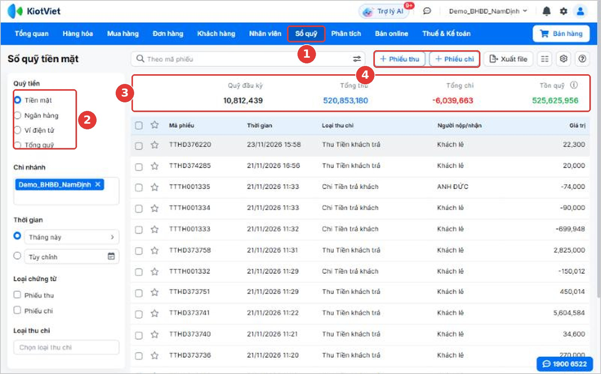
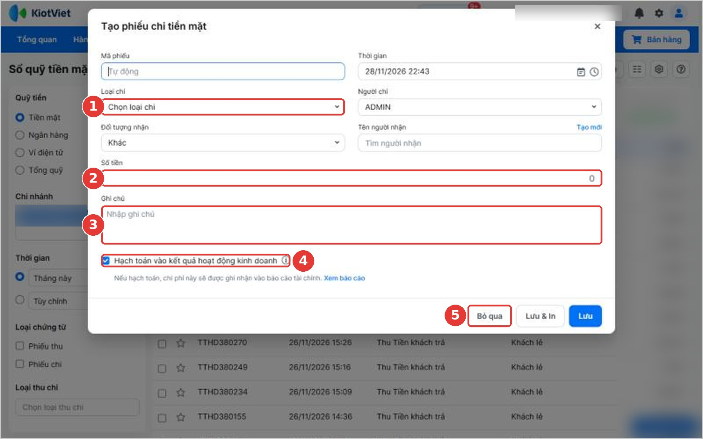
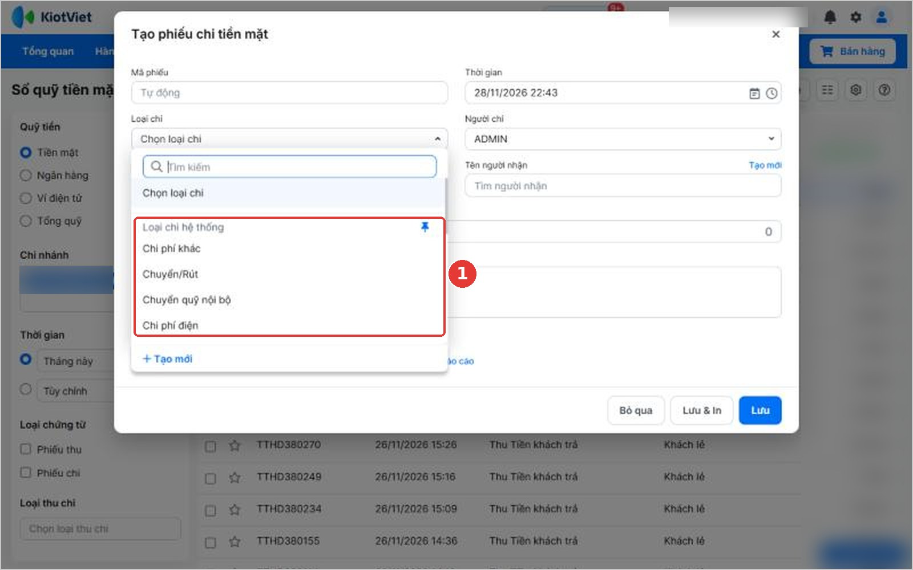

# Phiếu thu, phiếu chi trên sổ quỹ

TÀI LIỆU 30 · HƯỚNG DẪN NGHIỆP VỤ KIOTVIET

| Thông tin | Nội dung |
|---|---|
| **Mục đích** | Lập phiếu thu / chi **đúng loại, đúng số, có chứng từ** cho các khoản ngoài bán hàng, và biết các trường hợp **không được tự lập**. |
| **Người thực hiện** | Cửa hàng trưởng (khi được Đơn vị cho phép) |
| **Thời điểm** | Khi phát sinh khoản thu, chi ngoài bán hàng đã được duyệt |

!!! tip "Cách đọc"
    Số trong **vòng tròn đỏ** trên ảnh tương ứng với mục 1 2 3… trong phần chữ của bước đó; **khung đỏ** khoanh vùng cần bấm hoặc cần kiểm tra.

## Được lập và không được lập

| Được lập (có chứng từ, đã được duyệt) | Không được tự lập |
|---|---|
| Khoản chi nhỏ đã được Đơn vị duyệt (có hóa đơn / biên nhận) | Bù chênh lệch tiền két do chọn sai phương thức thanh toán (tài liệu 14) |
| Khoản thu ngoài bán hàng theo hướng dẫn của Đơn vị | Thay cho hóa đơn bán hàng hoặc phiếu trả hàng |
| Các khoản thu chi khác khi BU BHBĐ / Đơn vị hướng dẫn bằng văn bản | Làm tròn tồn quỹ, "cân" sổ quỹ cuối tháng |

!!! important "PHIẾU THU / CHI ẢNH HƯỞNG TRỰC TIẾP SỔ QUỸ VÀ BÁO CÁO TÀI CHÍNH"
    Chỉ lập khi có **chứng từ gốc** và đã được **Đơn vị duyệt**; danh mục **Loại thu / Loại chi** theo hướng dẫn của BU BHBĐ.

    Không tự tạo **loại thu chi mới** (+ Tạo mới) và không tự bỏ tick **Hạch toán vào kết quả hoạt động kinh doanh**.

## Bước 1. Mở Sổ quỹ

1 Vào menu **Sổ quỹ**.  
2 Chọn đúng **quỹ tiền**: Tiền mặt hoặc Ngân hàng.  
3 Kiểm tra **Tồn quỹ** trước khi lập phiếu.  
4 Bấm **+ Phiếu thu** hoặc **+ Phiếu chi**.  

<figure markdown="span">
  { loading=lazy }
  <figcaption>Hình 1. Sổ quỹ và nút tạo phiếu</figcaption>
</figure>

## Bước 2. Điền phiếu chi

1 **Loại chi**: chọn đúng loại theo danh mục.  
2 **Số tiền**: đúng số trên chứng từ.  
3 **Ghi chú**: nội dung, số chứng từ, người duyệt (ví dụ: *Mua túi nilon, HĐ 0001234, anh A duyệt 28/11*).  
4 **Hạch toán vào kết quả hoạt động kinh doanh**: giữ theo hướng dẫn, không tự đổi.  
5 Chưa chắc chắn: bấm **Bỏ qua**, hỏi Đơn vị trước khi Lưu.  

Kiểm tra xong bấm **Lưu** (hoặc **Lưu & In** để in phiếu ký nhận). Phiếu thu làm tương tự.

<figure markdown="span">
  { loading=lazy }
  <figcaption>Hình 2. Màn hình tạo phiếu chi tiền mặt</figcaption>
</figure>

### Danh mục loại chi

1 Chọn trong **Loại chi hệ thống** / danh mục có sẵn. Không bấm **+ Tạo mới** để tự thêm loại chi.  

<figure markdown="span">
  { loading=lazy }
  <figcaption>Hình 3. Chọn loại chi</figcaption>
</figure>

## Lưu ý và lỗi thường gặp

| Tình huống | Cách xử lý |
|---|---|
| Lập phiếu sai số tiền hoặc sai loại | Không lập phiếu ngược để bù. Báo Bộ phận Hệ thống BU BHBĐ kèm mã phiếu. |
| Lưu chứng từ | Ghi mã phiếu (PT…/PC…) lên chứng từ gốc, lưu cùng biên bản cuối ngày. |
| Tiền két lệch sổ quỹ | Xử lý theo tài liệu 14, 18; không dùng phiếu thu chi để cân. |
