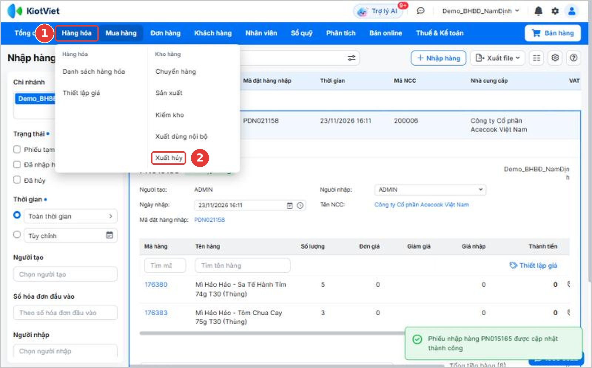
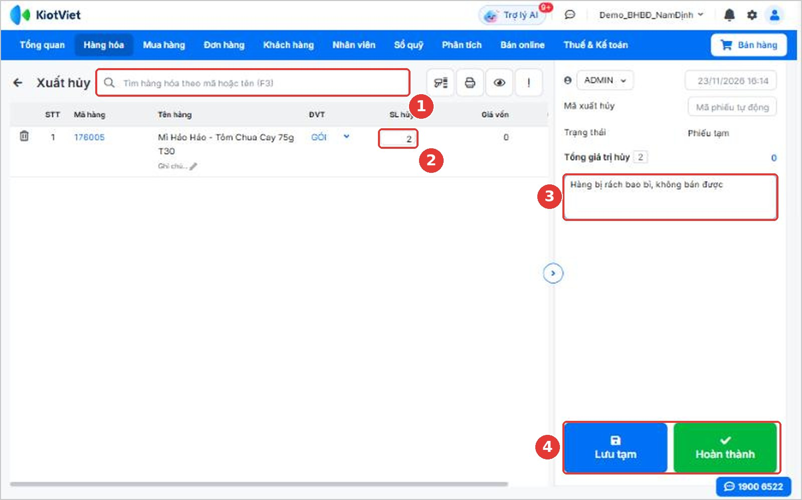

# Xử lý hàng cận date và hàng hỏng (xuất hủy có xác nhận)

TÀI LIỆU 31 · HƯỚNG DẪN NGHIỆP VỤ KIOTVIET

| Thông tin | Nội dung |
|---|---|
| **Mục đích** | Phát hiện sớm hàng cận date, xử lý hàng hỏng / hết hạn bằng phiếu xuất hủy **có xác nhận của BU BHBĐ**, giữ tồn kho và hao hụt đúng thực tế. |
| **Người thực hiện** | Cửa hàng trưởng, nhân viên kho / quầy |
| **Thời điểm** | Rà date hằng tuần; lập đề xuất hủy khi phát hiện hàng hỏng, hết hạn |

!!! tip "Cách đọc"
    Số trong **vòng tròn đỏ** trên ảnh tương ứng với mục 1 2 3… trong phần chữ của bước đó; **khung đỏ** khoanh vùng cần bấm hoặc cần kiểm tra.

## Quy định bắt buộc

!!! important "XUẤT HỦY PHẢI ĐƯỢC BU BHBĐ XÁC NHẬN – KHÔNG TỰ Ý HOÀN THÀNH PHIẾU"
    Cửa hàng lập phiếu xuất hủy, ghi rõ lý do và chụp ảnh hàng, rồi **Lưu tạm**.

    Gửi **mã phiếu (Lưu tạm)**, ảnh và danh sách hàng cho **BU BHBĐ** xác nhận.

    Chỉ bấm **Hoàn thành** khi **BU BHBĐ đã xác nhận**. Cửa hàng, Đơn vị không tự ý hủy hàng trên hệ thống.

    Hàng chờ hủy để riêng, **không bày bán**, không tự vứt bỏ trước khi được xác nhận.

## Phân loại và hướng xử lý

| Tình trạng | Hướng xử lý | Trên KiotViet |
|---|---|---|
| **Cận date** (còn hạn ngắn) | Báo BU BHBĐ / TTĐH để xin chương trình giảm giá hoặc trả NCC (nếu NCC nhận) | Không tự sửa giá bán; trả NCC theo tài liệu 15 khi được xác nhận |
| **Hỏng khi nhận hàng** | Không nhận, báo TTĐH | Không nhập phần hỏng (tài liệu 28) |
| **Hỏng, hết hạn tại cửa hàng** | Đề xuất xuất hủy, chờ BU BHBĐ xác nhận | Phiếu xuất hủy **Lưu tạm** → Hoàn thành khi được xác nhận |
| **Khách trả hàng hỏng** | Làm trả hàng trước, sau đó mới đề xuất hủy | Trả hàng (tài liệu 02) rồi xuất hủy |

## Bước 1. Rà hàng cận date hằng tuần

- Kiểm tra theo kệ, ưu tiên hàng tươi, sữa, bánh, đồ uống. Ghi lại **mã hàng, số lượng, hạn dùng**.
- Hàng còn dưới mức hạn dùng chuỗi quy định: báo BU BHBĐ / TTĐH trong ngày để có hướng xử lý (giảm giá, trả NCC).
- Sắp xếp hàng **hạn gần ra trước** (nhập trước – bán trước).

## Bước 2. Lập phiếu xuất hủy (đề xuất)

1 Rê chuột vào **Hàng hóa**.  
2 Chọn **Xuất hủy**, bấm **+ Xuất hủy**.  

<figure markdown="span">
  { loading=lazy }
  <figcaption>Hình 1. Hàng hóa → Xuất hủy</figcaption>
</figure>

### Nhập hàng hủy và Lưu tạm

1 Tìm đúng mặt hàng ở ô **Tìm hàng hóa (F3)**, đúng đơn vị tính.  
2 Nhập **SL hủy** đúng số thực tế.  
3 **Ghi chú**: lý do (hết hạn ngày…, móp, rách bao bì, hư hỏng…).  
4 Bấm **Lưu tạm**, gửi mã phiếu và ảnh cho BU BHBĐ. **Chỉ bấm Hoàn thành khi BU BHBĐ đã xác nhận.**  

<figure markdown="span">
  { loading=lazy }
  <figcaption>Hình 2. Phiếu xuất hủy: Lưu tạm chờ xác nhận</figcaption>
</figure>

## Lưu ý và lỗi thường gặp

| Tình huống | Cách xử lý |
|---|---|
| Lỡ bấm Hoàn thành khi chưa xác nhận | Không nhập hàng để bù. Báo ngay Bộ phận Hệ thống BU BHBĐ kèm mã phiếu XH. |
| Hủy nhiều mặt hàng | Gộp vào một phiếu theo ngày, mỗi dòng một mặt hàng; ảnh đặt tên theo mã hàng. |
| Tồn trên máy ít hơn số cần hủy | Kiểm tra phiếu nhập còn treo (tài liệu 26) trước; không hủy để ra tồn âm. |

**Phím tắt:** F3: tìm hàng hóa
