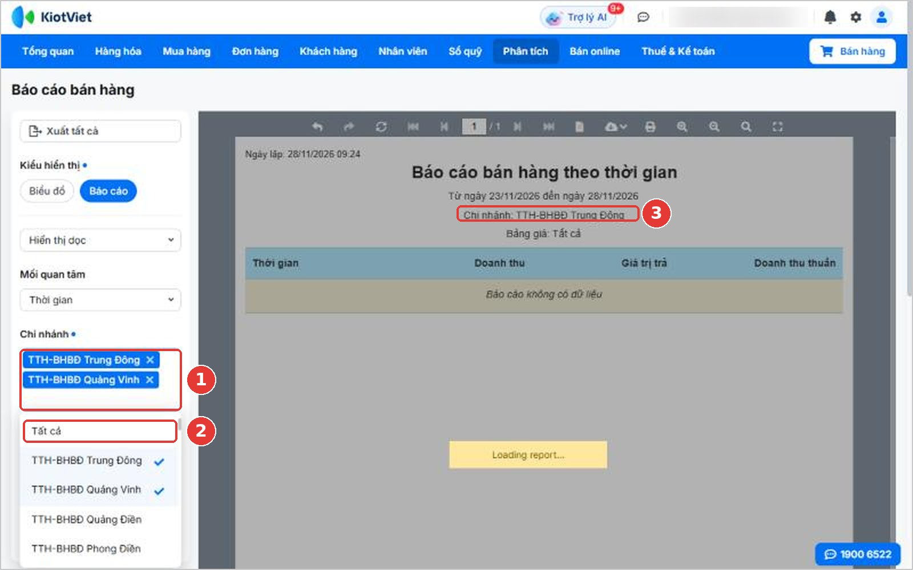
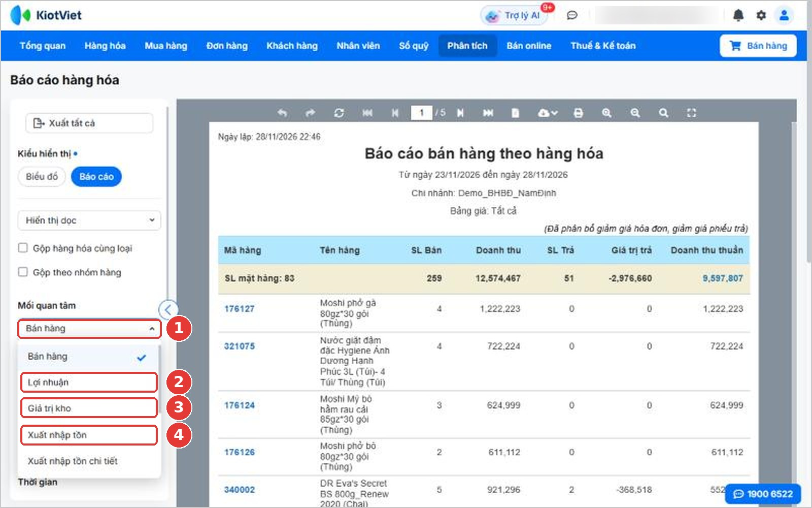
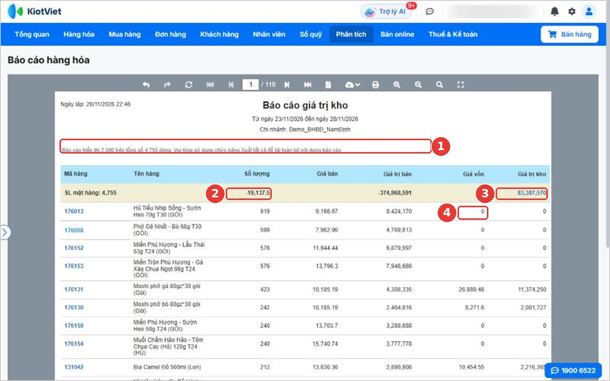
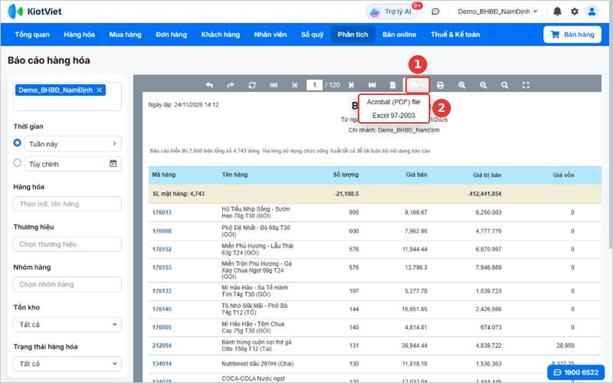

# Báo cáo tồn kho và giá trị tồn kho của tỉnh

TÀI LIỆU 32 · HƯỚNG DẪN NGHIỆP VỤ KIOTVIET

| Thông tin | Nội dung |
|---|---|
| **Mục đích** | Lấy số lượng và **giá trị tồn kho** của **tất cả cửa hàng thuộc tỉnh**, phát hiện tồn âm, giá vốn bằng 0. |
| **Người thực hiện** | Kế toán tỉnh, Kinh doanh tỉnh (Đơn vị) |
| **Thời điểm** | Cuối tháng, khi kiểm kê, khi BU BHBĐ yêu cầu số liệu tồn kho |

!!! tip "Cách đọc"
    Số trong **vòng tròn đỏ** trên ảnh tương ứng với mục 1 2 3… trong phần chữ của bước đó; **khung đỏ** khoanh vùng cần bấm hoặc cần kiểm tra.

## Bước 1. Mở Báo cáo hàng hóa và chọn cửa hàng của tỉnh

Vào **Phân tích → Báo cáo → Hàng hóa**, **Kiểu hiển thị: Báo cáo**. Ô **Chi nhánh** chọn **từng cửa hàng của tỉnh** giống tài liệu 27:

1 Bấm chọn lần lượt các cửa hàng có tiền tố tỉnh; gõ tên không lọc được danh sách.  
2 **Không chọn "Tất cả"**, không để trống ô (đều là toàn chuỗi).  

<figure markdown="span">
  { loading=lazy }
  <figcaption>Hình 1. Chọn nhiều cửa hàng của tỉnh</figcaption>
</figure>

## Bước 2. Chọn mối quan tâm

1 Bấm ô **Mối quan tâm**.  
2 **Lợi nhuận**: dùng ở tài liệu 33.  
3 **Giá trị kho**: số lượng và giá trị tồn từng mặt hàng.  
4 **Xuất nhập tồn**: tồn đầu kỳ, nhập, xuất, tồn cuối kỳ (chi tiết ở tài liệu 13).  

<figure markdown="span">
  { loading=lazy }
  <figcaption>Hình 2. Mối quan tâm của báo cáo hàng hóa</figcaption>
</figure>

## Bước 3. Đọc báo cáo Giá trị kho

1 Màn hình chỉ hiện **2.000 dòng đầu**. Lấy đủ số liệu phải bấm **Xuất tất cả**.  
2 **Số lượng** tổng âm hoặc nhiều dòng âm: cửa hàng bán trước khi nhập kho (tài liệu 13).  
3 **Giá trị kho** = số lượng × giá vốn của cả nhóm cửa hàng.  
4 **Giá vốn = 0** trong khi vẫn có tồn: hàng chưa có phiếu nhập; giá trị kho bị thấp hơn thực tế.  

Ví dụ trên Demo: tổng số lượng **âm 19.137,5** và nhiều mặt hàng giá vốn 0, nên giá trị kho không phản ánh đúng. Gặp trường hợp này báo cửa hàng xử lý phiếu nhập trước khi chốt số.

<figure markdown="span">
  { loading=lazy }
  <figcaption>Hình 3. Báo cáo giá trị kho</figcaption>
</figure>

## Bước 4. Xuất dữ liệu

1 Bấm **Xuất tất cả** (trên cùng bên trái) để tải toàn bộ dòng. Biểu tượng tải xuống trên thanh công cụ chỉ xuất **phần đang hiển thị** (tài liệu 10).  

<figure markdown="span">
  { loading=lazy }
  <figcaption>Hình 4. Xuất dữ liệu báo cáo</figcaption>
</figure>

## Lưu ý khi lấy số liệu tồn kho của tỉnh

!!! important "CHỌN ĐỦ CỬA HÀNG – XUẤT TẤT CẢ – RÀ TỒN ÂM VÀ GIÁ VỐN 0"
    Đối chiếu số cửa hàng đã chọn với danh sách cửa hàng của tỉnh (tài liệu 27).

    Cần số riêng từng cửa hàng: lấy báo cáo **từng cửa hàng một** (hoặc xem tổng ở báo cáo bán hàng, mối quan tâm Chi nhánh) rồi so với tổng của tỉnh.

    Tồn âm, giá vốn 0 nhiều: yêu cầu cửa hàng kiểm tra đơn chưa nhập kho (tài liệu 26) trước khi chốt.

    Không yêu cầu cửa hàng kiểm kho để "làm tròn" số âm; kiểm kho phải được BU BHBĐ xác nhận (tài liệu 06).

## Lưu ý và lỗi thường gặp

| Tình huống | Cách xử lý |
|---|---|
| Số tồn của tỉnh lớn bất thường | Ô Chi nhánh đang trống hoặc chọn "Tất cả". |
| File xuất thiếu dòng | Đã dùng biểu tượng tải xuống (giới hạn 2.000 dòng). Dùng Xuất tất cả. |
| Báo cáo tải lâu | Chọn ít cửa hàng hơn mỗi lần, hoặc lọc theo Nhóm hàng. |
