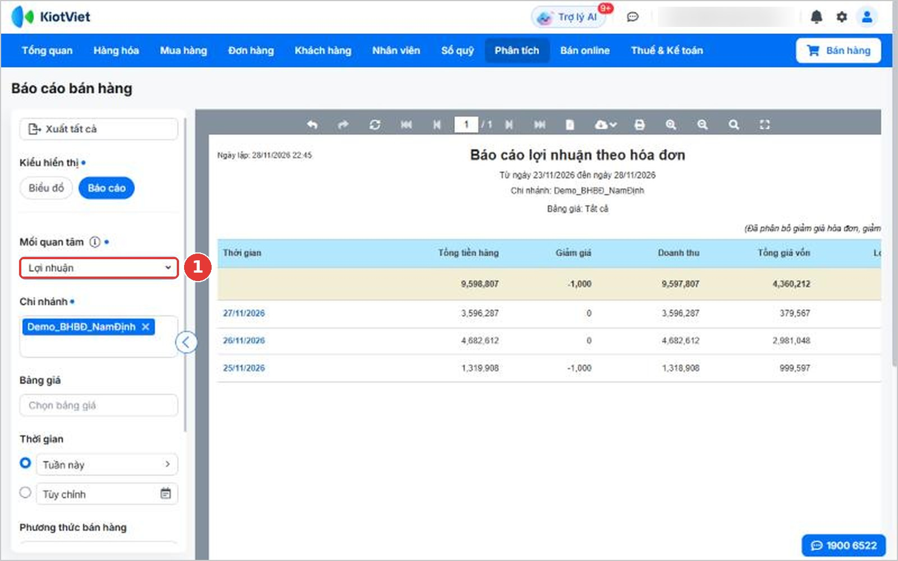
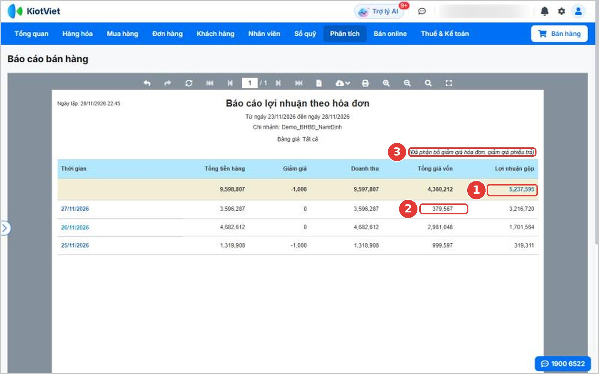
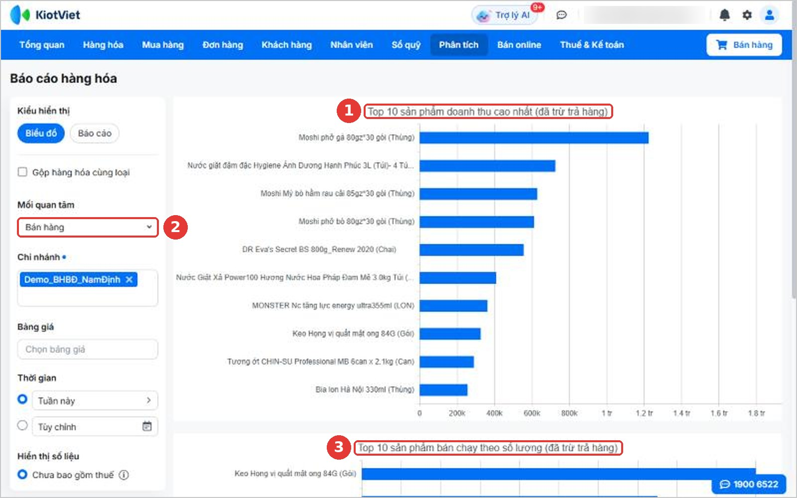
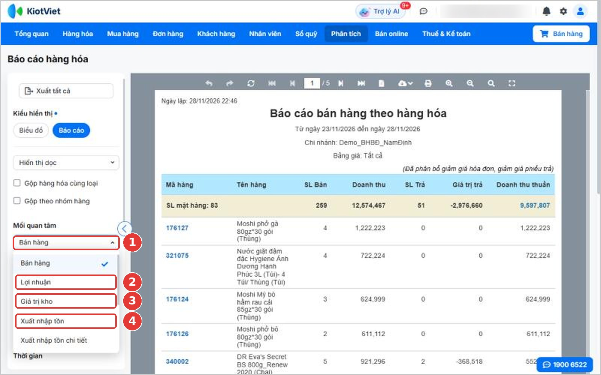
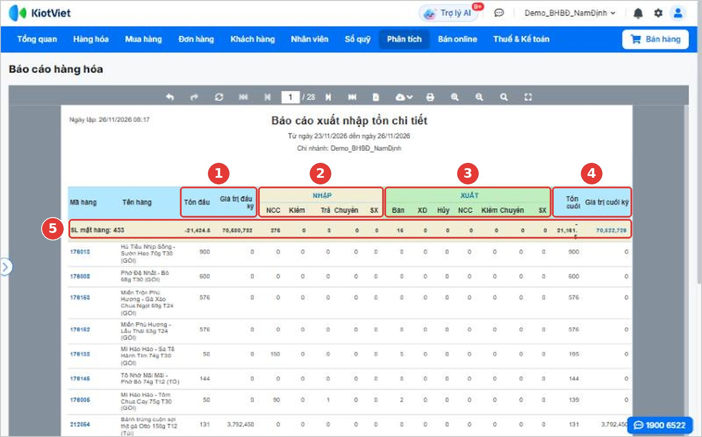

# Báo cáo lợi nhuận, hàng bán chạy và hàng chậm bán

TÀI LIỆU 33 · HƯỚNG DẪN NGHIỆP VỤ KIOTVIET

| Thông tin | Nội dung |
|---|---|
| **Mục đích** | Xem lợi nhuận gộp theo cửa hàng, tìm **hàng bán chạy** để đặt đủ hàng và **hàng chậm bán** để đề xuất giảm đặt / xử lý tồn. |
| **Người thực hiện** | Kinh doanh tỉnh, cửa hàng trưởng |
| **Thời điểm** | Hằng tuần, trước kỳ đề xuất đặt hàng |

!!! tip "Cách đọc"
    Số trong **vòng tròn đỏ** trên ảnh tương ứng với mục 1 2 3… trong phần chữ của bước đó; **khung đỏ** khoanh vùng cần bấm hoặc cần kiểm tra.

## Bước 1. Lợi nhuận theo thời gian / cửa hàng

Vào **Phân tích → Báo cáo → Bán hàng**, **Kiểu hiển thị: Báo cáo**, chọn cửa hàng (nhiều cửa hàng: cách chọn ở tài liệu 27):

1 **Mối quan tâm**: chọn **Lợi nhuận**.  

<figure markdown="span">
  { loading=lazy }
  <figcaption>Hình 1. Báo cáo bán hàng – mối quan tâm Lợi nhuận</figcaption>
</figure>

### Đọc báo cáo lợi nhuận

1 **Lợi nhuận gộp** = Doanh thu − Tổng giá vốn.  
2 **Giá vốn thấp bất thường** (ví dụ ngày 27/11 trên Demo: doanh thu 3,6 triệu, giá vốn chỉ 0,38 triệu): có hàng bán khi chưa nhập kho, giá vốn = 0. Lợi nhuận ngày đó **bị khai cao**.  
3 Báo cáo đã phân bổ giảm giá hóa đơn và giảm giá phiếu trả.  

<figure markdown="span">
  { loading=lazy }
  <figcaption>Hình 2. Báo cáo lợi nhuận theo hóa đơn</figcaption>
</figure>

## Bước 2. Hàng bán chạy

Vào **Phân tích → Báo cáo → Hàng hóa**, **Kiểu hiển thị: Biểu đồ**:

1 **Top 10 sản phẩm doanh thu cao nhất** (đã trừ trả hàng).  
2 **Mối quan tâm: Bán hàng**, chọn cửa hàng và thời gian.  
3 Kéo xuống: **Top 10 sản phẩm bán chạy theo số lượng**.  

Hàng bán chạy cần kiểm tra **tồn kho và đơn đặt hàng đang chờ** để tránh hết hàng.

<figure markdown="span">
  { loading=lazy }
  <figcaption>Hình 3. Top 10 hàng bán chạy</figcaption>
</figure>

### Danh sách đầy đủ để lọc

1 Chuyển **Kiểu hiển thị: Báo cáo**, mối quan tâm **Bán hàng**: mỗi mặt hàng một dòng (SL bán, doanh thu, SL trả, doanh thu thuần). Bấm **Xuất tất cả** để sắp xếp trong Excel.  

<figure markdown="span">
  { loading=lazy }
  <figcaption>Hình 4. Báo cáo bán hàng theo hàng hóa</figcaption>
</figure>

## Bước 3. Hàng chậm bán

1 Mối quan tâm **Xuất nhập tồn**, thời gian 30 – 60 ngày gần nhất.  
2 Xuất Excel; lọc các dòng **tồn cuối kỳ > 0** và **xuất bán = 0** (hoặc rất thấp): đó là hàng chậm bán.  
3 Đề xuất với TTĐH: **giảm / ngừng đặt**, điều chuyển sang cửa hàng bán được, hoặc chương trình giảm giá.  

<figure markdown="span">
  { loading=lazy }
  <figcaption>Hình 5. Báo cáo xuất nhập tồn (cột xuất bán và tồn cuối)</figcaption>
</figure>

## Lưu ý và lỗi thường gặp

| Tình huống | Cách xử lý |
|---|---|
| Lợi nhuận âm hoặc cao bất thường | Kiểm tra tồn âm, giá vốn 0 (tài liệu 13) trước khi kết luận. |
| So sánh giữa các cửa hàng | Dùng mối quan tâm Chi nhánh ở báo cáo bán hàng; cùng kỳ, cùng chế độ chưa thuế. |
| Hàng mới về chưa đủ thời gian bán | Không xếp vào hàng chậm bán khi mới nhập dưới 2 – 4 tuần. |
