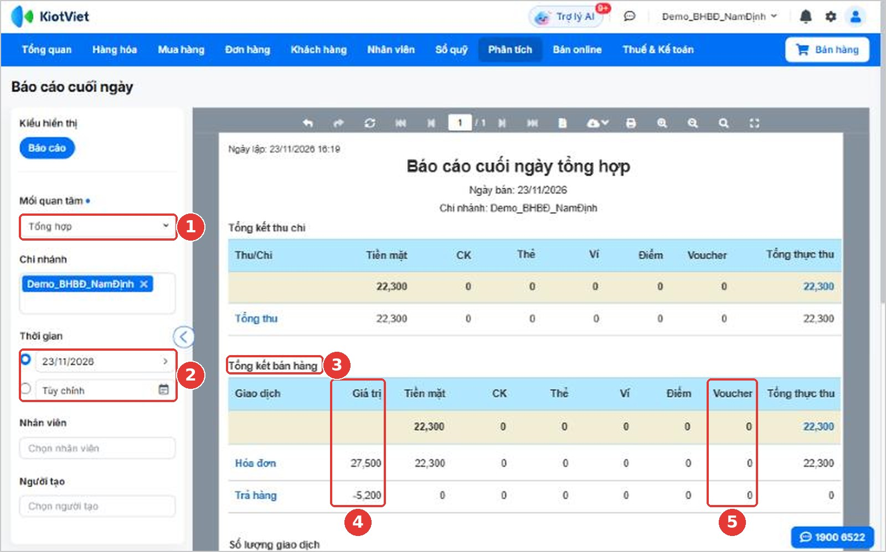
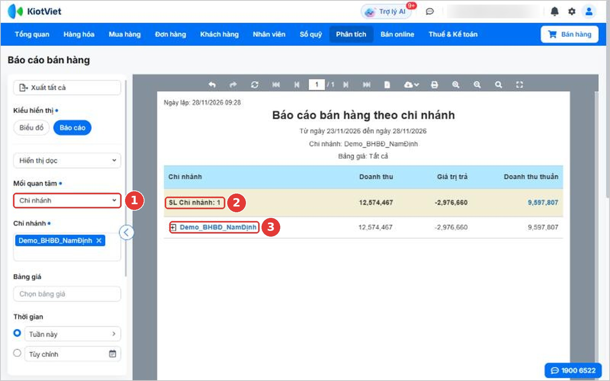

# Đối chiếu doanh thu – tiền nộp – sổ quỹ của tỉnh (cuối tháng)

TÀI LIỆU 34 · HƯỚNG DẪN NGHIỆP VỤ KIOTVIET

| Thông tin | Nội dung |
|---|---|
| **Mục đích** | Đối chiếu cuối tháng giữa **doanh thu trên KiotViet**, **tiền cửa hàng đã nộp** và **sổ quỹ**, phát hiện cửa hàng nộp thiếu / thừa. |
| **Người thực hiện** | Kế toán tỉnh |
| **Thời điểm** | Cuối tháng (và khi cửa hàng báo chênh lệch) |

!!! tip "Cách đọc"
    Số trong **vòng tròn đỏ** trên ảnh tương ứng với mục 1 2 3… trong phần chữ của bước đó; **khung đỏ** khoanh vùng cần bấm hoặc cần kiểm tra.

## Ba con số cần khớp

| Số liệu | Lấy ở đâu | Ý nghĩa |
|---|---|---|
| **A. Tiền phải nộp** | Báo cáo cuối ngày – **Tổng hợp**, dòng Hóa đơn: **Giá trị − Voucher** (tài liệu 08, 14) | Tiền khách trả (tiền mặt + chuyển khoản) của kỳ |
| **B. Tiền đã nộp** | Chứng từ nộp tiền / sao kê tài khoản của Đơn vị | Tiền cửa hàng thực nộp |
| **C. Doanh thu đã thuế** | Báo cáo bán hàng – **Đã bao gồm thuế**, mối quan tâm **Chi nhánh** (tài liệu 27) | Để đối chiếu xu hướng; khác A do trả hàng, voucher, giao dịch chưa hỗ trợ giá sau thuế |

!!! important "A (PHẢI NỘP) PHẢI BẰNG B (ĐÃ NỘP) CHO TỪNG CỬA HÀNG"
    Lệch do chọn sai phương thức thanh toán **không làm thay đổi A**: cửa hàng vẫn phải nộp đủ A (tài liệu 14).

    Không yêu cầu cửa hàng lập phiếu thu / chi để cân sổ quỹ (tài liệu 30).

## Bước 1. Lấy số phải nộp của từng cửa hàng

1 **Phân tích → Cuối ngày**, Mối quan tâm **Tổng hợp**; Thời gian **Tùy chỉnh** từ ngày 1 đến cuối tháng.  
2 Chọn **một cửa hàng** mỗi lần.  
3 Phần **Tổng kết bán hàng**, dòng **Hóa đơn**: lấy **Giá trị − Voucher**.  

Ghi vào bảng theo dõi của tỉnh: mỗi cửa hàng một dòng (A, B, chênh lệch, giải trình).

<figure markdown="span">
  { loading=lazy }
  <figcaption>Hình 1. Báo cáo cuối ngày – Tổng hợp</figcaption>
</figure>

## Bước 2. Đối chiếu doanh thu theo cửa hàng

1 **Báo cáo bán hàng**, mối quan tâm **Chi nhánh**, chọn đủ cửa hàng của tỉnh.  
2 **SL Chi nhánh** bằng số cửa hàng của tỉnh.  
3 Doanh thu thuần từng cửa hàng; chọn **Đã bao gồm thuế** khi so với tiền.  

<figure markdown="span">
  { loading=lazy }
  <figcaption>Hình 2. Doanh thu theo chi nhánh</figcaption>
</figure>

## Bước 3. Xử lý chênh lệch

| Chênh lệch | Nguyên nhân thường gặp | Xử lý |
|---|---|---|
| B < A (nộp thiếu) | Chưa nộp đủ các ngày cuối tháng; giữ lại tiền chênh do chọn sai phương thức | Yêu cầu cửa hàng nộp bổ sung kèm giải trình |
| B > A (nộp thừa) | Nộp cả tiền voucher; nộp trùng ngày | Kiểm tra chứng từ, trừ vào kỳ sau theo quy định của Đơn vị |
| Sổ quỹ tiền mặt khác tiền két | Chọn sai Tiền mặt / Chuyển khoản | Không sửa sổ quỹ; theo tài liệu 14 |
| Có hóa đơn hủy sau ngày nộp | Hủy hóa đơn ngày cũ làm A giảm | Đối chiếu lịch sử hủy (tài liệu 16, 25); báo BU BHBĐ |

## Lưu ý và lỗi thường gặp

| Tình huống | Cách xử lý |
|---|---|
| Số báo cáo thay đổi sau khi đã chốt | Có hóa đơn / trả hàng của ngày cũ bị hủy hoặc tạo bổ sung. Chốt số liệu kèm ngày giờ lấy báo cáo. |
| Nhiều cửa hàng, làm nhanh | Xuất báo cáo cuối ngày từng cửa hàng ra file, gộp trong Excel. |
| Cửa hàng mới khai trương giữa tháng | Lấy từ ngày bắt đầu bán; đối chiếu cả tiền bán thử (nếu có) với BU BHBĐ. |
