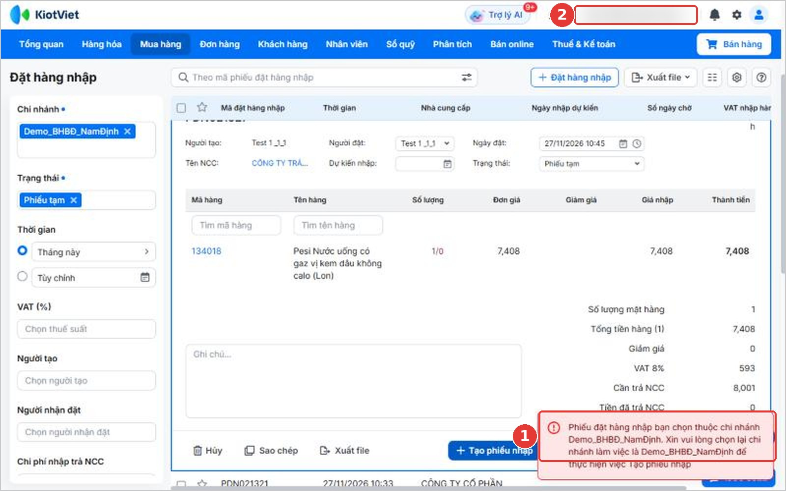

# Xử lý sự cố thường gặp

TÀI LIỆU 36 · HƯỚNG DẪN NGHIỆP VỤ KIOTVIET

| Thông tin | Nội dung |
|---|---|
| **Mục đích** | Tự xử lý nhanh các lỗi thường gặp tại quầy và khi làm phiếu; biết khi nào cần báo Bộ phận Hệ thống. |
| **Người thực hiện** | Thu ngân, cửa hàng trưởng |
| **Thời điểm** | Khi phát sinh sự cố |

!!! tip "Cách đọc"
    Số trong **vòng tròn đỏ** trên ảnh tương ứng với mục 1 2 3… trong phần chữ của bước đó; **khung đỏ** khoanh vùng cần bấm hoặc cần kiểm tra.

## Thiết bị và kết nối

| Sự cố | Tự kiểm tra | Vẫn lỗi |
|---|---|---|
| **Mất mạng / web không tải** | Kiểm tra wifi, modem (tắt bật lại 30 giây); thử mở trang khác; dùng 4G điện thoại phát wifi tạm | Ghi tay hóa đơn (mã hàng, SL, tiền, giờ), nhập lại khi có mạng; báo Bộ phận Hệ thống |
| **Máy in không in** | Máy bật, có giấy, đúng chiều giấy; là máy in mặc định; trình duyệt không chặn cửa sổ in | In lại từ danh sách Hóa đơn; báo Bộ phận Hệ thống |
| **In ra giấy trắng / mờ** | Giấy in nhiệt lắp ngược mặt; hết giấy | Thay cuộn giấy |
| **Máy quét không nhận** | Cắm lại USB; bấm vào ô Tìm hàng (F3) trước khi quét | Gõ mã hàng bằng tay, báo thay máy |
| **Quét ra chữ lạ / sai mã** | Bộ gõ tiếng Việt (Unikey/EVKey) chuyển sang **E** khi bán hàng | Báo Bộ phận Hệ thống |
| **Quét không ra hàng** | Thử gõ tên hàng; hàng chưa có mã vạch trên hệ thống | Gửi ảnh mã vạch + tên hàng cho Bộ phận Hệ thống; không bán bằng mặt hàng khác |

## Tài khoản và chi nhánh

| Sự cố | Tự kiểm tra | Vẫn lỗi |
|---|---|---|
| **Sai mật khẩu / bị khóa** | Kiểm tra Caps Lock, bộ gõ; không thử quá nhiều lần | Báo Bộ phận Hệ thống cấp lại (tài liệu 35) |
| **Không thấy chi nhánh của mình** | Đăng xuất, đăng nhập lại | Tài khoản chưa phân quyền, báo Bộ phận Hệ thống |
| **Báo cáo / danh sách trống** | Bộ lọc Chi nhánh, Thời gian, Trạng thái; ô tìm còn điều kiện cũ (bấm ×) | Báo Bộ phận Hệ thống |

## Lỗi khi tạo phiếu nhập từ đơn đặt hàng

1 Thông báo *"Phiếu đặt hàng nhập bạn chọn thuộc chi nhánh … Xin vui lòng chọn lại chi nhánh làm việc…"*: đơn của cửa hàng A nhưng đang đứng ở chi nhánh B.  
2 Bấm tên chi nhánh ở **góc trên bên phải**, chọn đúng cửa hàng của đơn, rồi bấm lại **Tạo phiếu nhập**.  

Không thấy cửa hàng của mình trong danh sách chi nhánh làm việc: tài khoản chưa được phân quyền, báo Bộ phận Hệ thống.

<figure markdown="span">
  { loading=lazy }
  <figcaption>Hình 1. Lỗi tạo phiếu nhập do sai chi nhánh làm việc</figcaption>
</figure>

## Lỗi nghiệp vụ thường gặp

| Thông báo / tình huống | Cách xử lý |
|---|---|
| "Hóa đơn đã có trả hàng, không thể hủy" | Hủy phiếu trả hàng trước rồi mới hủy hóa đơn (tài liệu 25) |
| Bán hàng báo tồn âm / hết hàng nhưng hàng có trên kệ | Vẫn bán; báo cửa hàng trưởng nhập phiếu nhập còn treo (tài liệu 26, 13) |
| Chọn sai phương thức thanh toán | Không hủy làm lại; nộp tiền theo Báo cáo cuối ngày (tài liệu 14) |
| Lỡ bấm Hoàn thành phiếu kiểm kho / xuất hủy chưa được xác nhận | Không tạo phiếu bù; báo ngay Bộ phận Hệ thống kèm mã phiếu (tài liệu 06, 31) |
| Lỡ tạo phiếu nhập không theo đơn (+ Nhập hàng) | Không tạo thêm phiếu; báo Bộ phận Hệ thống kèm mã PN (tài liệu 04) |

## Khi báo Bộ phận Hệ thống

!!! important "GỬI ĐỦ 4 THÔNG TIN ĐỂ ĐƯỢC XỬ LÝ NHANH"
    **Cửa hàng** + **tên đăng nhập**.

    **Mã chứng từ** liên quan (HD…, TH…, PN…, PDN…, XH…, KK…).

    **Ảnh chụp màn hình** thông báo lỗi.

    Đã làm gì trước khi lỗi. Liên hệ: Đặng Quốc Thịnh 0966 922 553 · Nguyễn Trọng Thành 0862 894 506.

**Phím tắt:** F3: tìm hàng hóa
